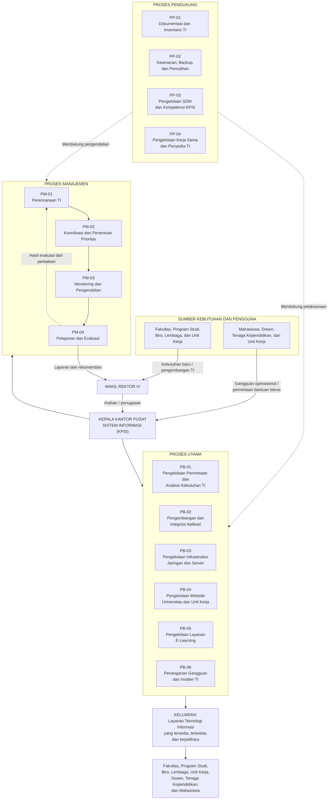

# PETA PROSES BISNIS
# KANTOR PUSAT SISTEM INFORMASI (KPSI)
## LEVEL 0

**[NAMA UNIVERSITAS]**

---

## IDENTITAS DOKUMEN

| Keterangan | Isi |
|---|---|
| Nama Dokumen | Peta Proses Bisnis KPSI Level 0 |
| Unit | Kantor Pusat Sistem Informasi (KPSI) |
| Atasan Langsung | Wakil Rektor IV |
| Versi | 1.0 |
| Status | Rancangan untuk pembahasan dan penetapan |
| Tanggal | [Tanggal penetapan] |

> **Catatan:** Lengkapi nama universitas, tanggal, dan identitas pengesahan. Dokumen ini merupakan rancangan peta proses bisnis tingkat makro. Rincian pelaksanaan setiap proses akan dijabarkan pada Peta Proses Bisnis Level 1 dan SOP terkait.

---

# 1. PENDAHULUAN

## 1.1 Latar Belakang

Kantor Pusat Sistem Informasi (KPSI) merupakan unit kerja di lingkungan [Nama Universitas] yang bertugas mengoordinasikan dan mengelola penyelenggaraan teknologi informasi untuk mendukung kegiatan akademik dan nonakademik universitas.

Pelaksanaan tugas KPSI melibatkan berbagai proses, mulai dari penerimaan kebutuhan teknologi informasi, analisis kebutuhan, pengembangan aplikasi, pengelolaan infrastruktur, pengelolaan website, layanan e-learning, hingga penanganan gangguan dan insiden teknologi informasi.

Agar seluruh proses tersebut berjalan secara terarah, terkoordinasi, dan saling mendukung, diperlukan Peta Proses Bisnis yang menggambarkan hubungan antara proses manajemen, proses utama, dan proses pendukung KPSI.

Peta Proses Bisnis Level 0 ini menjadi gambaran menyeluruh mengenai proses bisnis KPSI dan menjadi dasar penyusunan Peta Proses Bisnis Level 1 serta prosedur operasional standar (SOP).

## 1.2 Tujuan

Peta Proses Bisnis Level 0 disusun untuk:

1. Menggambarkan keseluruhan proses bisnis KPSI pada tingkat makro.
2. Menjelaskan hubungan antara proses manajemen, proses utama, dan proses pendukung.
3. Memperjelas sumber kebutuhan, alur koordinasi, dan keluaran layanan KPSI.
4. Menjadi acuan dalam penyusunan Peta Proses Bisnis Level 1.
5. Menjadi dasar identifikasi dan penyusunan SOP KPSI.

## 1.3 Ruang Lingkup

Peta Proses Bisnis ini mencakup seluruh proses manajemen, proses utama, dan proses pendukung yang diperlukan dalam pelaksanaan tugas KPSI, meliputi:

- Perencanaan dan pengendalian pengelolaan teknologi informasi.
- Pengelolaan permintaan dan analisis kebutuhan teknologi informasi.
- Pengembangan dan integrasi aplikasi.
- Pengelolaan infrastruktur jaringan dan server.
- Pengelolaan website universitas dan unit kerja.
- Pengelolaan layanan e-learning.
- Penanganan gangguan dan insiden teknologi informasi.
- Dokumentasi, inventaris, keamanan, backup, pemulihan, pengelolaan SDM, serta kerja sama dengan penyedia layanan TI.

---

# 2. PRINSIP DAN KETENTUAN UMUM

## 2.1 Kedudukan KPSI

KPSI berada di bawah dan bertanggung jawab kepada Wakil Rektor IV. Kepala KPSI mengoordinasikan pelaksanaan proses bisnis dan mendistribusikan pekerjaan kepada unit di lingkungan KPSI sesuai bidang tugasnya.

## 2.2 Dua Jalur Masuk Kebutuhan dan Layanan

Penyelenggaraan layanan KPSI menggunakan dua jalur masuk sebagai berikut.

### A. Jalur formal kebutuhan dan pengembangan TI

Kebutuhan baru, permintaan pengembangan, perubahan yang berdampak pada proses bisnis, serta kebutuhan TI yang memerlukan arahan atau keputusan pimpinan disampaikan oleh fakultas, program studi, biro, lembaga, atau unit kerja kepada Wakil Rektor IV.

Wakil Rektor IV meneruskan atau menugaskan kebutuhan tersebut kepada KPSI. Kepala KPSI selanjutnya mengoordinasikan identifikasi kebutuhan, penentuan unit pelaksana, prioritas, dan tindak lanjutnya.

### B. Jalur operasional gangguan dan dukungan teknis

Mahasiswa, dosen, tenaga kependidikan, dan unit kerja dapat menyampaikan laporan gangguan operasional atau permintaan bantuan teknis secara langsung kepada KPSI melalui saluran pelayanan yang ditetapkan.

KPSI mencatat laporan, mengidentifikasi permasalahan, dan menugaskan unit terkait untuk melakukan penanganan. Gangguan yang berdampak besar, memerlukan keputusan pimpinan, atau berpengaruh lintas unit dilaporkan oleh Kepala KPSI kepada Wakil Rektor IV.

## 2.3 Prinsip Pencatatan dan Pengendalian

Terlepas dari jalur masuknya, permintaan dan pekerjaan yang ditangani KPSI dicatat sesuai kebutuhan agar dapat ditelusuri, dipantau, dilaporkan, dan dievaluasi.

Kepala KPSI mengoordinasikan pekerjaan lintas unit dan memantau pelaksanaan proses bisnis. Setiap unit melaksanakan pekerjaan sesuai fungsi dan tanggung jawabnya.

## 2.4 Batas Tanggung Jawab

KPSI bertanggung jawab terhadap aspek teknis teknologi informasi. Unit pemilik proses tetap bertanggung jawab terhadap kebijakan substantif, proses bisnis, dan kebenaran data yang dikelolanya.

Pengelolaan teknis website oleh KPSI tidak mengalihkan tanggung jawab konten dari unit pemilik website. Pengelolaan infrastruktur terpusat oleh KPSI juga tidak mengalihkan tanggung jawab operasional rutin laboratorium dan perangkat TI yang dikelola unit kerja.

---

# 3. PETA PROSES BISNIS LEVEL 0

## 3.1 Gambaran Umum

Proses bisnis KPSI dikelompokkan menjadi tiga kelompok:

1. **Proses Manajemen**, yaitu proses untuk merencanakan, mengoordinasikan, mengendalikan, melaporkan, dan mengevaluasi penyelenggaraan teknologi informasi.
2. **Proses Utama**, yaitu proses yang menghasilkan layanan teknologi informasi bagi universitas.
3. **Proses Pendukung**, yaitu proses yang menyediakan dukungan agar proses manajemen dan proses utama dapat berjalan.

## 3.2 Diagram Peta Proses Bisnis Level 0

**Catatan pembacaan diagram:**

- Jalur melalui Wakil Rektor IV digunakan untuk kebutuhan baru, pengembangan, perubahan penting, atau kebutuhan yang memerlukan arahan pimpinan.
- Jalur langsung ke KPSI digunakan untuk gangguan operasional dan permintaan bantuan teknis.
- Proses utama tidak selalu berjalan secara berurutan. Unit yang terlibat ditentukan oleh jenis dan ruang lingkup kebutuhan.
- Proses pendukung melayani kebutuhan proses utama dan proses manajemen.
- Hasil monitoring dan evaluasi menjadi masukan bagi perencanaan dan perbaikan proses berikutnya.

---

# 4. DAFTAR INDUK PROSES BISNIS

Daftar Induk Proses Bisnis (Process Register) merupakan daftar proses yang menjadi tanggung jawab KPSI. Daftar ini digunakan sebagai acuan pengembangan proses pada level berikutnya.

## 4.1 Proses Manajemen

| Kode | Nama Proses | Tujuan | Penanggung Jawab |
|---|---|---|---|
| PM-01 | Perencanaan Teknologi Informasi | Menetapkan rencana kegiatan dan pengembangan TI berdasarkan kebutuhan universitas. | Kepala KPSI |
| PM-02 | Koordinasi dan Penentuan Prioritas | Mengoordinasikan kebutuhan dan menentukan prioritas pekerjaan KPSI. | Kepala KPSI |
| PM-03 | Monitoring dan Pengendalian | Memantau pelaksanaan pekerjaan dan kondisi layanan TI. | Kepala KPSI |
| PM-04 | Pelaporan dan Evaluasi | Melaporkan pelaksanaan tugas serta mengevaluasi kinerja dan layanan KPSI. | Kepala KPSI |

## 4.2 Proses Utama

| Kode | Nama Proses | Tujuan | Penanggung Jawab Utama |
|---|---|---|---|
| PB-01 | Pengelolaan Permintaan dan Analisis Kebutuhan TI | Menerima, mengidentifikasi, dan menganalisis kebutuhan TI untuk ditindaklanjuti. | Kepala KPSI dan Unit Analisis Sistem |
| PB-02 | Pengembangan dan Integrasi Aplikasi | Mengembangkan, memelihara, dan mengintegrasikan aplikasi universitas. | Unit Pengembangan Aplikasi dan Integrasi Sistem |
| PB-03 | Pengelolaan Infrastruktur Jaringan dan Server | Menjamin ketersediaan dan keandalan infrastruktur TI yang dikelola KPSI. | Unit Infrastruktur Jaringan dan Server |
| PB-04 | Pengelolaan Website Universitas dan Unit Kerja | Menjamin pengelolaan teknis, keamanan, dan ketersediaan website. | Unit Pengembangan Aplikasi dan Integrasi Sistem bersama Unit Infrastruktur Jaringan dan Server |
| PB-05 | Pengelolaan Layanan E-Learning | Menyelenggarakan operasional teknis dan dukungan layanan pembelajaran digital. | Unit E-Learning |
| PB-06 | Penanganan Gangguan dan Insiden TI | Memulihkan layanan dan menangani gangguan atau insiden TI sesuai kewenangan KPSI. | Unit terkait, dikoordinasikan Kepala KPSI |

## 4.3 Proses Pendukung

| Kode | Nama Proses | Tujuan | Penanggung Jawab |
|---|---|---|---|
| PP-01 | Dokumentasi dan Inventaris TI | Menjaga ketersediaan dokumentasi teknis dan informasi inventaris TI yang dikelola KPSI. | Kepala KPSI dan unit terkait |
| PP-02 | Keamanan, Backup, dan Pemulihan | Mendukung keamanan teknis, pencadangan, dan pemulihan layanan TI. | Unit terkait, terutama Unit Infrastruktur |
| PP-03 | Pengelolaan SDM dan Kompetensi KPSI | Memastikan kompetensi dan kapasitas personel sesuai kebutuhan pekerjaan. | Kepala KPSI |
| PP-04 | Pengelolaan Kerja Sama dan Penyedia TI | Mengoordinasikan aspek teknis kerja sama dengan penyedia dan mitra TI. | Kepala KPSI dan unit terkait |

---

# 5. MATRIKS HUBUNGAN PROSES DENGAN UNIT ORGANISASI

Matriks ini menunjukkan keterlibatan unit KPSI dalam proses bisnis tingkat makro.

Keterangan:

- **U (Utama):** memimpin atau bertanggung jawab atas pelaksanaan proses.
- **P (Pendukung):** memberikan dukungan dalam pelaksanaan proses.
- **K (Konsultasi):** dilibatkan untuk memberikan masukan sesuai kebutuhan.
- **—:** tidak terlibat secara langsung.

| Proses | Kepala KPSI | Analisis Sistem | Pengembangan Aplikasi | Infrastruktur | E-Learning |
|---|---:|---:|---:|---:|---:|
| PM-01 Perencanaan TI | U | P | P | P | P |
| PM-02 Koordinasi dan Prioritas | U | P | P | P | P |
| PM-03 Monitoring dan Pengendalian | U | P | P | P | P |
| PM-04 Pelaporan dan Evaluasi | U | P | P | P | P |
| PB-01 Permintaan dan Analisis Kebutuhan TI | U | U | P | K | K |
| PB-02 Pengembangan dan Integrasi Aplikasi | U | P | U | P | K |
| PB-03 Infrastruktur Jaringan dan Server | U | — | P | U | P |
| PB-04 Pengelolaan Website | U | K | U | U | — |
| PB-05 Pengelolaan E-Learning | U | K | P | P | U |
| PB-06 Penanganan Gangguan dan Insiden TI | U | P | P | P | P |
| PP-01 Dokumentasi dan Inventaris TI | U | P | P | P | P |
| PP-02 Keamanan, Backup, dan Pemulihan | U | K | P | U | P |
| PP-03 Pengelolaan SDM dan Kompetensi | U | P | P | P | P |
| PP-04 Kerja Sama dan Penyedia TI | U | K | P | P | P |

Matriks ini merupakan gambaran tingkat makro. Pembagian tanggung jawab pelaksanaan secara lebih terperinci ditetapkan pada Peta Proses Bisnis Level 1 dan dokumen SOP.

---

# 6. MATRIKS HUBUNGAN PROSES DENGAN SOP

Matriks ini merupakan daftar awal kebutuhan SOP yang akan disusun berdasarkan proses bisnis. Satu proses dapat memiliki lebih dari satu SOP apabila kompleksitas dan kebutuhan pengendaliannya memerlukan pemisahan.

| Kode Proses | Nama Proses | Rencana SOP atau Prosedur |
|---|---|---|
| PM-01 | Perencanaan Teknologi Informasi | SOP Penyusunan Program Kerja dan Rencana Pengembangan TI |
| PM-02 | Koordinasi dan Penentuan Prioritas | SOP Koordinasi dan Penentuan Prioritas Pekerjaan KPSI |
| PM-03 | Monitoring dan Pengendalian | SOP Monitoring dan Pengendalian Pekerjaan KPSI |
| PM-04 | Pelaporan dan Evaluasi | SOP Pelaporan dan Evaluasi Kinerja KPSI |
| PB-01 | Pengelolaan Permintaan dan Analisis Kebutuhan TI | SOP Penerimaan Permintaan dan Analisis Kebutuhan TI |
| PB-02 | Pengembangan dan Integrasi Aplikasi | SOP Pengembangan Aplikasi; SOP Pengujian dan Rilis Aplikasi; SOP Pemeliharaan Aplikasi; SOP Integrasi Sistem |
| PB-03 | Pengelolaan Infrastruktur Jaringan dan Server | SOP Pengelolaan Jaringan dan Server; SOP Backup dan Pemulihan Infrastruktur |
| PB-04 | Pengelolaan Website | SOP Pengelolaan Teknis Website |
| PB-05 | Pengelolaan Layanan E-Learning | SOP Pengelolaan Layanan E-Learning |
| PB-06 | Penanganan Gangguan dan Insiden TI | SOP Penanganan Gangguan dan Insiden TI |
| PP-01 | Dokumentasi dan Inventaris TI | Prosedur Dokumentasi dan Inventaris TI |
| PP-02 | Keamanan, Backup, dan Pemulihan | SOP Pengelolaan Keamanan Teknis; SOP Backup dan Pemulihan |
| PP-03 | Pengelolaan SDM dan Kompetensi KPSI | Prosedur Pengembangan Kompetensi SDM KPSI |
| PP-04 | Pengelolaan Kerja Sama dan Penyedia TI | Prosedur Koordinasi Teknis dengan Penyedia TI |

Daftar SOP di atas merupakan rencana awal. Penetapan SOP final dilakukan setelah proses terkait dijabarkan pada Level 1 agar tidak terjadi duplikasi atau prosedur yang tidak diperlukan.

---

# 7. KELUARAN DAN MANFAAT PROSES BISNIS KPSI

Pelaksanaan proses bisnis KPSI diharapkan menghasilkan:

1. Layanan teknologi informasi yang tersedia dan dapat dimanfaatkan oleh sivitas akademika serta unit kerja.
2. Aplikasi dan sistem informasi yang sesuai dengan kebutuhan universitas.
3. Infrastruktur jaringan dan server yang terkelola dan andal.
4. Website universitas dan unit kerja yang terpelihara dari sisi teknis.
5. Layanan e-learning yang mendukung kegiatan pembelajaran.
6. Penanganan gangguan dan insiden TI yang tercatat dan terkoordinasi.
7. Dokumentasi teknis dan inventaris layanan yang memadai.
8. Informasi pelaksanaan pekerjaan sebagai bahan monitoring, pelaporan, dan evaluasi.

---

# 8. PENGEMBANGAN PETA PROSES BISNIS LEVEL BERIKUTNYA

Peta Proses Bisnis Level 0 menjadi dasar penyusunan Peta Proses Bisnis Level 1.

Pada Level 1, setiap proses akan dijabarkan lebih lanjut dengan memuat:

1. Tujuan dan ruang lingkup proses.
2. Pemicu atau sumber proses.
3. Masukan yang diperlukan.
4. Pihak atau unit yang terlibat.
5. Urutan aktivitas dan alur koordinasi.
6. Keputusan atau persetujuan yang diperlukan.
7. Keluaran proses.
8. Hubungan dengan proses lain dan SOP terkait.

Pengembangan Level 1 dilakukan berdasarkan prioritas dan kebutuhan operasional KPSI. Proses yang menjadi pintu masuk layanan dan paling sering dilaksanakan dapat dijabarkan terlebih dahulu.

---

# 9. PENUTUP

Peta Proses Bisnis KPSI Level 0 merupakan gambaran menyeluruh mengenai proses manajemen, proses utama, dan proses pendukung dalam penyelenggaraan teknologi informasi di lingkungan universitas.

Dokumen ini menjadi acuan untuk mengembangkan Peta Proses Bisnis Level 1 dan menyusun SOP agar pelaksanaan tugas KPSI berjalan secara terarah, terkoordinasi, terdokumentasi, dan sesuai dengan kewenangan masing-masing.

Peta proses bisnis ini dapat ditinjau dan disempurnakan sesuai perkembangan kebutuhan universitas, perubahan organisasi, serta hasil evaluasi pelaksanaan layanan teknologi informasi.

---

## LEMBAR PENGESAHAN

Ditetapkan di: ........................................  
Pada tanggal: ........................................

**Kepala Kantor Pusat Sistem Informasi**  
**Universitas Kuningan**

   

**Aji Permana, M.Kom.**  
NIP/NIDN: ........................................

---

## CATATAN FINALISASI

Sebelum dokumen ditetapkan, lakukan pemeriksaan terhadap:

1. Kesesuaian kedudukan KPSI dan hubungan pertanggungjawaban kepada Wakil Rektor IV.
2. Kesesuaian nama unit dan jabatan dengan struktur organisasi resmi.
3. Kesesuaian jalur formal kebutuhan TI melalui Wakil Rektor IV.
4. Kesesuaian jalur langsung untuk gangguan operasional dan bantuan teknis.
5. Kesesuaian pembagian tanggung jawab antarunit dengan Pedoman Organisasi dan Tata Kerja KPSI.
6. Penetapan pihak yang berwenang mengesahkan dokumen.

Dokumen ini merupakan rancangan Level 0. Rincian alur kerja, penanggung jawab aktivitas, formulir, dan ketentuan teknis ditetapkan pada Level 1 atau SOP terkait.
