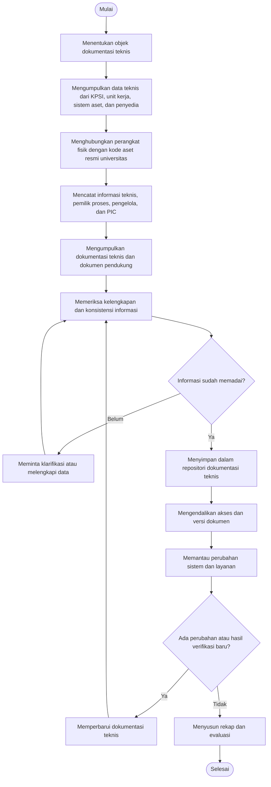

# PP-01 – PENGELOLAAN DOKUMENTASI DAN INFORMASI TEKNIS TEKNOLOGI INFORMASI

| Informasi | Keterangan |
|---|---|
| Kode Proses | PP-01 |
| Nama Proses | Pengelolaan Dokumentasi dan Informasi Teknis Teknologi Informasi |
| Pemilik Proses | Kantor Pusat Sistem Informasi (KPSI) |
| Penanggung Jawab | Kepala KPSI |
| Unit Pelaksana | Seluruh unit di lingkungan KPSI |
| Pihak Terkait | Fakultas, program studi, biro, lembaga, unit kerja, dan penyedia layanan TI |
| Versi | 1.1 |
| Status | Draf untuk ditinjau |
| Dokumen Induk | Peta Proses Bisnis KPSI Level 0 |

---

## 1. Tujuan

PP-01 menjadi acuan bagi KPSI dalam mengelola dokumentasi dan informasi teknis teknologi informasi agar informasi mengenai sistem, layanan, infrastruktur, konfigurasi, integrasi, dan tanggung jawab pengelolaannya tersedia secara tertib, akurat, aman, dan dapat ditelusuri.

Proses ini bertujuan untuk:

1. Menyediakan dokumentasi teknis yang diperlukan untuk operasional, pemeliharaan, pengembangan, keamanan, dan pemulihan layanan TI.
2. Memastikan informasi teknis aset TI yang dikelola KPSI dapat ditelusuri ke data aset resmi universitas melalui kode atau identitas aset.
3. Menghindari pencatatan ganda atas identitas dan administrasi aset fisik yang telah dikelola melalui Sistem Informasi Manajemen Aset Universitas.
4. Memastikan setiap sistem dan layanan memiliki informasi mengenai unit pemilik proses/data, pengelola teknis, PIC, dan penyedia layanan apabila berbeda.
5. Mengurangi ketergantungan pada pengetahuan personal dengan mendokumentasikan informasi penting untuk keberlangsungan layanan.
6. Mendukung perencanaan, pengamanan, backup, pemulihan, pengembangan, dan evaluasi layanan TI.
7. Memudahkan koordinasi KPSI dengan unit kerja dan penyedia layanan TI.

## 2. Ruang Lingkup

PP-01 mencakup pengelolaan dokumentasi dan informasi teknis yang berkaitan dengan layanan teknologi informasi universitas, antara lain:

1. **Aplikasi dan sistem informasi:** aplikasi yang dikembangkan sendiri, aplikasi pihak ketiga, aplikasi SaaS, serta modul tambahan yang digunakan universitas.
2. **Informasi teknis infrastruktur:** hostname, alamat IP, fungsi perangkat, sistem operasi, versi firmware, layanan yang berjalan, konfigurasi penting, topologi, dependensi, dan prosedur pemulihan.
3. **Website dan domain:** domain utama, subdomain, DNS, hosting, platform/CMS, sertifikat, pengelola teknis, dan PIC konten.
4. **Database dan integrasi:** jenis dan versi database, sistem sumber dan tujuan, API, pemilik data, pemetaan data, serta dependensi antarsistem.
5. **Layanan SaaS dan cloud:** nama penyedia, tenant, modul yang digunakan, administrator universitas, konfigurasi yang dikelola universitas, batas layanan, kontak dukungan, dan informasi SLA/kontrak.
6. **Lisensi dan langganan:** perangkat lunak, layanan cloud, SaaS, sertifikat, domain, dan layanan berlangganan lainnya.
7. **Dokumentasi teknis:** arsitektur, konfigurasi, topologi jaringan, diagram sistem, prosedur instalasi, deployment, pemeliharaan, backup, pemulihan, dan panduan operasional.
8. **Dokumentasi kerja sama teknis:** informasi penyedia, ruang lingkup layanan, kontak dukungan, kontrak, SLA, dan dokumen serah terima yang relevan.
9. **Riwayat perubahan:** perubahan penting pada konfigurasi, aplikasi, integrasi, layanan, dan status pengelolaan.
10. **Referensi aset fisik TI:** kode atau identitas aset dari Sistem Informasi Manajemen Aset Universitas yang diperlukan untuk menghubungkan dokumentasi teknis KPSI dengan data aset resmi.

PP-01 **tidak menggantikan dan tidak menduplikasi Sistem Informasi Manajemen Aset Universitas**. Identitas dan administrasi aset fisik—seperti kode inventaris, nama aset, nilai perolehan, tahun perolehan, lokasi, unit pengguna, kondisi, dan riwayat pemeliharaan—tetap dikelola pada sistem aset resmi universitas.

KPSI mencatat informasi teknis yang diperlukan untuk pengelolaan TI dan menggunakan kode/identitas aset resmi sebagai referensi apabila objek dokumentasi berkaitan dengan aset fisik. Untuk aset atau fasilitas lokal yang menjadi tanggung jawab fakultas, program studi, laboratorium, atau unit lain, KPSI hanya mencatat informasi teknis yang diperlukan untuk koordinasi layanan universitas. Pencatatan tersebut tidak mengalihkan kepemilikan atau tanggung jawab operasional aset kepada KPSI.

## 3. Prinsip Pengelolaan

1. **Satu sumber data resmi aset:** Sistem Informasi Manajemen Aset Universitas menjadi sumber data resmi untuk identitas dan administrasi aset fisik. PP-01 tidak membuat pencatatan administrasi aset fisik yang menduplikasi sistem tersebut.
2. **Dokumentasi teknis melengkapi data aset:** KPSI mencatat informasi teknis yang tidak menjadi cakupan sistem aset, seperti hostname, IP address, sistem operasi, konfigurasi, layanan yang berjalan, dependensi, dan prosedur pemulihan.
3. **Referensi menggunakan kode aset resmi:** apabila dokumentasi teknis berkaitan dengan aset fisik yang tercatat pada sistem aset universitas, kode/identitas aset tersebut digunakan sebagai penghubung.
4. **Pemilik dan pengelola dibedakan:** setiap catatan perlu membedakan unit pemilik aset atau proses/data, pengelola teknis, PIC, dan penyedia layanan apabila berbeda.
5. **Dokumentasi secukupnya tetapi berguna:** dokumentasi memuat informasi yang diperlukan untuk operasional, pemeliharaan, keamanan, pengembangan, dan pemulihan tanpa menambah administrasi yang tidak perlu.
6. **Informasi diperbarui ketika ada perubahan:** perubahan konfigurasi, sistem, layanan, integrasi, atau penanggung jawab harus diikuti pembaruan dokumentasi teknis.
7. **Sumber informasi dapat ditelusuri:** informasi berasal dari pemeriksaan, dokumen resmi, hasil serah terima, konfirmasi unit, sistem aset universitas, atau informasi penyedia.
8. **Akses berdasarkan kewenangan:** dokumentasi yang memuat informasi sensitif hanya dapat diakses oleh personel yang berwenang.
9. **Tidak menyimpan rahasia secara terbuka:** kata sandi, private key, token API, secret, dan kredensial lainnya tidak dicatat dalam dokumentasi biasa. Informasi tersebut dikelola melalui mekanisme penyimpanan rahasia yang aman.
10. **Mendukung kesinambungan layanan:** dokumentasi harus dapat digunakan oleh personel KPSI yang diberi kewenangan, bukan hanya oleh personel yang pertama kali membangun atau mengelola sistem.

## 4. Pihak yang Terlibat dan Tanggung Jawab

| Pihak | Tanggung Jawab |
|---|---|
| Kepala KPSI | Menetapkan pengendalian dokumentasi dan dokumentasi teknis KPSI, menunjuk penanggung jawab pendataan, memastikan pembaruan, serta mengevaluasi kelengkapan dan keakuratan informasi. |
| Unit-unit KPSI | Mendata aset dan layanan sesuai bidang tugas, membuat dan memperbarui dokumentasi teknis, serta menyampaikan perubahan kepada koordinator dokumentasi teknis KPSI. |
| Koordinator dokumentasi teknis KPSI | Mengompilasi, memeriksa kelengkapan, mengelola struktur penyimpanan, mengendalikan versi, dan menyiapkan rekap dokumentasi. Penugasan ini dapat dirangkap oleh personel KPSI sesuai kebutuhan. |
| Unit pemilik aset/proses | Menjaga kebenaran data aset pada sistem aset universitas sesuai kewenangannya serta menyediakan informasi teknis atau konfirmasi yang diperlukan KPSI untuk koordinasi layanan. |
| PIC unit | Menjadi kontak koordinasi untuk konfirmasi informasi teknis atau layanan yang berada dalam tanggung jawab unit. |
| Penyedia layanan TI | Menyediakan dokumentasi teknis, informasi layanan, konfigurasi yang dapat diberikan, kontak dukungan, serta dokumen serah terima sesuai kontrak atau perjanjian. |
| Wakil Rektor IV | Memberikan arahan apabila terdapat persoalan lintas unit, kebutuhan sumber daya, atau keputusan pengelolaan yang berada di luar kewenangan KPSI. |

## 5. Masukan Proses

1. Data referensi aset fisik dari Sistem Informasi Manajemen Aset Universitas, khususnya kode/identitas aset dan informasi administratif yang diperlukan untuk penelusuran.
2. Informasi teknis aset dan layanan yang dikelola KPSI.
3. Informasi aplikasi, website, domain, server, jaringan, database, dan integrasi.
4. Informasi layanan SaaS, cloud, dan aplikasi pihak ketiga yang digunakan universitas.
5. Dokumen pengadaan, kontrak, lisensi, langganan, dan SLA yang relevan.
6. Dokumen serah terima pekerjaan internal atau pihak ketiga.
7. Dokumentasi arsitektur, konfigurasi, topologi, instalasi, dan pemeliharaan.
8. Informasi perubahan sistem, konfigurasi, PIC, atau status layanan.
9. Informasi dari unit kerja dan penyedia layanan.
10. Hasil pemeriksaan dan verifikasi dokumentasi teknis.

## 6. Alur Proses

## 7. Tahapan Pelaksanaan

### 7.1 Penetapan Objek Dokumentasi Teknis

1. Kepala KPSI menetapkan kategori sistem, layanan, infrastruktur, dan informasi teknis yang perlu didokumentasikan oleh KPSI.
2. Setiap unit KPSI mengidentifikasi sistem, layanan, infrastruktur, dan dokumentasi yang berada dalam bidang tanggung jawabnya.
3. Objek dokumentasi dikelompokkan berdasarkan batas pengelolaannya, sekurang-kurangnya:
   - dikelola langsung oleh KPSI;
   - dikelola unit kerja lain, tetapi terkait dengan layanan atau integrasi universitas;
   - dikelola penyedia atau pihak ketiga;
   - digunakan bersama atau memiliki tanggung jawab pengelolaan bersama.
4. Untuk aset fisik yang tercatat pada Sistem Informasi Manajemen Aset Universitas, KPSI menggunakan kode/identitas aset resmi sebagai referensi. KPSI tidak membuat ulang pencatatan administrasi aset tersebut.
5. Untuk aset lokal yang tidak dikelola KPSI, dokumentasi dibatasi pada informasi teknis yang diperlukan untuk koordinasi, integrasi, keamanan, dan perencanaan layanan universitas.
6. Objek dokumentasi dapat mencakup aset fisik sebagai referensi, aset digital, aplikasi, layanan, konfigurasi, integrasi, dan hubungan antarsistem.

### 7.2 Pengumpulan Informasi

1. Unit KPSI mengumpulkan informasi aset dan layanan sesuai tanggung jawabnya.
2. Informasi dapat diperoleh dari pemeriksaan langsung, konsol administrasi, dokumen pengadaan, dokumen serah terima, kontrak, informasi penyedia, dan konfirmasi unit terkait.
3. Untuk sistem yang dikembangkan pihak ketiga, KPSI meminta dokumentasi dan informasi teknis sesuai ruang lingkup pekerjaan dan hak universitas.
4. Untuk layanan SaaS, KPSI mencatat informasi tenant, administrator universitas, modul yang digunakan, penyedia, kontak dukungan, batas layanan, serta informasi kontrak yang relevan. KPSI tidak mengasumsikan memiliki akses ke infrastruktur internal penyedia.
5. Untuk aset yang dikelola unit lain, KPSI dapat meminta informasi minimum seperti nama aset/layanan, unit pemilik, PIC, lokasi atau cakupan penggunaan, serta hubungan dengan sistem universitas.
6. Informasi yang belum dapat diverifikasi diberi status belum terverifikasi agar tidak dianggap sebagai data yang sudah pasti.

### 7.3 Pencatatan Informasi Teknis

1. Unit KPSI mencatat informasi teknis ke dalam format atau repositori dokumentasi yang ditetapkan.
2. Untuk perangkat fisik yang tercatat pada sistem aset universitas, dokumentasi KPSI mencantumkan kode/identitas aset resmi sebagai referensi. Data administratif aset tidak disalin ulang kecuali diperlukan sementara untuk kebutuhan teknis dan tetap merujuk pada sistem aset resmi.
3. Informasi teknis minimum disesuaikan dengan jenis objek. Contohnya:
   - **Server/perangkat infrastruktur:** kode aset resmi jika tersedia, hostname, alamat IP, fungsi, lokasi teknis, sistem operasi/firmware, layanan yang berjalan, dependensi, pengelola teknis, dan prosedur pemulihan.
   - **Perangkat jaringan:** kode aset resmi jika tersedia, hostname, management IP, peran perangkat, VLAN, relasi koneksi, konfigurasi yang relevan, dan dokumentasi port mapping sesuai kebutuhan.
   - **Aplikasi/sistem informasi:** nama aplikasi, fungsi, unit pemilik proses/data, pengelola teknis, framework/teknologi, repository, lingkungan deployment, database, integrasi, PIC, dan status layanan.
   - **Website/domain:** nama website, domain/subdomain, unit pemilik konten, PIC konten, CMS/platform, DNS, hosting, sertifikat, dan pengelola teknis.
   - **Database:** nama/jenis database, versi, sistem terkait, pengelola teknis, pemilik data, mekanisme backup, dan dependensi.
   - **SaaS/cloud:** nama penyedia, tenant, modul yang digunakan, administrator universitas, konfigurasi yang dikelola universitas, kontak dukungan, dan informasi layanan yang relevan.
   - **Lisensi/langganan:** nama produk/layanan, unit pengguna, kapasitas, masa berlaku, penyedia, dan mekanisme perpanjangan.
   - **Integrasi/API:** sistem sumber dan tujuan, tujuan integrasi, metode integrasi, pemilik data, pengelola teknis, status, dokumentasi, dan pihak penyedia jika ada.
4. Dokumentasi teknis tidak boleh memuat kata sandi, token, private key, atau rahasia autentikasi dalam bentuk teks terbuka.
5. Jika suatu informasi tidak tersedia atau tidak relevan untuk jenis objek tertentu, kolom dapat diberi keterangan yang sesuai, bukan diisi dengan perkiraan.
6. Jika terdapat ketidaksesuaian antara informasi administratif aset pada dokumentasi KPSI dan sistem aset universitas, sistem aset universitas menjadi acuan untuk data administratif aset. KPSI menyampaikan koreksi kepada pengelola sistem aset melalui mekanisme yang berlaku.

### 7.4 Pengumpulan dan Penyimpanan Dokumentasi Teknis

1. Unit KPSI menyusun atau mengumpulkan dokumentasi teknis yang diperlukan untuk pengelolaan aset dan layanan.
2. Dokumentasi dapat mencakup:
   - diagram arsitektur dan hubungan antarkomponen;
   - topologi jaringan dan skema alamat IP sesuai tingkat akses;
   - spesifikasi dan konfigurasi perangkat;
   - struktur aplikasi dan lingkungan deployment;
   - skema database dan dokumentasi data yang relevan;
   - dokumentasi API dan integrasi;
   - panduan instalasi, deployment, pemeliharaan, dan pemulihan;
   - informasi lisensi, kontrak, dan SLA;
   - catatan perubahan dan serah terima pekerjaan.
3. Dokumentasi disimpan dalam repositori atau lokasi penyimpanan yang ditetapkan KPSI dengan struktur folder, penamaan, dan pengaturan akses yang konsisten.
4. Dokumen yang bersifat sensitif, seperti topologi rinci, konfigurasi keamanan, atau informasi infrastruktur kritis, diberikan pembatasan akses sesuai kebutuhan tugas.
5. Dokumen kontrak, lisensi, dan dokumen resmi lainnya disimpan dengan memperhatikan ketentuan administrasi universitas.
6. Untuk pekerjaan pihak ketiga, KPSI memastikan dokumentasi yang menjadi kewajiban serah terima telah diterima dan disimpan.

### 7.5 Verifikasi dan Validasi

1. Koordinator dokumentasi teknis memeriksa kelengkapan data dan konsistensi informasi.
2. Unit terkait melakukan konfirmasi atas data yang menjadi tanggung jawabnya.
3. Untuk aset yang dikelola langsung oleh KPSI, verifikasi dapat dilakukan melalui pemeriksaan fisik, konsol administrasi, konfigurasi, atau sumber informasi teknis lain.
4. Untuk layanan pihak ketiga atau SaaS, verifikasi dilakukan berdasarkan informasi yang dapat diakses secara sah, dokumen kontrak, dashboard administrator, atau konfirmasi penyedia.
5. Perbedaan data dicatat dan ditindaklanjuti kepada pihak yang berwenang.
6. Status verifikasi dapat dibedakan menjadi terverifikasi, perlu konfirmasi, atau belum terverifikasi.

### 7.6 Pembaruan Dokumentasi Teknis

1. Setiap unit KPSI wajib menginformasikan perubahan penting pada aset atau layanan yang menjadi tanggung jawabnya kepada koordinator dokumentasi teknis.
2. Perubahan yang perlu dicatat antara lain:
   - penambahan atau penghapusan aset;
   - perubahan lokasi, fungsi, atau status aset;
   - perubahan konfigurasi atau arsitektur yang berdampak;
   - perubahan versi aplikasi atau teknologi utama;
   - perubahan domain, hosting, atau penyedia;
   - penambahan atau perubahan integrasi;
   - perubahan PIC, administrator, atau unit pengelola;
   - perubahan kontrak, lisensi, atau masa berlangganan;
   - penghentian atau penggantian layanan.
3. Dokumentasi diperbarui sebagai bagian dari penyelesaian pekerjaan perubahan, pengembangan, pemeliharaan, atau serah terima.
4. Apabila perubahan dilakukan oleh pihak ketiga, KPSI memastikan dokumentasi hasil perubahan diterima sesuai ruang lingkup pekerjaan.
5. Pembaruan dokumentasi teknis tidak harus menunggu jadwal evaluasi berkala apabila perubahan berdampak pada operasional, keamanan, atau keberlangsungan layanan.

### 7.7 Pengendalian Akses dan Versi Dokumen

1. KPSI menetapkan lokasi penyimpanan resmi dokumentasi teknis.
2. Hak akses diberikan berdasarkan kebutuhan pekerjaan dan tanggung jawab personel.
3. Dokumen yang memuat informasi sensitif hanya dapat diakses oleh personel yang diberi kewenangan.
4. Perubahan dokumen penting menggunakan mekanisme versi atau riwayat perubahan agar informasi sebelumnya dapat ditelusuri.
5. Salinan dokumentasi penting dilindungi melalui mekanisme backup sesuai PP-02.
6. Akses personel yang berpindah tugas atau tidak lagi memiliki kewenangan harus ditinjau dan disesuaikan.
7. Penyampaian dokumen kepada pihak ketiga dilakukan berdasarkan kebutuhan pekerjaan dan persetujuan yang berwenang.

### 7.8 Pelaporan dan Evaluasi

1. Koordinator dokumentasi teknis menyusun rekap dokumentasi berdasarkan kategori yang ditetapkan.
2. Kepala KPSI mengevaluasi kelengkapan, status verifikasi, pembaruan, dan ketersediaan dokumentasi.
3. Temuan seperti aset tanpa PIC, layanan tanpa dokumentasi, lisensi mendekati masa berakhir, atau sistem yang tidak diketahui status pengelolaannya ditindaklanjuti kepada pihak terkait.
4. Hasil dokumentasi teknis digunakan sebagai masukan perencanaan TI, keamanan, backup, pengadaan, pemeliharaan, dan evaluasi layanan.
5. Rekap dokumentasi teknis disampaikan kepada Kepala KPSI dan WR IV atau pihak lain sesuai kebutuhan dan kewenangan.

## 8. Ketentuan Pengelolaan

### 8.1 Hubungan dengan Sistem Informasi Manajemen Aset Universitas

1. Sistem Informasi Manajemen Aset Universitas merupakan sumber data resmi untuk identitas dan administrasi aset fisik universitas.
2. Data administratif yang menjadi cakupan sistem aset, seperti kode inventaris, nama aset, nilai dan tahun perolehan, lokasi, unit pengguna, kondisi, serta riwayat pemeliharaan, tetap dikelola dan diperbarui pada sistem tersebut oleh pihak yang berwenang.
3. KPSI tidak membuat aplikasi atau dokumentasi teknis fisik terpisah yang menduplikasi data administratif aset universitas.
4. KPSI membuat dokumentasi teknis untuk kebutuhan pengelolaan TI. Dokumentasi tersebut dapat memuat kode/identitas aset resmi sebagai referensi, kemudian dilengkapi informasi teknis yang tidak tercakup dalam sistem aset.
5. Contoh informasi teknis yang dikelola KPSI antara lain hostname, IP address, sistem operasi, versi firmware, fungsi perangkat, layanan yang berjalan, konfigurasi, topologi, dependensi, serta prosedur pemeliharaan dan pemulihan.
6. Jika sistem aset universitas menyediakan fasilitas tautan, lampiran, atau kolom tambahan yang dapat digunakan tanpa menduplikasi fungsi utamanya, KPSI dapat berkoordinasi dengan pengelola sistem aset untuk memanfaatkannya. Pengembangan atau perubahan sistem mengikuti mekanisme PB-01 dan PB-02.
7. Untuk aset TI yang belum tercatat pada sistem aset universitas, KPSI menyampaikan informasi kepada unit/pengelola aset yang berwenang agar pencatatan administratif dilakukan pada sistem resmi.
8. KPSI tetap bertanggung jawab atas dokumentasi teknis aset dan layanan yang berada dalam kewenangannya, tanpa mengambil alih tanggung jawab administrasi aset dari unit pengelola aset universitas.

### 8.2 Dokumentasi Aplikasi dan Sistem Informasi

1. Setiap aplikasi atau sistem informasi yang dikelola atau digunakan universitas diupayakan memiliki dokumentasi dasar mengenai fungsi, unit pemilik proses/data, pengelola teknis, teknologi, integrasi, dan status layanan.
2. Untuk aplikasi yang dikembangkan sendiri atau melalui pihak ketiga, dokumentasi teknis disesuaikan dengan ruang lingkup dan kebutuhan pemeliharaan.
3. Untuk aplikasi SaaS, dokumentasi mencakup informasi administrasi tenant, modul yang digunakan, konfigurasi yang dapat dikelola universitas, integrasi, batas layanan, dan informasi dukungan penyedia.
4. KPSI tidak diwajibkan memiliki source code atau dokumentasi internal produk SaaS yang tidak menjadi hak atau kewajiban penyedia untuk diserahkan.
5. Informasi mengenai sumber data utama dan pemilik data perlu dicatat untuk menghindari ketidakjelasan tanggung jawab antarsistem.

### 8.3 Dokumentasi Website dan Domain

1. KPSI mencatat domain dan subdomain resmi universitas beserta informasi teknis pengelolaannya.
2. Untuk setiap website unit, dicatat unit pemilik konten, PIC konten, pengelola teknis, platform/CMS, hosting, dan status layanan.
3. Kewenangan pengelolaan konten tetap berada pada unit pemilik website sesuai PB-04.
4. KPSI mencatat informasi teknis dan masa berlaku domain, sertifikat, hosting, atau layanan terkait agar dapat dipantau.
5. Informasi akun registrar, DNS, hosting, dan administrator disimpan secara aman dan tidak ditulis sebagai kata sandi terbuka dalam inventaris.

### 8.4 Dokumentasi Infrastruktur

1. KPSI mendokumentasikan server, jaringan, perangkat keamanan, penyimpanan, layanan cloud, dan komponen infrastruktur yang berada dalam pengelolaannya.
2. Dokumentasi dapat meliputi spesifikasi, lokasi, fungsi, topologi, konfigurasi penting, dependensi, status, dan prosedur pemulihan.
3. Informasi jaringan dan keamanan yang sensitif dibatasi aksesnya.
4. Untuk pekerjaan Layer 1–2 yang dilaksanakan pihak ketiga, dokumentasi hasil pekerjaan seperti pemetaan kabel, port, dan konfigurasi yang diserahterimakan disimpan oleh KPSI sesuai ruang lingkup pekerjaan.
5. Pembagian tanggung jawab infrastruktur mengikuti PB-03.

### 8.5 Dokumentasi SaaS dan Layanan Pihak Ketiga

1. KPSI mencatat layanan SaaS dan pihak ketiga yang digunakan universitas, termasuk nama penyedia, unit pemilik proses, administrator universitas, modul yang digunakan, kontak dukungan, masa layanan, dan informasi SLA/kontrak.
2. KPSI mencatat integrasi dan ketergantungan layanan yang berdampak pada sistem universitas.
3. Dokumentasi dibatasi pada informasi yang dapat diakses secara sah dan diperlukan untuk administrasi serta koordinasi universitas.
4. KPSI tidak menganggap memiliki kendali atas infrastruktur internal, basis data, atau source code produk penyedia kecuali secara tegas diatur dalam kontrak.
5. Dokumen kontrak dan ketentuan layanan dikoordinasikan dengan unit universitas yang berwenang mengelola kerja sama atau pengadaan.

### 8.6 Kerahasiaan dan Keamanan Dokumentasi

1. Dokumentasi teknis diklasifikasikan berdasarkan tingkat sensitivitas dan kebutuhan akses.
2. Informasi umum dapat diakses oleh personel terkait, sedangkan informasi teknis sensitif hanya dapat diakses oleh personel yang berwenang.
3. Kata sandi, token, private key, secret, recovery code, dan kredensial tidak boleh disimpan dalam dokumen biasa atau repositori yang tidak dilindungi.
4. Kredensial dikelola melalui password manager atau mekanisme penyimpanan rahasia lain yang disetujui universitas.
5. Dokumen yang dibagikan kepada pihak ketiga harus dibatasi pada informasi yang diperlukan untuk pekerjaan.
6. Kehilangan, perubahan tanpa izin, atau kebocoran dokumentasi sensitif ditangani sebagai insiden sesuai PB-06 dan ketentuan keamanan yang berlaku.

## 9. Pembagian Tanggung Jawab

| Aktivitas | Kepala KPSI | Unit KPSI | Koordinator Dokumentasi Teknis | Unit Pemilik Aset/Proses | Penyedia |
|---|---|---|---|---|---|
| Menetapkan kategori dokumentasi teknis KPSI | Bertanggung jawab | Memberi masukan | Menyiapkan format | - | - |
| Mendokumentasikan sistem dan layanan KPSI | Mengawasi | Bertanggung jawab | Mengompilasi | - | Memberi informasi sesuai kontrak |
| Menyediakan informasi teknis aset/layanan unit | Koordinasi bila diperlukan | Meminta/berkoordinasi | Mencatat | Bertanggung jawab atas informasi unit | - |
| Menyusun dokumentasi teknis | Mengawasi | Bertanggung jawab | Mengelola penyimpanan | Memberi informasi bila terkait | Menyediakan dokumen sesuai kontrak |
| Memverifikasi dokumentasi teknis | Mengendalikan | Memverifikasi bidangnya | Memeriksa kelengkapan | Mengonfirmasi data milik unit | Mengonfirmasi data layanan penyedia |
| Memperbarui dokumentasi | Memastikan | Memperbarui bidangnya | Mengelola versi dan rekap | Menginformasikan perubahan | Menyediakan dokumentasi perubahan |
| Mengendalikan akses dokumentasi | Menetapkan kewenangan | Mengikuti ketentuan | Mengelola akses repositori | Mengikuti ketentuan | Akses terbatas sesuai pekerjaan |
| Menyusun rekap dokumentasi teknis | Menyetujui/menyampaikan | Memberi data | Menyiapkan laporan | Memberi konfirmasi | Memberi data sesuai kontrak |

## 10. Keluaran Proses

1. Dokumentasi teknis server, perangkat jaringan, layanan cloud, dan komponen infrastruktur yang dikelola KPSI.
2. Dokumentasi aplikasi dan sistem informasi universitas.
3. Dokumentasi teknis domain, subdomain, dan website universitas serta unit kerja.
4. Dokumentasi layanan SaaS, lisensi, langganan, dan penyedia TI.
5. Dokumentasi integrasi dan dependensi antarsistem.
6. Referensi kode/identitas aset resmi untuk perangkat fisik yang terkait dengan dokumentasi teknis KPSI.
7. Dokumentasi arsitektur, konfigurasi, operasional, pemeliharaan, backup, dan pemulihan.
8. Daftar unit pemilik proses/data, pengelola teknis, PIC, dan penyedia layanan.
9. Riwayat perubahan sistem, konfigurasi, dan layanan.
10. Rekap kelengkapan dan status verifikasi dokumentasi teknis.
11. Rekomendasi tindak lanjut atas sistem atau layanan yang belum memiliki informasi teknis memadai.

## 11. Proses Terkait

| Kode | Nama Proses | Hubungan dengan PP-01 |
|---|---|---|
| PM-01 | Perencanaan Teknologi Informasi | Menggunakan dokumentasi teknis sebagai salah satu dasar perencanaan dan prioritas kebutuhan TI. |
| PB-01 | Pengelolaan Permintaan dan Analisis Kebutuhan TI | Menggunakan informasi sistem dan aset yang sudah tersedia untuk analisis kebutuhan. |
| PB-02 | Pengembangan dan Integrasi Aplikasi | Menghasilkan dan memperbarui dokumentasi aplikasi, integrasi, serta hasil serah terima. |
| PB-03 | Pengelolaan Infrastruktur Jaringan dan Server | Menghasilkan dan memperbarui dokumentasi teknis infrastruktur. |
| PB-04 | Pengelolaan Website Universitas dan Unit Kerja | Menghasilkan dan memperbarui informasi teknis website dan domain. |
| PB-05 | Pengelolaan Layanan E-Learning | Menghasilkan dan memperbarui informasi platform LMS, tenant, dan integrasi. |
| PB-06 | Penanganan Gangguan dan Insiden TI | Menggunakan dokumentasi untuk diagnosis dan pemulihan serta menghasilkan catatan perubahan/insiden. |
| PP-02 | Keamanan, Backup, dan Pemulihan | Menggunakan dokumentasi teknis dan referensi aset resmi untuk menentukan objek yang perlu diamankan dan dicadangkan. |
| PP-03 | Pengelolaan SDM dan Kompetensi KPSI | Menggunakan informasi sistem dan dokumentasi untuk kebutuhan kompetensi personel. |
| PP-04 | Pengelolaan Kerja Sama dan Penyedia TI | Menggunakan informasi penyedia, kontrak, lisensi, dan SLA dalam dokumentasi teknis untuk mendukung pengelolaan kerja sama. |

## 12. Dokumen dan Formulir Pendukung

Dokumen atau alat bantu yang dapat digunakan untuk mendukung proses ini:

1. Template dokumentasi teknis server dan infrastruktur.
2. Template dokumentasi aplikasi dan sistem informasi.
3. Daftar referensi kode/identitas aset fisik yang terkait dengan dokumentasi teknis KPSI.
4. Daftar domain, subdomain, dan website.
5. Daftar layanan SaaS, cloud, lisensi, dan langganan.
6. Daftar integrasi dan dependensi antarsistem.
7. Template diagram arsitektur dan topologi jaringan.
8. Template berita acara serah terima pekerjaan dan dokumentasi teknis.
9. Daftar unit pemilik proses/data, pengelola teknis, PIC, dan penyedia.
10. Daftar perubahan sistem, konfigurasi, dan layanan.
11. Daftar akses repositori dokumentasi.
12. Rekap verifikasi dan kelengkapan dokumentasi teknis.

Dokumentasi teknis dapat dikelola menggunakan repositori dokumen, Git, penyimpanan cloud universitas, server internal, atau media lain yang ditetapkan KPSI. Sistem Informasi Manajemen Aset Universitas tetap digunakan untuk pencatatan administratif aset fisik. KPSI dapat memulai dengan media sederhana dan mengembangkan integrasi atau fasilitas tambahan apabila kebutuhan dan kelayakannya telah ditetapkan.

## 13. Indikator Kinerja Proses

| No. | Indikator | Tujuan |
|---|---|---|
| 1 | Persentase sistem dan layanan TI yang berada dalam lingkup KPSI dan telah memiliki dokumentasi teknis dasar | Mengukur cakupan dokumentasi |
| 2 | Persentase perangkat infrastruktur KPSI yang memiliki referensi kode aset resmi apabila perangkat tersebut tercatat pada sistem aset universitas | Mengukur keterhubungan dokumentasi teknis dengan data aset resmi |
| 3 | Persentase sistem/aplikasi yang memiliki dokumentasi dasar | Mengukur kelengkapan dokumentasi sistem |
| 4 | Persentase objek dokumentasi yang memiliki unit pemilik proses/data dan pengelola teknis yang jelas | Memastikan tanggung jawab dapat ditelusuri |
| 5 | Persentase dokumentasi penting yang telah diverifikasi atau diperbarui | Memantau keakuratan dokumentasi |
| 6 | Jumlah perubahan sistem/layanan yang belum diikuti pembaruan dokumentasi | Memantau kedisiplinan pembaruan |
| 7 | Persentase layanan pihak ketiga/SaaS yang memiliki informasi penyedia dan dukungan | Memantau kesiapan koordinasi layanan |

Target dan periode pengukuran indikator ditetapkan lebih lanjut dalam SOP atau rencana kerja KPSI, dengan mempertimbangkan kapasitas personel dan ketersediaan data.

## 14. Catatan Validasi

Ketentuan dalam versi ini menggunakan asumsi bahwa universitas telah memiliki Sistem Informasi Manajemen Aset yang digunakan untuk mencatat administrasi aset fisik, termasuk aset TI. Sebelum dokumen ditetapkan, hal-hal operasional berikut dapat dikonfirmasi:

1. Nama resmi sistem aset universitas yang akan disebutkan dalam dokumen.
2. Apakah KPSI memperoleh akses baca atau mekanisme ekspor data untuk mengambil kode/identitas aset yang diperlukan sebagai referensi teknis.
3. Lokasi repositori resmi dokumentasi teknis KPSI, misalnya Git, penyimpanan cloud universitas, server internal, atau kombinasi.
4. Penunjukan koordinator dokumentasi teknis serta pembagian tanggung jawab pembaruan pada masing-masing unit KPSI.
5. Periode pemeriksaan kelengkapan dokumentasi, misalnya setiap semester atau setiap tahun.

Hal-hal teknis tersebut dapat ditetapkan melalui SOP atau keputusan internal KPSI tanpa mengubah prinsip bahwa sistem aset universitas tetap menjadi sumber data resmi aset fisik.

## 15. Penutup

PP-01 menjadi acuan pengelolaan dokumentasi dan informasi teknis teknologi informasi di lingkungan universitas dengan menempatkan KPSI sebagai pengelola dokumentasi teknis sesuai kewenangannya, serta mengatur hubungan dengan sistem aset universitas, unit pemilik aset/proses, dan penyedia layanan.

Dokumentasi teknis yang tertib dan terhubung dengan referensi aset resmi menjadi dasar bagi pengelolaan layanan, keamanan, backup, pemulihan, pengembangan, serta perencanaan teknologi informasi universitas. Rincian format, media penyimpanan, penanggung jawab, dan periode verifikasi ditetapkan lebih lanjut melalui SOP dan pedoman teknis KPSI.
