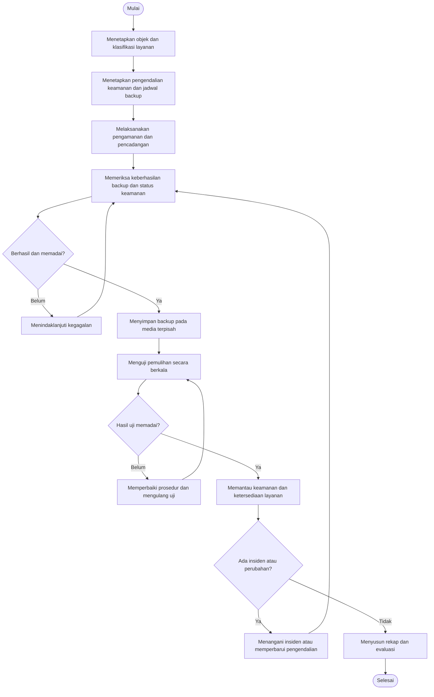

# PP-02 – KEAMANAN, BACKUP, DAN PEMULIHAN

| Informasi | Keterangan |
|---|---|
| Kode Proses | PP-02 |
| Nama Proses | Keamanan, Backup, dan Pemulihan |
| Pemilik Proses | Kantor Pusat Sistem Informasi (KPSI) |
| Penanggung Jawab | Kepala KPSI |
| Unit Pelaksana | Unit Infrastruktur Jaringan dan Server bersama unit terkait |
| Pihak Terkait | Fakultas, program studi, biro, lembaga, unit kerja, dan penyedia layanan TI |
| Versi | 1.0 |
| Status | Draf untuk ditinjau |
| Dokumen Induk | Peta Proses Bisnis KPSI Level 0 |

---

## 1. Tujuan

PP-02 menjadi acuan bagi KPSI dalam mengelola keamanan teknis, backup, dan pemulihan layanan teknologi informasi agar layanan universitas terlindungi dari gangguan dan ancaman, data serta konfigurasi penting tersedia cadangannya, dan layanan yang terganggu dapat dipulihkan secara tertib dan dapat ditelusuri.

Proses ini bertujuan untuk:

1. Menjamin keamanan teknis layanan teknologi informasi yang dikelola KPSI dari akses tidak sah, malware, penyalahgunaan, dan perubahan tanpa izin.
2. Menjamin ketersediaan backup data, konfigurasi, dan dokumen penting yang diperlukan untuk pemulihan layanan.
3. Memastikan layanan teknologi informasi yang terganggu dapat dipulihkan dalam batas waktu yang ditetapkan sesuai tingkat kepentingannya.
4. Menetapkan prioritas pengamanan dan pencadangan berdasarkan dampak layanan terhadap kegiatan universitas.
5. Memastikan insiden keamanan informasi ditangani secara tercatat, terkoordinasi, dan dievaluasi sebagai bahan perbaikan.
6. Mengurangi ketergantungan pada pengetahuan personal dengan mendokumentasikan prosedur pengamanan, backup, dan pemulihan.
7. Mendukung keberlangsungan layanan, perencanaan, dan evaluasi teknologi informasi universitas.

## 2. Ruang Lingkup

PP-02 mencakup pengelolaan keamanan teknis, backup, dan pemulihan yang berkaitan dengan layanan teknologi informasi universitas, antara lain:

1. **Aplikasi dan sistem informasi:** aplikasi yang dikembangkan sendiri, aplikasi pihak ketiga, aplikasi SaaS, serta modul tambahan yang digunakan universitas.
2. **Infrastruktur jaringan dan server:** server, perangkat jaringan, perangkat keamanan, penyimpanan, dan layanan pendukung yang dikelola KPSI.
3. **Website dan domain:** website resmi universitas dan unit kerja, domain, subdomain, DNS, hosting, dan sertifikat.
4. **Database dan integrasi:** database, sistem sumber dan tujuan, API, serta dependensi antarsistem yang dikelola KPSI.
5. **Layanan SaaS dan cloud:** aspek keamanan, backup, dan pemulihan yang menjadi tanggung jawab universitas sesuai kontrak dan ketentuan penyedia.
6. **Akun dan hak akses:** akun administratif, akun layanan, dan hak akses atas sistem, aplikasi, infrastruktur, dan layanan TI yang dikelola KPSI.
7. **Data dan konfigurasi:** data operasional, konfigurasi sistem dan aplikasi, serta dokumentasi teknis yang diperlukan untuk pemulihan layanan.
8. **Insiden keamanan informasi:** dugaan akses tidak sah, penyalahgunaan akun, malware, kebocoran data, perubahan data tanpa izin, dan aktivitas mencurigakan lainnya.

PP-02 **tidak menggantikan kebijakan keamanan informasi universitas**. Ketentuan mengenai tata kelola keamanan informasi, klasifikasi data, dan tanggung jawab hukum ditetapkan melalui kebijakan universitas yang berlaku, sedangkan PP-02 mengatur pelaksanaan teknis pengamanan, backup, dan pemulihan oleh KPSI.

Tanggung jawab atas kebenaran data dan proses bisnis tetap berada pada unit pemilik data/proses. KPSI bertanggung jawab atas aspek teknis pengamanan, pencadangan, dan pemulihan layanan sesuai kewenangannya.

Untuk layanan SaaS dan pihak ketiga, KPSI tidak mengklaim kendali atas infrastruktur internal, basis data, atau source code produk penyedia, kecuali secara tegas diatur dalam kontrak. Pengelolaan backup, pemulihan, keamanan, dan ketersediaan infrastruktur internal penyedia mengikuti tanggung jawab penyedia sebagaimana diatur dalam kontrak, dan KPSI memastikan aspek tersebut diperhatikan dalam koordinasi serta evaluasi layanan.

## 3. Prinsip Pengelolaan

1. **Pertahanan berlapis:** pengamanan diterapkan pada beberapa lapisan—perimeter, jaringan, server, aplikasi, dan data—agar kegagalan pada satu lapisan tidak langsung membahayakan layanan.
2. **Hak akses minimum:** setiap akun dan personel hanya memperoleh akses yang diperlukan untuk melaksanakan tugasnya.
3. **Cadangan terpisah dari sistem utama:** backup disimpan pada media atau lokasi yang terpisah dari sistem yang dicadangkan, agar gangguan pada sistem utama tidak menghilangkan cadangannya.
4. **Cadangan yang belum diuji belum dapat diandalkan:** backup hanya dinyatakan layak apabila keterbacaan dan prosedur pemulihannya telah diuji secara berkala.
5. **Pengamanan dan pencadangan berdasarkan dampak:** prioritas, jadwal, dan target pemulihan ditetapkan berdasarkan dampak layanan terhadap kegiatan universitas, bukan berdasarkan kemudahan teknis semata.
6. **Pencatatan dan ketertelusuran:** setiap kegiatan pengamanan, backup, pengujian, insiden, dan pemulihan dicatat agar dapat ditelusuri, dipantau, dan dievaluasi.
7. **Tanggung jawab teknis dan substantif dibedakan:** KPSI bertanggung jawab atas aspek teknis, sedangkan unit pemilik layanan bertanggung jawab atas kebijakan substantif, proses bisnis, dan kebenaran data yang dikelolanya.
8. **Perubahan diikuti pembaruan pengamanan dan cadangan:** setiap perubahan sistem, konfigurasi, atau layanan yang berdampak harus diikuti peninjauan pengendalian keamanan dan cakupan backup.
9. **Informasi keamanan bersifat terbatas:** informasi mengenai konfigurasi keamanan, kerentanan, dan prosedur pemulihan hanya dapat diakses oleh personel yang berwenang.
10. **Perbaikan berkelanjutan:** setiap insiden dan hasil pengujian pemulihan dievaluasi untuk memperbaiki pengendalian, prosedur, dan dokumentasi.

## 4. Pihak yang Terlibat dan Tanggung Jawab

| Pihak | Tanggung Jawab |
|---|---|
| Kepala KPSI | Menetapkan pengendalian keamanan, jadwal backup, dan target pemulihan; mengoordinasikan penanganan insiden keamanan informasi di tingkat universitas; melakukan eskalasi kepada Wakil Rektor IV atau Rektor apabila diperlukan; serta mengevaluasi pelaksanaan PP-02. |
| Unit Infrastruktur Jaringan dan Server | Melaksanakan pengamanan infrastruktur, pencadangan, pengujian pemulihan, pemulihan layanan, serta pemantauan keamanan dan ketersediaan layanan sesuai bidang tugasnya. |
| Unit-unit KPSI lainnya | Melaksanakan pengamanan dan pencadangan pada bidang tugasnya, memperbarui dokumentasi teknis terkait, serta melaporkan gangguan atau dugaan insiden keamanan kepada Kepala KPSI. |
| Unit pemilik layanan/data | Menjaga kebenaran data dan proses bisnis yang menjadi tanggung jawabnya, menetapkan kebutuhan pemulihan layanan bersama KPSI, serta berkoordinasi dalam penanganan insiden yang melibatkan data atau proses milik unit. |
| PIC unit | Menjadi kontak koordinasi untuk konfirmasi dampak layanan, kebutuhan pemulihan, dan tindak lanjut penanganan pada unitnya. |
| Penyedia layanan TI | Melaksanakan pengamanan, backup, dan pemulihan yang menjadi tanggung jawabnya sesuai kontrak atau perjanjian, menyediakan informasi layanan dan dukungan, serta memberitahukan gangguan atau perubahan layanan kepada KPSI. |
| Wakil Rektor IV | Memberikan arahan atau keputusan atas insiden dan kebutuhan pengamanan, backup, atau pemulihan yang memerlukan keputusan pimpinan, anggaran, atau koordinasi lintas unit. |

## 5. Masukan Proses

1. Daftar layanan, sistem, dan infrastruktur yang dikelola KPSI beserta klasifikasinya berdasarkan dampak terhadap kegiatan universitas.
2. Dokumentasi teknis sistem dan layanan sesuai PP-01, termasuk konfigurasi, dependensi, dan prosedur pemulihan.
3. Hasil pemantauan layanan dan keamanan sesuai PM-03 dan PB-03.
4. Laporan gangguan dan insiden sesuai PB-06, termasuk dugaan insiden keamanan informasi.
5. Hasil analisis kebutuhan dan perubahan sistem sesuai PB-01 dan PB-02.
6. Hasil pengujian pemulihan dan evaluasi backup sebelumnya.
7. Informasi kerentanan, pembaruan keamanan, dan pemberitahuan dari penyedia atau pihak berwenang.
8. Dokumen pengadaan, kontrak, lisensi, langganan, dan SLA yang memuat ketentuan keamanan, backup, dan pemulihan penyedia.
9. Kebijakan keamanan informasi dan ketentuan universitas yang berlaku.
10. Informasi dari unit kerja dan penyedia layanan mengenai kebutuhan pemulihan layanan.

## 6. Alur Proses

## 7. Tahapan Pelaksanaan

### 7.1 Penetapan Objek dan Klasifikasi Layanan

1. Kepala KPSI bersama Unit Infrastruktur Jaringan dan Server menetapkan layanan, sistem, dan infrastruktur yang menjadi objek pengamanan dan pencadangan KPSI berdasarkan dokumentasi teknis sesuai PP-01.
2. Setiap objek diklasifikasikan berdasarkan dampak apabila layanan terganggu atau data hilang, sekurang-kurangnya:
   - **Kritis:** gangguan berdampak luas pada kegiatan utama universitas dan memerlukan pemulihan segera;
   - **Penting:** gangguan menghambat pekerjaan satu atau beberapa unit dan memerlukan pemulihan terjadwal;
   - **Pendukung:** gangguan berdampak terbatas dan pemulihan dapat dilakukan pada kesempatan berikutnya.
3. Untuk setiap klasifikasi ditetapkan target pemulihan, meliputi target waktu pemulihan dan target batas data yang dapat diterima kehilangannya, serta didokumentasikan sebagai acuan pelaksanaan.
4. Penanggung jawab teknis dan unit pemilik layanan ditetapkan untuk setiap objek, agar penugasan penanganan dan eskalasi dapat dilakukan tanpa penundaan.
5. Klasifikasi dan target pemulihan ditinjau kembali apabila terjadi perubahan layanan, perubahan dampak, atau hasil evaluasi penanganan sebelumnya.

### 7.2 Pengelolaan Keamanan Teknis

1. Unit KPSI melaksanakan pengamanan teknis sesuai bidang tugasnya, meliputi pembaruan keamanan sistem dan aplikasi, penutupan layanan atau port yang tidak diperlukan, serta penerapan konfigurasi aman.
2. Akses administratif ke server, perangkat jaringan, dan konsol layanan dibatasi hanya bagi personel yang berwenang dan dicatat.
3. Aktivitas administratif dan kejadian keamanan yang relevan dipantau melalui catatan sistem (log) dan hasil pemantauan layanan.
4. Temuan kerentanan atau anomali dicatat dan ditindaklanjuti sesuai tingkat risikonya.
5. Perubahan pengendalian keamanan didokumentasikan dan diinformasikan kepada personel terkait agar tidak menimbulkan gangguan layanan yang tidak direncanakan.

### 7.3 Pencadangan (Backup)

1. Unit KPSI melaksanakan backup sesuai jadwal yang ditetapkan berdasarkan klasifikasi layanan.
2. Cakupan backup disesuaikan dengan jenis objek, sekurang-kurangnya:
   - **Aplikasi dan database:** data operasional, struktur database, dan konfigurasi yang diperlukan untuk menjalankan kembali layanan;
   - **Server dan infrastruktur:** konfigurasi sistem, konfigurasi layanan, dan dokumen pemulihan;
   - **Website:** berkas website, database pendukung, dan konfigurasi terkait;
   - **Dokumen penting:** dokumentasi teknis dan dokumen pendukung pemulihan sesuai PP-01.
3. Backup disimpan pada media atau lokasi penyimpanan yang terpisah dari sistem utama, dan salinan untuk layanan kritis disimpan pada lokasi yang berbeda dari lokasi sistem utama.
4. Backup yang memuat data sensitif dilindungi dengan enkripsi atau mekanisme pengamanan yang setara.
5. Keberhasilan setiap pelaksanaan backup diperiksa dan dicatat. Kegagalan backup ditindaklanjuti pada kesempatan pertama dan tidak dibiarkan berulang tanpa penyelesaian.
6. Masa retensi backup ditetapkan berdasarkan klasifikasi layanan dan ketentuan universitas yang berlaku.

### 7.4 Pengujian Keterbacaan Backup dan Pemulihan

1. Keterbacaan backup dan prosedur pemulihan diuji secara berkala sesuai klasifikasi layanan.
2. Pengujian mencakup sekurang-kurangnya satu skenario pemulihan, misalnya pemulihan berkas yang hilang, pemulihan database, atau pemulihan layanan pada perangkat pengganti.
3. Hasil pengujian dicatat, meliputi tanggal pengujian, objek yang diuji, hasil, kendala, dan tindak lanjut yang diperlukan.
4. Apabila pengujian menunjukkan backup tidak dapat dipulihkan, Unit Infrastruktur Jaringan dan Server wajib menindaklanjuti temuan tersebut dan mengulang pengujian setelah perbaikan.
5. Backup yang belum pernah diuji tidak dinyatakan sebagai cadangan yang dapat diandalkan dalam perencanaan pemulihan.

### 7.5 Pemulihan Layanan

1. Pemulihan layanan dilaksanakan apabila terjadi gangguan, kerusakan data, atau kehilangan layanan yang memerlukan pengembalian dari backup.
2. Kepala KPSI atau unit yang diberi kewenangan menetapkan cakupan pemulihan, sumber backup yang digunakan, dan urutan pemulihan berdasarkan klasifikasi layanan.
3. Pemulihan menggunakan backup terakhir yang telah terverifikasi keterbacaannya. Apabila backup terakhir tidak dapat digunakan, digunakan backup sebelumnya yang terverifikasi, dan selisih data yang hilang dicatat serta disampaikan kepada unit pemilik layanan.
4. Setelah pemulihan, unit terkait melakukan pengujian layanan untuk memastikan layanan berfungsi sebelum dinyatakan pulih.
5. Unit pemilik layanan dan pengguna yang terdampak diinformasikan mengenai status pemulihan sesuai kebutuhan.
6. Seluruh kegiatan pemulihan dicatat, meliputi penyebab gangguan, backup yang digunakan, waktu pemulihan, hasil pengujian, dan tindak lanjut.

### 7.6 Penanganan Insiden Keamanan Informasi

1. Setiap dugaan akses tidak sah, penyalahgunaan akun, malware, kebocoran data, perubahan data tanpa izin, atau aktivitas mencurigakan yang dilaporkan kepada KPSI harus segera dicatat dan ditelaah.
2. KPSI melakukan tindakan pengamanan awal sesuai kewenangan, seperti membatasi akses, menonaktifkan sementara akun yang terindikasi disalahgunakan, mengisolasi komponen terdampak, atau meminta bantuan penyedia.
3. Tindakan pengamanan harus mempertimbangkan kebutuhan menjaga bukti dan catatan kejadian sejauh memungkinkan.
4. Kepala KPSI menjadi koordinator penanganan insiden keamanan informasi di tingkat universitas dan mengoordinasikan tindakan teknis awal serta komunikasi dengan pihak terkait.
5. Kepala KPSI segera melakukan eskalasi kepada Wakil Rektor IV atau Rektor apabila insiden berpotensi berdampak serius, memerlukan keputusan pimpinan, atau membutuhkan koordinasi lintas unit.
6. Jika insiden melibatkan data atau proses milik unit tertentu, KPSI berkoordinasi dengan unit pemilik data/proses dan pihak universitas yang berwenang.
7. Komunikasi kepada pihak internal maupun eksternal mengenai insiden dilakukan melalui pihak yang berwenang. KPSI tidak menyampaikan informasi sensitif secara terbuka tanpa persetujuan.
8. Penanganan lebih lanjut mengikuti kebijakan keamanan informasi dan ketentuan universitas yang berlaku.
9. Setelah insiden ditangani, KPSI menyusun evaluasi yang memuat penyebab, dampak, tindakan yang dilakukan, dan rekomendasi perbaikan untuk mencegah kejadian berulang.

### 7.7 Pencatatan dan Pelaporan

1. Setiap pelaksanaan backup, pengujian pemulihan, insiden keamanan, dan pemulihan layanan dicatat dengan sekurang-kurangnya memuat waktu, pelaksana, objek, hasil, dan tindak lanjut.
2. Kegagalan backup, kegagalan pengujian, dan insiden keamanan dilaporkan kepada Kepala KPSI pada kesempatan pertama.
3. Kepala KPSI menyampaikan laporan pelaksanaan PP-02, termasuk status backup, hasil pengujian pemulihan, dan insiden yang ditangani, sesuai mekanisme pelaporan KPSI.
4. Catatan penanganan insiden disimpan sebagai bahan evaluasi dan tidak disebarluaskan di luar pihak yang berwenang.

### 7.8 Pemantauan dan Evaluasi

1. Unit Infrastruktur Jaringan dan Server memantau status keamanan, keberhasilan backup, dan ketersediaan layanan secara berkala.
2. Kepala KPSI mengevaluasi pelaksanaan pengamanan, backup, dan pemulihan berdasarkan catatan pelaksanaan, hasil pengujian, dan insiden yang terjadi.
3. Temuan seperti layanan kritis tanpa backup yang terverifikasi, backup yang berulang kali gagal, atau pengendalian keamanan yang belum diterapkan ditindaklanjuti kepada pihak terkait.
4. Hasil evaluasi digunakan sebagai masukan perencanaan TI, pengadaan, pengembangan, dan penyusunan SOP.

## 8. Ketentuan Pengelolaan

### 8.1 Keamanan Jaringan dan Perimeter

1. Akses ke jaringan dan layanan universitas dilindungi melalui pengendalian pada sisi perimeter, antara lain penyaringan trafik berbahaya, pembatasan laju permintaan, dan pembatasan akses administratif.
2. Perangkat jaringan dan perangkat keamanan dikonfigurasi sesuai kebutuhan layanan dan ditinjau secara berkala.
3. Lalu lintas yang mencurigakan dicatat dan ditindaklanjuti sesuai tingkat risikonya.
4. Perubahan konfigurasi perimeter yang berdampak pada layanan dikoordinasikan dengan unit terkait dan didokumentasikan.
5. Pembagian tanggung jawab pengelolaan jaringan mengikuti PB-03.

### 8.2 Keamanan Server dan Sistem

1. Sistem operasi, perangkat lunak, dan firmware pada server yang dikelola KPSI diperbarui mengikuti pembaruan keamanan yang tersedia dan hasil penilaian risiko.
2. Layanan dan port yang tidak diperlukan pada server dinonaktifkan.
3. Akun administratif server dibatasi hanya bagi personel yang berwenang dan ditinjau secara berkala.
4. Aktivitas administratif yang penting dicatat agar dapat ditelusuri apabila terjadi gangguan atau insiden.
5. Lingkungan produksi dan lingkungan pengujian dipisahkan apabila pemisahan tersebut dimungkinkan dan diperlukan untuk mengurangi risiko terhadap layanan yang sedang berjalan.

### 8.3 Keamanan Aplikasi dan Website

1. Aplikasi dan platform website yang dikelola KPSI diperbarui mengikuti pembaruan keamanan yang tersedia dan hasil penilaian risiko.
2. Masukan pengguna pada aplikasi divalidasi agar tidak dapat digunakan untuk mengubah perilaku aplikasi atau mengakses data tanpa izin.
3. Mekanisme sesi dan autentikasi pada aplikasi dikelola sesuai ketentuan keamanan yang berlaku.
4. Sertifikat keamanan website dipantau masa berlakunya dan diperbarui sebelum kedaluwarsa.
5. Perubahan konten atau berkas website tanpa izin diperiksa melalui pemantauan berkala, dan temuan ditindaklanjuti sebagai gangguan atau insiden sesuai PB-06.
6. Pembagian tanggung jawab pengelolaan website mengikuti PB-04.

### 8.4 Pengelolaan Akun dan Hak Akses

1. Setiap akun diberikan hak akses sekurang-kurangnya sesuai kebutuhan tugas pemegang akun.
2. Akun administratif dan akun layanan didata beserta pemilik, tujuan penggunaan, dan tingkat hak aksesnya.
3. Akun bersama untuk pekerjaan administratif dihindari. Apabila tidak dapat dihindari, penggunaannya dicatat dan dibatasi.
4. Kata sandi, token, private key, secret, dan kredensial lainnya tidak dicatat dalam dokumen biasa. Kredensial dikelola melalui mekanisme penyimpanan rahasia yang aman.
5. Hak akses ditinjau secara berkala. Akun personel yang berpindah tugas, tidak lagi memiliki kewenangan, atau tidak aktif harus disesuaikan atau dinonaktifkan.
6. Akun yang terindikasi disalahgunakan dinonaktifkan sementara dan ditindaklanjuti sebagai insiden keamanan sesuai 7.6.

### 8.5 Pencadangan dan Retensi

1. Jadwal backup ditetapkan berdasarkan klasifikasi layanan dan didokumentasikan.
2. Backup dilaksanakan secara terjadwal dan tidak bergantung pada pelaksanaan manual yang tidak terpantau, kecuali untuk kebutuhan tertentu yang didokumentasikan.
3. Media penyimpanan backup dipisahkan dari sistem utama. Untuk layanan kritis, salinan backup disimpan pada lokasi yang berbeda dari lokasi sistem utama.
4. Backup dilindungi dari perubahan dan penghapusan yang tidak berwenang.
5. Masa retensi backup ditetapkan berdasarkan klasifikasi layanan dan ketentuan universitas. Backup yang telah melewati masa retensi dihapus melalui mekanisme yang aman dan tercatat.
6. Perubahan cakupan backup akibat penambahan, perubahan, atau penghentian layanan dicatat dan disesuaikan tanpa menunggu jadwal evaluasi berkala.

### 8.6 Pengujian dan Pemulihan

1. Pengujian keterbacaan backup dan prosedur pemulihan dilaksanakan secara berkala sesuai klasifikasi layanan.
2. Rencana pemulihan disusun untuk layanan kritis, sekurang-kurangnya memuat objek yang dipulihkan, sumber backup, urutan pemulihan, penanggung jawab, dan cara pengujian layanan setelah pemulihan.
3. Pemulihan dilaksanakan dari backup yang telah terverifikasi keterbacaannya.
4. Hasil pengujian dan pemulihan dicatat dan dievaluasi sebagai bahan perbaikan prosedur.
5. Target waktu pemulihan dan target batas data yang dapat diterima kehilangannya ditetapkan per klasifikasi layanan dan ditinjau secara berkala.

### 8.7 Layanan Keamanan dan Infrastruktur Pihak Ketiga

1. KPSI mencatat layanan keamanan, backup, dan pemulihan yang menjadi tanggung jawab penyedia, termasuk ruang lingkup layanan, kontak dukungan, dan ketentuan SLA atau kontrak.
2. KPSI memastikan aspek keamanan, backup, dan pemulihan diperhatikan dalam koordinasi dan evaluasi layanan penyedia, tanpa mengklaim melakukan operasi langsung atas infrastruktur penyedia.
3. Gangguan atau perubahan layanan penyedia yang berdampak pada keamanan atau ketersediaan layanan universitas dikoordinasikan dengan penyedia dan dicatat.
4. Dokumen kontrak dan ketentuan layanan dikoordinasikan dengan unit universitas yang berwenang mengelola kerja sama atau pengadaan.

### 8.8 Kerahasiaan dan Penanganan Data Sensitif

1. Informasi mengenai konfigurasi keamanan, kerentanan, prosedur pemulihan, dan hasil penanganan insiden diklasifikasikan sebagai informasi terbatas.
2. Informasi terbatas hanya dapat diakses oleh personel yang diberi kewenangan.
3. Kredensial, token, private key, secret, dan recovery code tidak boleh disimpan dalam dokumen biasa atau repositori yang tidak dilindungi.
4. Penyampaian informasi keamanan kepada pihak ketiga dibatasi pada informasi yang diperlukan untuk pekerjaan dan berdasarkan persetujuan yang berwenang.
5. Kehilangan, perubahan tanpa izin, atau kebocoran informasi keamanan ditangani sebagai insiden keamanan informasi sesuai 7.6.

## 9. Pembagian Tanggung Jawab

| Aktivitas | Kepala KPSI | Unit Infrastruktur | Unit KPSI Lainnya | Unit Pemilik Layanan | Penyedia |
|---|---|---|---|---|---|
| Menetapkan klasifikasi dan target pemulihan layanan | Bertanggung jawab | Memberi masukan | Memberi masukan | Memberi masukan kebutuhan layanan | - |
| Melaksanakan pengamanan infrastruktur | Mengawasi | Bertanggung jawab | - | - | Mendukung sesuai kontrak |
| Melaksanakan pengamanan aplikasi dan website | Mengawasi | Bertanggung jawab bersama Unit Pengembangan Aplikasi | Bertanggung jawab pada bidangnya | Bertanggung jawab atas konten | Mendukung sesuai kontrak |
| Melaksanakan backup dan menyimpan cadangan | Mengawasi | Bertanggung jawab | Bertanggung jawab pada bidangnya | - | Melaksanakan bagian penyedia sesuai kontrak |
| Menguji keterbacaan backup dan pemulihan | Mengendalikan | Bertanggung jawab | Mendukung | Mengonfirmasi hasil pemulihan layanan | Mendukung sesuai kontrak |
| Memulihkan layanan | Mengendalikan | Bertanggung jawab | Mendukung | Mengonfirmasi layanan pulih | Mendukung sesuai kontrak |
| Menangani insiden keamanan informasi | Koordinator | Melaksanakan tindakan teknis | Mendukung | Berkoordinasi | Mendukung sesuai kontrak |
| Mengelola akun dan hak akses | Menetapkan kewenangan | Melaksanakan pada infrastruktur | Melaksanakan pada bidangnya | Mengusulkan kebutuhan akses unit | Akses terbatas sesuai pekerjaan |
| Menyusun rekap dan evaluasi | Menyetujui/menyampaikan | Menyiapkan data | Memberi data | Memberi konfirmasi | Memberi data sesuai kontrak |

## 10. Keluaran Proses

1. Daftar layanan, sistem, dan infrastruktur beserta klasifikasi dan target pemulihannya.
2. Pengendalian keamanan teknis pada perimeter, jaringan, server, aplikasi, dan website.
3. Backup data, konfigurasi, dan dokumen penting yang tersimpan pada media terpisah dari sistem utama.
4. Hasil pengujian keterbacaan backup dan prosedur pemulihan.
5. Rencana pemulihan untuk layanan kritis.
6. Layanan yang dipulihkan dari backup yang terverifikasi beserta catatan pemulihannya.
7. Catatan penanganan insiden keamanan informasi beserta evaluasinya.
8. Daftar akun dan hak akses beserta hasil peninjauannya.
9. Rekap pelaksanaan backup, pengujian pemulihan, dan insiden keamanan.
10. Rekomendasi perbaikan pengendalian keamanan, backup, dan pemulihan.
11. Informasi penyedia mengenai tanggung jawab keamanan, backup, dan pemulihan sesuai kontrak.

## 11. Proses Terkait

| Kode | Nama Proses | Hubungan dengan PP-02 |
|---|---|---|
| PM-01 | Perencanaan Teknologi Informasi | Menggunakan klasifikasi layanan dan target pemulihan sebagai salah satu dasar perencanaan dan prioritas kebutuhan TI. |
| PM-03 | Monitoring dan Pengendalian | Menggunakan hasil pemantauan keamanan, backup, dan ketersediaan layanan sebagai bahan pengendalian. |
| PM-04 | Pelaporan dan Evaluasi | Menggunakan rekap pelaksanaan PP-02 sebagai bahan pelaporan dan evaluasi kinerja KPSI. |
| PB-01 | Pengelolaan Permintaan dan Analisis Kebutuhan TI | Meneruskan kebutuhan pengamanan, backup, atau pemulihan layanan baru untuk ditetapkan klasifikasi dan target pemulihannya. |
| PB-02 | Pengembangan dan Integrasi Aplikasi | Menghasilkan perubahan aplikasi yang perlu diikuti peninjauan pengendalian keamanan dan cakupan backup. |
| PB-03 | Pengelolaan Infrastruktur Jaringan dan Server | Menghasilkan dan memperbarui infrastruktur yang menjadi objek pengamanan dan pencadangan PP-02. |
| PB-04 | Pengelolaan Website Universitas dan Unit Kerja | Menghasilkan dan memperbarui website yang menjadi objek pengamanan dan pencadangan PP-02. |
| PB-05 | Pengelolaan Layanan E-Learning | Menghasilkan dan memperbarui layanan e-learning yang menjadi objek pengamanan dan pencadangan PP-02. |
| PB-06 | Penanganan Gangguan dan Insiden TI | Menerima dan menindaklanjuti gangguan layanan serta berkoordinasi dalam penanganan insiden keamanan informasi. |
| PP-01 | Pengelolaan Dokumentasi dan Informasi Teknis TI | Menyediakan dokumentasi teknis, konfigurasi, dan referensi aset yang menjadi dasar penetapan objek PP-02. |
| PP-03 | Pengelolaan SDM dan Kompetensi KPSI | Menggunakan kebutuhan kompetensi pengamanan, backup, dan pemulihan sebagai bahan pengembangan kompetensi personel. |
| PP-04 | Pengelolaan Kerja Sama dan Penyedia TI | Menggunakan informasi penyedia, kontrak, dan SLA dalam pengelolaan kerja sama terkait keamanan, backup, dan pemulihan. |

## 12. Dokumen dan Formulir Pendukung

Dokumen atau alat bantu yang dapat digunakan untuk mendukung proses ini:

1. Daftar layanan, sistem, dan infrastruktur beserta klasifikasi dan target pemulihannya.
2. Jadwal backup dan masa retensi per layanan.
3. Daftar media dan lokasi penyimpanan backup.
4. Rencana pemulihan layanan kritis.
5. Template laporan pengujian keterbacaan backup dan pemulihan.
6. Template laporan insiden keamanan informasi.
7. Template laporan pemulihan layanan.
8. Daftar akun dan hak akses beserta hasil peninjauannya.
9. Daftar kontak eskalasi internal, pimpinan, unit pemilik layanan, dan penyedia layanan.
10. Daftar pengendalian keamanan per layanan atau sistem.
11. Rekap pelaksanaan backup, pengujian pemulihan, dan insiden keamanan.
12. Dokumen kontrak dan SLA penyedia yang memuat ketentuan keamanan, backup, dan pemulihan.

## 13. Indikator Kinerja Proses

| No. | Indikator | Tujuan |
|---|---|---|
| 1 | Persentase layanan kritis yang memiliki backup yang telah diuji keterbacaannya | Mengukur kesiapan pemulihan layanan kritis |
| 2 | Persentase pelaksanaan backup terjadwal yang berhasil | Mengukur keandalan pelaksanaan backup |
| 3 | Jumlah kegagalan backup yang belum ditindaklanjuti | Memantau penyelesaian kegagalan backup |
| 4 | Persentase layanan yang memiliki rencana pemulihan yang terdokumentasi | Mengukur kesiapan pemulihan |
| 5 | Persentase pengujian pemulihan berkala yang dilaksanakan sesuai jadwal | Memantau kedisiplinan pengujian |
| 6 | Jumlah insiden keamanan informasi yang ditangani dan didokumentasikan | Memantau penanganan insiden |
| 7 | Persentase akun yang telah ditinjau hak aksesnya dalam periode berjalan | Memantau pengendalian hak akses |
| 8 | Persentase temuan pengujian atau insiden yang telah ditindaklanjuti dengan perbaikan | Mengukur tindak lanjut perbaikan |

Target dan periode pengukuran indikator ditetapkan lebih lanjut dalam SOP atau rencana kerja KPSI, dengan mempertimbangkan kapasitas personel dan ketersediaan data.

## 14. Catatan Validasi

Ketentuan dalam versi ini disusun berdasarkan Peta Proses Bisnis KPSI Level 0 dan ketentuan terkait pada PB-03 dan PB-06. Sebelum dokumen ditetapkan, hal-hal operasional berikut dapat dikonfirmasi:

1. Klasifikasi layanan beserta target waktu pemulihan dan target batas data yang dapat diterima kehilangannya untuk setiap klasifikasi.
2. Jadwal backup dan masa retensi untuk setiap klasifikasi layanan.
3. Media dan lokasi penyimpanan backup, termasuk lokasi penyimpanan salinan untuk layanan kritis.
4. Periode pengujian keterbacaan backup dan pemulihan untuk setiap klasifikasi layanan.
5. Penunjukan koordinator keamanan dan backup serta pembagian tanggung jawab pelaksanaan pada masing-masing unit KPSI.
6. Daftar kontak eskalasi internal, pimpinan, unit pemilik layanan, dan penyedia layanan.
7. Mekanisme penyimpanan rahasia untuk kredensial dan informasi keamanan yang disetujui universitas.

Hal-hal teknis tersebut dapat ditetapkan melalui SOP atau keputusan internal KPSI tanpa mengubah prinsip pengelolaan dalam dokumen ini.

## 15. Penutup

PP-02 menjadi acuan pengelolaan keamanan, backup, dan pemulihan layanan teknologi informasi di lingkungan universitas dengan menempatkan KPSI sebagai pengelola teknis sesuai kewenangannya, serta mengatur hubungan dengan unit pemilik layanan dan penyedia layanan.

Pengamanan yang berlapis, backup yang tersimpan terpisah dan teruji, serta pemulihan yang tercatat dan terkoordinasi menjadi dasar bagi keberlangsungan layanan teknologi informasi universitas. Rincian jadwal, target pemulihan, media penyimpanan, dan penanggung jawab ditetapkan lebih lanjut melalui SOP dan pedoman teknis KPSI.
