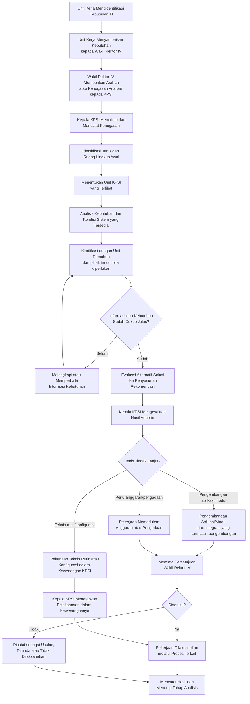

# PETA PROSES BISNIS KPSI
# LEVEL 1 – PB-01
## PENGELOLAAN PERMINTAAN DAN ANALISIS KEBUTUHAN TEKNOLOGI INFORMASI

**UNIVERSITAS KUNINGAN**

---

## IDENTITAS DOKUMEN

| Keterangan | Isi |
|---|---|
| Kode Proses | PB-01 |
| Nama Proses | Pengelolaan Permintaan dan Analisis Kebutuhan Teknologi Informasi |
| Kelompok Proses | Proses Utama |
| Pemilik Proses | Kepala Kantor Pusat Sistem Informasi |
| Unit Pelaksana | Unit Analisis Sistem dan unit KPSI terkait |
| Atasan Langsung KPSI | Wakil Rektor IV |
| Versi | 1.2 |
| Status | Rancangan untuk pembahasan dan penetapan |
| Tanggal | [Tanggal penetapan] |

> Dokumen ini menjabarkan PB-01 pada Peta Proses Bisnis KPSI Level 0. Dokumen ini menjelaskan alur proses pada tingkat operasional umum dan menjadi dasar penyusunan SOP terkait.

---

# 1. TUJUAN

Proses ini bertujuan memastikan kebutuhan teknologi informasi dari fakultas, program studi, biro, lembaga, dan unit kerja lainnya diterima, dicatat, diidentifikasi, dianalisis, dan dievaluasi secara terkoordinasi sebelum ditetapkan tindak lanjutnya.

KPSI tidak langsung mengasumsikan bahwa setiap kebutuhan harus diselesaikan melalui pengembangan aplikasi. KPSI terlebih dahulu menilai sistem, layanan, dan infrastruktur yang telah tersedia serta mengevaluasi alternatif solusi yang paling sesuai dengan kebutuhan dan kepentingan universitas.

Melalui proses ini, KPSI memperoleh gambaran mengenai kebutuhan pengguna, tujuan yang ingin dicapai, ruang lingkup pekerjaan, keterkaitan dengan sistem yang telah tersedia, kebutuhan teknis, risiko, kebutuhan sumber daya, serta rekomendasi solusi dan pelaksanaannya.

# 2. RUANG LINGKUP

Proses PB-01 mencakup pengelolaan permintaan yang bersifat kebutuhan baru, peningkatan, atau perubahan teknologi informasi, antara lain:

1. Permintaan pengembangan aplikasi atau sistem informasi baru.
2. Permintaan pengembangan modul tambahan, fitur, atau perubahan aplikasi.
3. Permintaan integrasi antarsistem, termasuk integrasi dengan aplikasi SaaS.
4. Permintaan konfigurasi atau kustomisasi aplikasi yang telah digunakan universitas.
5. Permintaan pemanfaatan aplikasi SaaS atau layanan teknologi pihak ketiga.
6. Permintaan pengadaan atau berlangganan aplikasi dan layanan TI.
7. Permintaan layanan infrastruktur baru atau peningkatan kapasitas.
8. Permintaan pengembangan atau perubahan teknis website.
9. Permintaan pengembangan atau perubahan layanan e-learning.
10. Permintaan konsultasi dan analisis kebutuhan teknologi informasi yang memerlukan koordinasi formal.

Dalam menganalisis kebutuhan, KPSI mempertimbangkan kemungkinan optimalisasi sistem yang telah tersedia, konfigurasi aplikasi, pengembangan modul tambahan, integrasi, pengembangan internal, maupun pemanfaatan solusi pihak ketiga. Pemilihan alternatif disesuaikan dengan kebutuhan, kewenangan, kemampuan teknis, risiko, biaya, dan kebijakan universitas.

PB-01 tidak menggantikan proses penanganan gangguan operasional sehari-hari. Gangguan operasional dan permintaan bantuan teknis rutin ditangani melalui PB-06 – Penanganan Gangguan dan Insiden TI, atau proses layanan terkait, dengan pelaporan langsung kepada KPSI.

Apabila dari penanganan gangguan ditemukan kebutuhan perubahan atau pengembangan yang lebih luas, kebutuhan tersebut dapat dialihkan ke PB-01 melalui koordinasi Kepala KPSI dan mekanisme persetujuan yang berlaku.

# 3. PIHAK YANG TERLIBAT DAN TANGGUNG JAWAB

| Pihak/Unit | Tanggung Jawab dalam Proses |
|---|---|
| Fakultas, Program Studi, Biro, Lembaga, atau Unit Kerja Pemohon | Mengidentifikasi kebutuhan, menjelaskan permasalahan dan tujuan, menyediakan informasi pendukung, serta memvalidasi kesesuaian hasil analisis dengan kebutuhan unit. |
| Wakil Rektor IV | Menerima kebutuhan formal dari unit kerja dan meneruskan atau menugaskan kebutuhan tersebut kepada KPSI untuk dianalisis. Memberikan persetujuan sebelum pekerjaan pengembangan aplikasi dilaksanakan serta memberikan persetujuan akhir untuk pekerjaan yang memerlukan anggaran atau pengadaan. |
| Kepala KPSI | Menerima dan mencatat penugasan, mengidentifikasi ruang lingkup awal, mengoordinasikan analisis, menentukan unit yang terlibat, mengevaluasi hasil analisis, serta memutuskan pekerjaan teknis rutin yang berada dalam kewenangannya. Kepala KPSI memastikan pengembangan aplikasi dan pekerjaan yang memerlukan anggaran atau pengadaan tidak dilaksanakan sebelum memperoleh persetujuan Wakil Rektor IV. |
| Unit Analisis Sistem | Menganalisis kebutuhan, proses bisnis, kebutuhan pengguna, ruang lingkup, dan spesifikasi kebutuhan sistem apabila permintaan berkaitan dengan sistem atau aplikasi. Membantu membandingkan kebutuhan dengan fungsi sistem yang telah tersedia. |
| Unit Pengembangan Aplikasi dan Integrasi Sistem | Memberikan masukan teknis aplikasi, integrasi, API, kompleksitas pengembangan, dan perkiraan kebutuhan teknis, termasuk kemungkinan pengembangan modul internal yang terhubung dengan aplikasi pihak ketiga. |
| Unit Infrastruktur Jaringan dan Server | Memberikan analisis kebutuhan jaringan, server, penyimpanan, kapasitas, hosting, keamanan infrastruktur, dan dukungan teknis lainnya. |
| Unit E-Learning | Memberikan analisis kebutuhan layanan pembelajaran digital dan LMS apabila permintaan berkaitan dengan e-learning, termasuk pemanfaatan fitur LMS yang tersedia pada aplikasi universitas. |
| Penyedia aplikasi/layanan pihak ketiga (jika terkait) | Memberikan informasi teknis, penjelasan kemampuan produk, dokumentasi, API, batasan konfigurasi, estimasi pekerjaan, dan dukungan teknis sesuai kontrak atau kesepakatan. Penyedia tidak menggantikan tanggung jawab KPSI dalam melakukan analisis kebutuhan dan menyusun rekomendasi bagi universitas. |

Tidak semua unit KPSI harus terlibat dalam setiap permintaan. Kepala KPSI menetapkan unit yang dilibatkan berdasarkan jenis dan ruang lingkup kebutuhan.

# 4. MASUKAN PROSES

Masukan yang dapat digunakan dalam proses ini meliputi:

1. Surat, nota dinas, disposisi, atau bentuk penugasan dari Wakil Rektor IV.
2. Uraian kebutuhan atau permasalahan dari unit pemohon.
3. Tujuan dan manfaat yang diharapkan.
4. Gambaran proses kerja yang akan didukung.
5. Informasi sistem atau infrastruktur yang telah digunakan, apabila tersedia.
6. Dokumen pendukung, contoh formulir, data, atau gambaran alur kerja.
7. Informasi mengenai aplikasi, layanan SaaS, API, infrastruktur, atau solusi TI yang telah tersedia dan relevan.
8. Informasi mengenai batasan waktu, sumber daya, biaya, kontrak, dan ketergantungan dengan unit lain atau penyedia.

Kelengkapan masukan disesuaikan dengan jenis dan kompleksitas permintaan. Tidak semua permintaan harus menggunakan seluruh dokumen pendukung tersebut.

# 5. ALUR PROSES

## 5.1 Diagram Alur PB-01

## 5.2 Uraian Tahapan

| No. | Tahapan | Pelaksana Utama | Uraian Kegiatan | Keluaran |
|---:|---|---|---|---|
| 1 | Identifikasi kebutuhan | Unit pemohon | Unit kerja mengidentifikasi permasalahan, kebutuhan, atau peluang pengembangan teknologi informasi. | Uraian kebutuhan TI |
| 2 | Penyampaian kebutuhan | Unit pemohon | Unit kerja menyampaikan kebutuhan secara formal kepada Wakil Rektor IV sesuai mekanisme administrasi universitas. | Surat/nota dinas atau dokumen permintaan |
| 3 | Arahan atau penugasan | Wakil Rektor IV | Wakil Rektor IV menelaah kebutuhan dan meneruskan atau menugaskan KPSI untuk melakukan tindak lanjut. | Arahan/disposisi/penugasan |
| 4 | Penerimaan dan pencatatan | Kepala KPSI | KPSI menerima penugasan dan mencatat permintaan sebagai dasar pemantauan. | Catatan atau register permintaan |
| 5 | Identifikasi awal | Kepala KPSI | Kepala KPSI mengidentifikasi jenis kebutuhan, ruang lingkup awal, urgensi, dan kemungkinan unit yang terlibat. | Klasifikasi awal dan penugasan internal |
| 6 | Penentuan unit analisis | Kepala KPSI | Kepala KPSI menetapkan unit KPSI yang perlu melakukan analisis atau memberikan masukan teknis. | Penugasan kepada unit terkait |
| 7 | Analisis kebutuhan | Unit terkait | Unit KPSI melakukan analisis sesuai bidangnya. Unit Analisis Sistem dilibatkan untuk kebutuhan yang berkaitan dengan aplikasi, sistem, atau proses bisnis. Unit teknis lain memberikan analisis sesuai kebutuhan. | Hasil analisis kebutuhan |
| 8 | Klarifikasi | Unit terkait bersama unit pemohon | Unit terkait melakukan klarifikasi apabila informasi belum lengkap atau terdapat kebutuhan yang belum jelas. | Informasi kebutuhan yang telah diklarifikasi |
| 9 | Evaluasi alternatif solusi | Unit terkait | Unit terkait menilai apakah kebutuhan dapat dipenuhi melalui optimalisasi atau konfigurasi sistem yang tersedia, pengembangan modul tambahan, integrasi, pengembangan internal, atau pemanfaatan/pengadaan solusi pihak ketiga. Penilaian mempertimbangkan kebutuhan pengguna, kemampuan sistem, API dan integrasi, biaya, risiko, keamanan, ketergantungan, serta sumber daya. | Hasil evaluasi alternatif solusi |
| 10 | Penyusunan rekomendasi | Unit terkait | Unit terkait menyusun ruang lingkup, alternatif yang direkomendasikan, kebutuhan teknis, ketergantungan, risiko, dan perkiraan sumber daya apabila dapat diidentifikasi. | Dokumen hasil analisis dan rekomendasi teknis |
| 11 | Evaluasi KPSI | Kepala KPSI | Kepala KPSI mengevaluasi hasil analisis, keterkaitan dengan sistem yang ada, prioritas, kapasitas KPSI, risiko, dan kebutuhan koordinasi. | Hasil evaluasi KPSI |
| 12 | Penentuan jalur persetujuan | Kepala KPSI | Kepala KPSI mengelompokkan tindak lanjut berdasarkan jenis pekerjaan: pengembangan aplikasi, pekerjaan teknis rutin, atau pekerjaan yang memerlukan anggaran/pengadaan. | Klasifikasi jalur persetujuan |
| 13 | Persetujuan Wakil Rektor IV | Wakil Rektor IV | Pengembangan aplikasi wajib memperoleh persetujuan Wakil Rektor IV sebelum pelaksanaan. Pekerjaan apa pun yang memerlukan anggaran atau pengadaan juga wajib memperoleh persetujuan akhir Wakil Rektor IV. | Persetujuan atau keputusan Wakil Rektor IV |
| 14 | Penetapan pekerjaan teknis rutin | Kepala KPSI | Pekerjaan teknis rutin yang tidak termasuk pengembangan aplikasi dan tidak memerlukan anggaran atau pengadaan dapat diputuskan oleh Kepala KPSI dalam batas kewenangannya. | Keputusan pelaksanaan teknis rutin |
| 15 | Penetapan tindak lanjut | Kepala KPSI | Kepala KPSI menetapkan tindak lanjut sesuai persetujuan Wakil Rektor IV atau kewenangan Kepala KPSI. Pekerjaan yang tidak disetujui atau belum dapat dilaksanakan dicatat sebagai usulan, ditunda, atau tidak dilanjutkan. | Keputusan tindak lanjut |
| 16 | Penerusan proses | Kepala KPSI | Pekerjaan yang telah memperoleh persetujuan atau keputusan sesuai kewenangan diteruskan ke proses bisnis terkait. | Penugasan proses berikutnya atau catatan usulan |
| 17 | Dokumentasi | KPSI/unit terkait | Hasil analisis, persetujuan, keputusan, dan tindak lanjut dicatat sebagai dokumentasi proses. | Arsip dan catatan proses |

# 6. HASIL ANALISIS KEBUTUHAN

Hasil analisis disesuaikan dengan jenis permintaan. Untuk kebutuhan yang memerlukan analisis sistem, hasilnya dapat memuat:

1. Latar belakang dan permasalahan.
2. Tujuan pengembangan atau perubahan.
3. Gambaran proses bisnis saat ini dan proses yang diharapkan.
4. Kebutuhan pengguna.
5. Kebutuhan fungsional dan nonfungsional.
6. Ruang lingkup dan batasan sistem.
7. Kebutuhan integrasi dan pertukaran data.
8. Kebutuhan infrastruktur dan keamanan teknis.
9. Evaluasi alternatif solusi, yang dapat meliputi optimalisasi sistem yang tersedia, konfigurasi atau kustomisasi, pengembangan modul tambahan, integrasi, pengembangan internal, atau pemanfaatan/pengadaan aplikasi pihak ketiga.
10. Kebutuhan API, pertukaran data, integrasi, dan ketergantungan kepada penyedia apabila relevan.
11. Pertimbangan keamanan, akses, kepemilikan dan ketersediaan data, serta risiko operasional apabila relevan.
12. Rekomendasi solusi.
13. Perkiraan kompleksitas, sumber daya, biaya, dan tahapan pelaksanaan apabila dapat diidentifikasi.

Untuk kebutuhan yang tidak berkaitan dengan pengembangan aplikasi, hasil analisis dapat berupa kajian teknis yang lebih sederhana, misalnya kebutuhan kapasitas server, konektivitas jaringan, hosting, konfigurasi, atau layanan e-learning.

# 7. KEPUTUSAN DAN TINDAK LANJUT

Hasil analisis dan evaluasi ditindaklanjuti dengan ketentuan kewenangan berikut:

| Jenis Pekerjaan | Persetujuan Sebelum Pelaksanaan | Penanggung Jawab Keputusan |
|---|---|---|
| Pengembangan aplikasi atau sistem informasi, termasuk aplikasi baru, pengembangan modul tambahan, penambahan fitur, dan perubahan aplikasi yang memerlukan pekerjaan pengembangan | Wajib memperoleh persetujuan Wakil Rektor IV sebelum pelaksanaan, terlepas dari ada atau tidaknya kebutuhan anggaran/pengadaan. | Wakil Rektor IV |
| Konfigurasi atau pengaturan rutin pada aplikasi yang telah digunakan, serta pekerjaan teknis rutin lainnya yang berada dalam kewenangan dan sumber daya KPSI, tanpa pengembangan aplikasi serta tanpa anggaran/pengadaan | Dapat diputuskan oleh Kepala KPSI dalam batas kewenangannya tanpa persetujuan terlebih dahulu dari Wakil Rektor IV. | Kepala KPSI |
| Pekerjaan teknis atau pekerjaan lainnya yang memerlukan anggaran atau pengadaan | Wajib memperoleh persetujuan akhir Wakil Rektor IV sebelum komitmen anggaran, pengadaan, atau pelaksanaan yang menimbulkan kewajiban biaya dilakukan. | Wakil Rektor IV |
| Pekerjaan teknis rutin yang sekaligus memerlukan anggaran atau pengadaan | Tetap memerlukan persetujuan akhir Wakil Rektor IV karena terdapat kebutuhan anggaran atau pengadaan. | Wakil Rektor IV |

Ketentuan tambahan:

1. Analisis dan penyusunan rekomendasi teknis dapat dilakukan sebelum persetujuan pelaksanaan diminta.
2. Persetujuan analisis atau penugasan untuk melakukan kajian tidak otomatis berarti persetujuan untuk melaksanakan pengembangan aplikasi.
3. Kepala KPSI dapat memutuskan pekerjaan teknis rutin dalam batas kewenangannya, sepanjang pekerjaan tersebut tidak termasuk pengembangan aplikasi dan tidak memerlukan anggaran atau pengadaan.
4. Penggunaan aplikasi SaaS, konfigurasi tenant, atau permintaan perubahan kepada vendor harus diklasifikasikan berdasarkan substansi pekerjaannya. Apabila tindak lanjutnya merupakan pengembangan aplikasi/modul atau memerlukan anggaran/pengadaan, ketentuan persetujuan Wakil Rektor IV tetap berlaku.
5. Permintaan bantuan vendor atau perubahan konfigurasi yang tidak termasuk pengembangan aplikasi dan tidak menimbulkan kebutuhan anggaran/pengadaan dapat dikoordinasikan oleh KPSI sesuai kewenangannya dan ketentuan kontrak.
6. Apabila suatu pekerjaan memiliki lebih dari satu karakteristik, ketentuan persetujuan yang mensyaratkan persetujuan Wakil Rektor IV tetap berlaku.
7. Pekerjaan yang tidak disetujui atau belum dapat dilaksanakan dicatat sebagai usulan, ditunda, atau tidak dilanjutkan, disertai alasan dan hasil evaluasi.

KPSI bertanggung jawab atas analisis dan rekomendasi teknis serta pengoordinasian pelaksanaan. Wakil Rektor IV memberikan persetujuan pengembangan aplikasi dan persetujuan akhir atas pekerjaan yang memerlukan anggaran atau pengadaan.

## 7.1 Prinsip Evaluasi Alternatif Solusi

Dalam mengevaluasi alternatif solusi, KPSI memperhatikan hal-hal berikut sesuai relevansi dan ketersediaan informasi:

1. Kesesuaian solusi dengan kebutuhan dan proses bisnis unit pemohon.
2. Kemampuan sistem atau layanan yang telah tersedia untuk memenuhi kebutuhan, termasuk kemungkinan konfigurasi.
3. Ketersediaan API, mekanisme integrasi, dan batasan teknis dari aplikasi pihak ketiga.
4. Kelayakan pengembangan modul tambahan atau aplikasi internal.
5. Kebutuhan pengadaan, biaya berlangganan, biaya pengembangan, dan biaya pemeliharaan.
6. Keamanan, hak akses, pertukaran data, serta keberlanjutan layanan.
7. Risiko ketergantungan kepada penyedia dan kemudahan pemindahan atau pemanfaatan kembali data apabila relevan.

Evaluasi tersebut merupakan dasar rekomendasi teknis KPSI. Keputusan strategis dan persetujuan pelaksanaan tetap mengikuti kewenangan pimpinan universitas.

# 8. KELUARAN PROSES

Keluaran PB-01 dapat berupa:

1. Catatan atau register permintaan kebutuhan TI.
2. Klasifikasi dan penugasan internal.
3. Dokumen analisis kebutuhan sistem atau kajian teknis.
4. Hasil evaluasi alternatif solusi.
5. Spesifikasi kebutuhan sistem, apabila diperlukan.
6. Rekomendasi teknis KPSI.
7. Catatan keputusan atau persetujuan pihak berwenang.
8. Penugasan untuk proses bisnis berikutnya.
9. Catatan usulan yang ditunda atau belum dapat dilaksanakan.

# 9. HUBUNGAN DENGAN PROSES BISNIS LAIN

PB-01 memiliki hubungan dengan proses berikut:

| Kode Proses | Nama Proses | Hubungan dengan PB-01 |
|---|---|---|
| PM-02 | Koordinasi dan Penentuan Prioritas | Menjadi bagian dari koordinasi dan penentuan prioritas kebutuhan yang diterima KPSI. |
| PB-02 | Pengembangan dan Integrasi Aplikasi | Menerima kebutuhan aplikasi yang telah dianalisis dan disetujui untuk dilanjutkan. |
| PB-03 | Pengelolaan Infrastruktur Jaringan dan Server | Menindaklanjuti kebutuhan infrastruktur yang telah dianalisis dan disetujui. |
| PB-04 | Pengelolaan Website Universitas dan Unit Kerja | Menindaklanjuti kebutuhan pengembangan atau perubahan teknis website. |
| PB-05 | Pengelolaan Layanan E-Learning | Menindaklanjuti kebutuhan pengembangan atau perubahan layanan e-learning. |
| PB-06 | Penanganan Gangguan dan Insiden TI | Menangani gangguan operasional. Hasil penanganan dapat menghasilkan usulan pengembangan yang kemudian masuk ke PB-01. |
| PM-03 | Monitoring dan Pengendalian | Memantau tindak lanjut permintaan dan pekerjaan yang dihasilkan dari PB-01. |
| PM-04 | Pelaporan dan Evaluasi | Menggunakan catatan permintaan dan hasil analisis sebagai bahan laporan dan evaluasi. |

# 10. DOKUMEN DAN FORMULIR TERKAIT

Dokumen atau formulir yang dapat digunakan dalam proses ini meliputi:

1. Surat atau nota dinas permintaan kebutuhan TI dari unit kerja kepada Wakil Rektor IV.
2. Disposisi atau penugasan Wakil Rektor IV kepada KPSI.
3. Register permintaan kebutuhan TI.
4. Formulir identifikasi kebutuhan TI.
5. Dokumen analisis kebutuhan sistem atau kajian teknis.
6. Dokumen spesifikasi kebutuhan sistem, apabila diperlukan.
7. Catatan rekomendasi dan hasil evaluasi KPSI.
8. Catatan keputusan atau persetujuan pihak berwenang.

Format formulir dapat ditetapkan lebih lanjut melalui SOP PB-01. KPSI dapat menggunakan sistem pencatatan elektronik apabila telah tersedia.

# 11. INDIKATOR PEMANTAUAN PROSES

Pemantauan PB-01 dapat dilakukan dengan indikator sederhana berikut:

1. Jumlah permintaan kebutuhan TI yang diterima.
2. Jumlah permintaan yang telah dianalisis.
3. Jumlah permintaan yang menunggu klarifikasi atau keputusan.
4. Jumlah permintaan yang diteruskan ke proses berikutnya.
5. Jumlah usulan yang ditunda atau belum dapat dilaksanakan.

Indikator digunakan untuk mengetahui kondisi permintaan dan beban kerja KPSI. Penetapan target waktu atau target kinerja dilakukan kemudian sesuai jenis layanan dan kemampuan sumber daya universitas.

# 12. PENUTUP

Peta Proses Bisnis Level 1 PB-01 menjadi acuan bagi KPSI dan unit kerja terkait dalam mengelola permintaan serta analisis kebutuhan teknologi informasi.

Rincian tata cara, formulir, kewenangan persetujuan, dan ketentuan administrasi lebih lanjut diatur dalam SOP Pengelolaan Permintaan dan Analisis Kebutuhan Teknologi Informasi sesuai kebijakan universitas.

---

## CATATAN PEMBAHASAN DAN VALIDASI

Ketentuan kewenangan yang telah dikonfirmasi:

1. Seluruh pengembangan aplikasi wajib memperoleh persetujuan Wakil Rektor IV sebelum dilaksanakan.
2. Kepala KPSI dapat memutuskan pekerjaan teknis rutin tanpa meminta persetujuan Wakil Rektor IV, sepanjang pekerjaan tersebut tidak termasuk pengembangan aplikasi dan tidak memerlukan anggaran atau pengadaan.
3. Pekerjaan yang memerlukan anggaran atau pengadaan wajib memperoleh persetujuan akhir Wakil Rektor IV.
4. Analisis kebutuhan harus mempertimbangkan alternatif solusi, tidak hanya pengembangan aplikasi.
5. Pemanfaatan SaaS, konfigurasi, pengembangan modul tambahan, dan integrasi dapat menjadi alternatif penyelesaian kebutuhan TI sesuai kemampuan sistem serta kewenangan KPSI.

Hal administratif yang masih perlu ditetapkan dalam penyusunan SOP:

1. Bentuk dokumen yang digunakan unit kerja untuk menyampaikan kebutuhan kepada Wakil Rektor IV.
2. Bentuk arahan atau penugasan Wakil Rektor IV kepada KPSI.
3. Saluran pencatatan dan pemantauan permintaan yang digunakan KPSI.

Ketentuan di atas menjadi dasar penyusunan SOP PB-01 dan perlu diselaraskan dengan kebijakan serta tata naskah dinas universitas.
