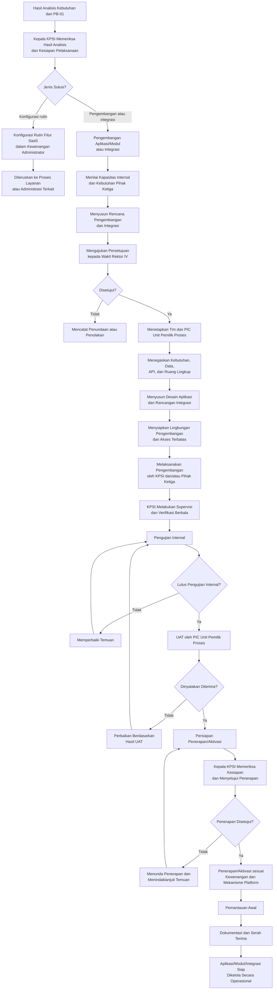

# PB-02 – PENGEMBANGAN DAN INTEGRASI APLIKASI

## 1. Identitas Dokumen

| Elemen | Keterangan |
|---|---|
| Kode Proses | PB-02 |
| Nama Proses | Pengembangan dan Integrasi Aplikasi |
| Kategori | Proses Utama |
| Penanggung Jawab Proses | Kepala Kantor Pusat Sistem Informasi |
| Unit Utama | Unit Pengembangan Aplikasi dan Integrasi Sistem |
| Unit Pendukung | Unit Analisis Sistem, Unit Infrastruktur Jaringan dan Server, Unit E-Learning (sesuai kebutuhan) |
| Versi | 1.3 |
| Status | Draft untuk pembahasan dan validasi |

## 2. Tujuan

Proses ini bertujuan memastikan pengembangan aplikasi, modul tambahan, dan integrasi antarsistem di lingkungan universitas dilaksanakan secara terencana, berdasarkan kebutuhan yang telah dianalisis, memperoleh persetujuan sesuai kewenangan, diuji sebelum digunakan, serta didokumentasikan dan dikelola secara berkelanjutan. Proses ini juga mengatur pengembangan solusi internal yang berkomunikasi dengan aplikasi pihak ketiga atau SaaS melalui API maupun mekanisme integrasi resmi lainnya.

## 3. Ruang Lingkup

PB-02 mencakup:

1. Pengembangan aplikasi atau sistem informasi baru oleh KPSI atau pihak ketiga.
2. Pengembangan modul tambahan atau aplikasi pendamping untuk memenuhi kebutuhan khusus universitas.
3. Penambahan fitur atau fungsi pada aplikasi internal yang sudah berjalan.
4. Pengembangan integrasi antaraplikasi internal, antara aplikasi internal dan SaaS, atau dengan layanan eksternal melalui API maupun mekanisme resmi lainnya.
5. Pengembangan konektor, adapter, atau komponen integrasi yang diperlukan agar aplikasi internal dapat berkomunikasi dengan aplikasi pihak ketiga.
6. Pengembangan khusus oleh pihak ketiga yang mengubah atau menambah fungsi aplikasi sesuai ruang lingkup kerja sama.
7. Pengujian, penerapan atau aktivasi integrasi, dokumentasi, dan serah terima hasil pengembangan.
8. Pemantauan awal setelah aplikasi, modul, atau integrasi diterapkan.
9. Pelaksanaan pengembangan oleh pihak ketiga apabila kapasitas atau kompetensi sumber daya internal KPSI tidak mencukupi.
10. Supervisi, verifikasi hasil pekerjaan, dan serah terima hasil pengembangan dari pihak ketiga.

PB-02 dimulai setelah kebutuhan memperoleh hasil analisis dari PB-01 dan persetujuan pelaksanaan pengembangan dari Wakil Rektor IV.

### Batasan proses

- Perbaikan gangguan atau kesalahan aplikasi yang tidak menambah fungsi baru dan tidak mengubah kebutuhan/proses bisnis dapat ditangani sebagai pemeliharaan atau penanganan insiden sesuai kewenangan Kepala KPSI dan proses PB-06.
- Pengelolaan akun, pemberian hak akses, dan konfigurasi rutin pada fitur standar SaaS yang telah menjadi kewenangan administrator tenant atau administrator unit bukan pengembangan aplikasi dan ditangani melalui proses layanan terkait.
- Permintaan penambahan fitur, perubahan fungsi melalui pekerjaan pengembangan, pembuatan modul tambahan, atau pengembangan integrasi diperlakukan sebagai pengembangan dan wajib melalui PB-01 serta memperoleh persetujuan Wakil Rektor IV sebelum pelaksanaan.
- Permintaan perubahan kepada penyedia SaaS harus diklasifikasikan berdasarkan substansinya. Permintaan konfigurasi standar dapat dikoordinasikan sesuai kewenangan dan kontrak; pekerjaan pengembangan khusus oleh penyedia mengikuti PB-01 dan PB-02.
- Pengadaan atau pekerjaan yang membutuhkan anggaran tetap memerlukan persetujuan akhir Wakil Rektor IV.
- KPSI bertanggung jawab atas aspek teknis aplikasi dan integrasi yang menjadi ruang lingkup universitas. Unit pemilik proses tetap bertanggung jawab atas kebijakan, aturan bisnis, validitas data, dan penerimaan fungsional aplikasi.

## 4. Pihak yang Terlibat dan Tanggung Jawab

| Pihak | Tanggung Jawab |
|---|---|
| Wakil Rektor IV | Memberikan persetujuan pelaksanaan pengembangan aplikasi sebelum pekerjaan pengembangan dimulai. Memberikan persetujuan akhir apabila pekerjaan memerlukan anggaran atau pengadaan. Memberikan arahan apabila terdapat keputusan yang berada di luar kewenangan Kepala KPSI. |
| Kepala KPSI | Mengendalikan proses pengembangan, menetapkan penugasan tim, memastikan persetujuan telah diperoleh, mengoordinasikan unit terkait, memantau kemajuan, mengevaluasi hasil, dan memastikan dokumentasi tersedia. |
| Unit Analisis Sistem | Memastikan kebutuhan dan proses bisnis dipahami, membantu merumuskan kebutuhan fungsional dan nonfungsional, serta menjaga kesesuaian hasil pengembangan dengan hasil analisis PB-01. |
| Unit Pengembangan Aplikasi dan Integrasi Sistem | Melaksanakan pengembangan internal apabila ditugaskan, atau mengendalikan dan memeriksa hasil pekerjaan pihak ketiga; melakukan pengujian teknis, penerapan, dan dokumentasi bersama unit terkait. |
| Unit Infrastruktur Jaringan dan Server | Menyiapkan atau menilai kebutuhan server, jaringan, penyimpanan, hosting, konfigurasi infrastruktur, keamanan teknis, dan kapasitas layanan. |
| Unit E-Learning | Terlibat apabila pengembangan berkaitan dengan LMS, pembelajaran digital, atau layanan e-learning. |
| Unit Pemilik Proses / Pemohon | Menunjuk satu orang PIC untuk setiap pengembangan aplikasi. Menyediakan informasi proses bisnis, menetapkan aturan bisnis dan kebutuhan fungsional, menyediakan data atau akses yang diperlukan, serta memastikan PIC melakukan pengujian penerimaan pengguna dan menyatakan hasil UAT diterima atau belum diterima. |
| PIC Unit Pemilik Proses | Menjadi narahubung resmi unit selama pengembangan, mengoordinasikan pengguna yang terlibat dalam pengujian, menyampaikan umpan balik unit, dan berwenang menyatakan hasil UAT diterima atau belum diterima. |
| Penyedia Eksternal / Pihak Ketiga | Melaksanakan pekerjaan pengembangan sesuai ruang lingkup, spesifikasi, jadwal, standar teknis, dan ketentuan kerja sama. Menyediakan hasil pekerjaan, dokumentasi, source code atau artefak lain yang dipersyaratkan sesuai jenis pekerjaan dan hak yang disepakati. Bekerja di bawah supervisi dan pengendalian teknis KPSI. |
| Penyedia SaaS / Pemilik Aplikasi Pihak Ketiga | Menyediakan dokumentasi API, mekanisme autentikasi, ketentuan akses, batasan integrasi, informasi perubahan layanan, dan dukungan teknis sesuai kontrak. Melaksanakan perubahan pada produk SaaS yang menjadi kewenangannya sesuai kontrak atau kesepakatan. |

## 5. Masukan Proses

Masukan utama PB-02 meliputi:

1. Hasil analisis kebutuhan dan rekomendasi teknis dari PB-01.
2. Persetujuan Wakil Rektor IV untuk melaksanakan pengembangan aplikasi.
3. Penetapan unit pemilik proses dan narahubung/pengguna yang terlibat.
4. Kebutuhan fungsional dan nonfungsional yang telah disepakati.
5. Ketersediaan sumber daya manusia, infrastruktur, dan anggaran apabila diperlukan.
6. Informasi aplikasi atau sistem lain yang akan diintegrasikan, termasuk dokumentasi API dan ketentuan akses apabila tersedia.
7. Hasil penilaian kapasitas dan kompetensi sumber daya internal KPSI.
8. Persetujuan dan dokumen kerja sama/pengadaan apabila pengembangan melibatkan pihak ketiga.
9. Informasi mengenai pemilik data, sumber data utama, hak akses, batasan pertukaran data, dan kebutuhan keamanan integrasi.

**Ketentuan persetujuan:** pekerjaan pengembangan tidak boleh dimulai sebelum persetujuan Wakil Rektor IV diperoleh. Kegiatan analisis kebutuhan dan penyusunan rekomendasi pada PB-01 dapat dilakukan sebelum persetujuan pengembangan diminta.

## 6. Diagram Alur Proses

## 7. Tahapan Pelaksanaan Proses

| No. | Tahapan | Pelaksana/Penanggung Jawab | Uraian Kegiatan | Keluaran |
|---|---|---|---|---|
| 1 | Penerimaan hasil analisis | Kepala KPSI | Menerima hasil PB-01 yang memuat kebutuhan, ruang lingkup, rekomendasi teknis, dan unit pemilik proses. | Dokumen hasil analisis |
| 2 | Pemeriksaan kesiapan | Kepala KPSI bersama unit terkait | Memeriksa kejelasan kebutuhan, kelayakan teknis, risiko, kesiapan unit pemilik proses, dan perkiraan sumber daya. Jika belum siap, kebutuhan dikembalikan untuk dilengkapi melalui PB-01. | Hasil pemeriksaan kesiapan |
| 3 | Penilaian metode pelaksanaan | Kepala KPSI bersama unit terkait | Menilai apakah pengembangan dapat dilaksanakan oleh sumber daya internal KPSI atau memerlukan pihak ketiga karena keterbatasan jumlah personel, kompetensi, waktu, atau kebutuhan khusus. Hasil penilaian menjadi bagian dari rencana pengembangan. | Keputusan metode pelaksanaan |
| 4 | Pengajuan persetujuan pengembangan | Kepala KPSI | Menyampaikan rencana pengembangan kepada Wakil Rektor IV, termasuk tujuan, ruang lingkup, prioritas, metode pelaksanaan (internal dan/atau pihak ketiga), perkiraan waktu, kebutuhan sumber daya, serta kebutuhan anggaran/pengadaan apabila ada. | Usulan/rencana pengembangan |
| 5 | Persetujuan pengembangan | Wakil Rektor IV | Menilai dan memberikan keputusan atas rencana pengembangan. Persetujuan wajib diperoleh sebelum pekerjaan pengembangan dimulai, termasuk untuk pengembangan yang menggunakan sumber daya internal tanpa biaya tambahan. Apabila diperlukan anggaran atau pengadaan, persetujuan akhir juga diberikan oleh Wakil Rektor IV. | Persetujuan atau keputusan Wakil Rektor IV |
| 6 | Penetapan tindak lanjut | Kepala KPSI | Jika disetujui, menetapkan penugasan, tim, dan rencana kerja. Jika tidak disetujui atau ditunda, hasil keputusan dicatat dan disampaikan kepada unit pemohon. | Penugasan dan rencana kerja atau catatan keputusan |
| 7 | Penegasan kebutuhan | Unit Analisis Sistem bersama Unit Pengembangan Aplikasi dan unit pemilik proses | Memastikan kebutuhan fungsional, aturan bisnis, pengguna, alur kerja, kebutuhan data, hak akses, dan kriteria penerimaan dipahami bersama. | Spesifikasi kebutuhan yang disepakati |
| 8 | Perancangan aplikasi dan integrasi | Unit Pengembangan Aplikasi dan Integrasi Sistem bersama Unit Analisis Sistem dan/atau pihak ketiga, dikoordinasikan Kepala KPSI | Menyusun atau mengevaluasi rancangan teknis, struktur data, antarmuka, alur integrasi, kebutuhan keamanan, dan rancangan pengujian. Untuk integrasi SaaS, rancangan memperhatikan dokumentasi API resmi, autentikasi, hak akses, pemetaan data, batas penggunaan API, penanganan kesalahan, dan perubahan versi API. KPSI menentukan sumber data utama bersama pemilik proses/data. Jika pihak ketiga menyusun desain, KPSI memeriksa kesesuaiannya dengan kebutuhan dan standar teknis universitas. | Desain/rancangan teknis yang diperiksa KPSI |
| 9 | Persiapan lingkungan | Unit Pengembangan Aplikasi dan Integrasi Sistem bersama Unit Infrastruktur Jaringan dan Server | Menyiapkan atau mengoordinasikan lingkungan pengembangan dan pengujian, repositori kode, server, jaringan, basis data, serta konfigurasi yang diperlukan. Untuk integrasi SaaS, menyiapkan kredensial/API access yang aman dan lingkungan uji jika disediakan vendor. Jika pihak ketiga terlibat, akses diberikan secara terbatas sesuai kewenangan dan kebutuhan pekerjaan. | Lingkungan pengembangan dan pengujian siap |
| 10 | Pengembangan aplikasi dan integrasi | Unit Pengembangan Aplikasi dan Integrasi Sistem dan/atau pihak ketiga, di bawah supervisi KPSI | Melaksanakan pemrograman, konfigurasi komponen yang termasuk ruang lingkup pengembangan, pembuatan basis data, konektor, adapter, API internal, dan integrasi sesuai rancangan serta ruang lingkup yang disetujui. Apabila dilaksanakan pihak ketiga, KPSI melakukan supervisi, memantau kemajuan, memeriksa kesesuaian hasil, dan mengendalikan perubahan ruang lingkup. Perubahan pada produk inti SaaS hanya dilakukan oleh penyedia sesuai kontrak dan tidak dianggap sebagai kewenangan pengembangan langsung KPSI. | Aplikasi, modul, konektor, atau komponen integrasi |
| 11 | Pengujian internal | Unit Pengembangan Aplikasi dan Integrasi Sistem bersama Unit Analisis Sistem; pihak ketiga apabila terlibat | Melakukan atau mengawasi pengujian fungsi, integrasi, keamanan teknis dasar, kinerja yang relevan, dan penanganan kesalahan. KPSI memeriksa hasil pengujian dan memastikan temuan penting ditangani sebelum UAT. | Hasil pengujian internal yang diverifikasi KPSI |
| 12 | Pengujian penerimaan pengguna | PIC unit pemilik proses bersama pengguna terkait, didampingi KPSI; pihak ketiga dapat membantu menjelaskan fungsi teknis | Menguji kesesuaian aplikasi dengan kebutuhan dan aturan bisnis. PIC mengoordinasikan pengujian dan menyatakan secara resmi apakah hasil UAT diterima atau belum diterima. KPSI memastikan temuan UAT diteruskan kepada pelaksana pengembangan untuk ditindaklanjuti. | Hasil User Acceptance Test (UAT) dan pernyataan PIC |
| 13 | Perbaikan dan pengujian ulang | Unit Pengembangan Aplikasi dan Integrasi Sistem dan/atau pihak ketiga, di bawah supervisi KPSI | Memperbaiki temuan yang disepakati dan melakukan pengujian ulang bersama pihak terkait sampai memenuhi kriteria penerimaan. KPSI memverifikasi penyelesaian temuan teknis. | Aplikasi yang telah diperbaiki dan hasil pengujian ulang |
| 14 | Persiapan penerapan | Unit Pengembangan Aplikasi dan Integrasi Sistem bersama unit terkait | Memastikan hasil UAT telah diterima PIC, infrastruktur siap, pencadangan tersedia sesuai kewenangan dan kebutuhan, serta rencana penerapan, akses pengguna, dan rencana pemulihan telah disiapkan. Untuk integrasi SaaS, memastikan kesiapan kredensial produksi, konfigurasi endpoint, koordinasi jadwal dengan vendor, dan mekanisme pemantauan. | Daftar periksa kesiapan penerapan |
| 15 | Persetujuan penerapan | Kepala KPSI | Memeriksa kesiapan penerapan berdasarkan hasil UAT, daftar periksa kesiapan, kesiapan infrastruktur, dan rencana penerapan. Kepala KPSI memberikan persetujuan sebelum aplikasi diterapkan di lingkungan produksi. | Persetujuan penerapan aplikasi |
| 16 | Penerapan atau aktivasi | Unit Pengembangan Aplikasi dan Integrasi Sistem bersama unit terkait; pihak ketiga atau vendor jika diperlukan | Setelah persetujuan Kepala KPSI diperoleh, menerapkan aplikasi/modul internal atau mengaktifkan integrasi sesuai jadwal dan rencana. Untuk perubahan atau aktivasi pada lingkungan SaaS yang hanya dapat dilakukan vendor, KPSI mengoordinasikan pelaksanaan dengan vendor dan memverifikasi hasilnya; KPSI tidak melakukan perubahan langsung di luar kewenangan tenant. | Aplikasi/modul tersedia atau integrasi aktif |
| 17 | Pemantauan awal | Unit terkait di KPSI | Memantau fungsi aplikasi setelah diterapkan, menangani kendala awal, dan mengoordinasikan perbaikan apabila ditemukan masalah. | Catatan pemantauan awal |
| 18 | Dokumentasi dan serah terima | Unit Pengembangan Aplikasi dan Integrasi Sistem, dikoordinasikan Kepala KPSI; pihak ketiga/vendor sesuai ruang lingkup | Memastikan dokumentasi teknis, source code untuk komponen yang memang dikembangkan dan menjadi hak/akses universitas, desain arsitektur, struktur data, API/integrasi, pemetaan data, konfigurasi deployment, panduan instalasi dan pemeliharaan, informasi lisensi/hak penggunaan, serta akses administratif yang dipersyaratkan telah diserahkan dan diperiksa. Untuk SaaS, dokumentasi API, konfigurasi tenant yang dapat diekspor, catatan integrasi, serta ketentuan akses dan dukungan vendor menjadi bagian dokumentasi; source code produk inti SaaS tidak dianggap sebagai keluaran yang otomatis wajib diserahkan. | Dokumentasi, artefak pengembangan sesuai kesepakatan, dan catatan serah terima |
| 19 | Penutupan proses | Kepala KPSI | Memastikan keluaran utama, keputusan, hasil pengujian, dan dokumentasi tercatat. Mengakhiri proses pengembangan dan mengalihkan penanganan operasional ke mekanisme layanan/pemeliharaan. | Catatan penyelesaian PB-02 |

## 8. Ketentuan Persetujuan dan Pengendalian Perubahan

### 8.1 Persetujuan pengembangan

1. Setiap pengembangan aplikasi wajib memperoleh persetujuan Wakil Rektor IV sebelum pekerjaan pengembangan dimulai.
2. Ketentuan ini berlaku untuk aplikasi baru, penambahan fitur, perubahan fungsi, dan pengembangan integrasi.
3. Persetujuan tetap diperlukan meskipun pekerjaan dilaksanakan oleh personel internal KPSI dan tidak memerlukan anggaran tambahan.
4. Penugasan untuk melakukan analisis atau kajian pada PB-01 tidak dapat dianggap sebagai persetujuan untuk melaksanakan pengembangan.
5. Kepala KPSI bertanggung jawab memastikan bukti persetujuan tersedia dan tercatat sebelum pekerjaan dimulai.

### 8.2 Anggaran dan pengadaan

1. Pekerjaan yang membutuhkan anggaran atau pengadaan wajib memperoleh persetujuan akhir Wakil Rektor IV.
2. Persetujuan pengembangan aplikasi tidak menggantikan persetujuan anggaran atau pengadaan apabila keduanya diperlukan.
3. KPSI tidak melakukan komitmen pengeluaran atau pengadaan sebelum persetujuan yang diperlukan diperoleh.
4. Pelaksanaan pengadaan mengikuti ketentuan dan mekanisme resmi universitas.

### 8.3 Perubahan ruang lingkup

1. Perubahan ruang lingkup yang menambah fungsi, mengubah proses bisnis, atau menimbulkan kebutuhan pengembangan baru harus dievaluasi oleh KPSI.
2. Apabila perubahan tersebut merupakan pengembangan aplikasi, perubahan harus memperoleh persetujuan Wakil Rektor IV sebelum dilaksanakan.
3. Apabila perubahan berdampak pada kebutuhan anggaran atau pengadaan, persetujuan akhir Wakil Rektor IV juga harus diperoleh.
4. Perbaikan kesalahan teknis yang tidak menambah fungsi baru dan tidak mengubah proses bisnis dapat ditangani sebagai pemeliharaan sesuai kewenangan Kepala KPSI, sepanjang tidak memerlukan anggaran atau pengadaan.
5. Setiap perubahan yang disetujui harus dicatat dalam dokumentasi pengembangan.

### 8.4 Persetujuan penerapan ke lingkungan produksi

1. Aplikasi yang telah dinyatakan diterima oleh PIC unit pemilik proses belum boleh langsung diterapkan ke lingkungan produksi.
2. Unit pengembangan menyiapkan daftar periksa kesiapan penerapan yang mencakup hasil UAT, kesiapan infrastruktur, pencadangan, akses pengguna, rencana penerapan, dan rencana pemulihan.
3. Kepala KPSI memeriksa kesiapan tersebut dan memberikan persetujuan penerapan.
4. Penerapan ke lingkungan produksi hanya dapat dilakukan setelah persetujuan Kepala KPSI diperoleh.
5. Persetujuan penerapan oleh Kepala KPSI merupakan pengendalian teknis operasional dan tidak menggantikan persetujuan pengembangan dari Wakil Rektor IV.

### 8.5 Pengembangan Modul dan Integrasi dengan Aplikasi SaaS

1. KPSI dapat mengembangkan aplikasi atau modul tambahan yang berkomunikasi dengan aplikasi SaaS untuk memenuhi kebutuhan universitas yang belum dapat dipenuhi oleh fitur standar SaaS.
2. Integrasi dilakukan melalui API atau mekanisme resmi lain yang disediakan dan diizinkan oleh penyedia SaaS. KPSI tidak melakukan akses langsung ke database internal penyedia SaaS tanpa dasar dan persetujuan resmi.
3. Sebelum pengembangan integrasi dilakukan, KPSI memastikan ketersediaan dokumentasi API, hak akses, metode autentikasi, batas penggunaan, ketentuan kontrak, biaya tambahan apabila ada, serta dukungan vendor.
4. KPSI bersama unit pemilik proses/data menetapkan sumber data utama (*system of record*) untuk setiap jenis data yang dipertukarkan agar tidak terjadi perbedaan atau duplikasi data yang tidak terkendali.
5. Desain integrasi memperhatikan keamanan kredensial, pembatasan hak akses, pemetaan data, pencatatan aktivitas, penanganan kegagalan, pemantauan, dan perubahan versi API.
6. Jika sesuai dengan kebutuhan dan skala solusi, KPSI dapat menggunakan komponen integrasi bersama seperti API client, adapter, atau integration layer agar modul internal tidak bergantung langsung pada detail teknis satu penyedia.
7. KPSI bertanggung jawab atas desain dan pengendalian teknis modul internal serta komponen integrasi yang dikembangkan universitas. Penyedia SaaS tetap bertanggung jawab atas produk inti, infrastruktur, dan API sesuai kontrak.
8. Perubahan atau pengembangan fitur pada produk inti SaaS yang harus dilakukan oleh vendor dikoordinasikan KPSI dengan penyedia. Apabila pekerjaan tersebut merupakan pengembangan khusus, prosesnya tetap mengikuti PB-01 dan persetujuan PB-02.
9. Pengembangan modul tambahan atau integrasi yang termasuk pengembangan aplikasi wajib memperoleh persetujuan Wakil Rektor IV sebelum pekerjaan dimulai.
10. Pengujian integrasi dilakukan menggunakan lingkungan uji atau mekanisme pengujian yang disediakan vendor apabila tersedia. Jika lingkungan uji tidak tersedia, KPSI menetapkan langkah pengujian dan mitigasi risiko sebelum integrasi diaktifkan pada lingkungan produksi.
11. Dokumentasi integrasi sekurang-kurangnya memuat tujuan integrasi, sistem yang terhubung, data yang dipertukarkan, endpoint/API yang digunakan, metode autentikasi tanpa menyimpan rahasia akses dalam dokumen terbuka, pemetaan data, jadwal atau pemicu sinkronisasi, penanganan kesalahan, serta PIC teknis.
12. Perubahan API atau penghentian layanan oleh penyedia harus dievaluasi dampaknya oleh KPSI dan dikoordinasikan dengan unit pemilik proses.

### 8.6 Pelaksanaan pengembangan oleh pihak ketiga

1. Pengembangan aplikasi dapat dilaksanakan oleh personel internal KPSI, pihak ketiga, atau kombinasi keduanya, sesuai kebutuhan dan kapasitas sumber daya.
2. Keterlibatan pihak ketiga dapat dipertimbangkan apabila jumlah personel, kompetensi, waktu, atau kebutuhan teknis tidak memungkinkan pekerjaan dilaksanakan sepenuhnya oleh sumber daya internal KPSI.
3. Analisis kebutuhan tetap menjadi tanggung jawab KPSI. Unit Analisis Sistem dan unit KPSI terkait menyusun atau mengendalikan spesifikasi kebutuhan bersama unit pemilik proses.
4. Penggunaan pihak ketiga tidak mengalihkan tanggung jawab KPSI dalam pengendalian teknis, supervisi, verifikasi hasil, dan pengelolaan sistem informasi universitas.
5. Rencana pengembangan yang melibatkan pihak ketiga tetap wajib memperoleh persetujuan Wakil Rektor IV sebelum pekerjaan pengembangan dimulai.
6. Apabila pelibatan pihak ketiga memerlukan anggaran atau pengadaan, persetujuan akhir Wakil Rektor IV wajib diperoleh dan proses pengadaan mengikuti ketentuan universitas.
7. KPSI mengendalikan ruang lingkup pekerjaan, spesifikasi teknis, jadwal, standar kualitas, akses teknis, pelaporan kemajuan, dan mekanisme penerimaan hasil pekerjaan pihak ketiga.
8. Pihak ketiga melaksanakan pekerjaan sesuai ruang lingkup dan ketentuan kerja sama. KPSI melakukan supervisi selama pelaksanaan dan memeriksa hasil pekerjaan sebelum diteruskan ke tahap berikutnya.
9. Perubahan ruang lingkup pekerjaan pihak ketiga harus dievaluasi dan disetujui sesuai kewenangan. Perubahan yang merupakan pengembangan aplikasi tetap memerlukan persetujuan Wakil Rektor IV sebelum dilaksanakan.
10. Sebelum serah terima dinyatakan selesai, pihak ketiga wajib menyerahkan hasil pekerjaan dan dokumentasi yang dipersyaratkan sesuai jenis pekerjaan dan kesepakatan. Untuk aplikasi atau modul yang dikembangkan khusus bagi universitas, penyerahan dapat mencakup source code, dokumentasi teknis, struktur basis data, API/integrasi, konfigurasi deployment, panduan instalasi dan pemeliharaan, informasi lisensi/hak penggunaan, serta akses administratif. Untuk konfigurasi atau pengembangan pada produk inti SaaS, artefak serah terima mengikuti hak dan ketentuan kontrak dengan penyedia.
11. KPSI memeriksa kelengkapan dan keterpakaian hasil serah terima agar universitas tidak bergantung sepenuhnya pada pengetahuan atau akses yang hanya dimiliki pihak ketiga.
12. Kriteria kepemilikan, lisensi, hak penggunaan, kerahasiaan, keamanan, dukungan pemeliharaan, dokumentasi, akses, dan penyerahan source code apabila relevan harus dicantumkan dalam dokumen kerja sama atau pengadaan sesuai ketentuan universitas.

## 9. Pembagian Tanggung Jawab Teknis dan Substantif

| Aspek | Tanggung Jawab KPSI | Tanggung Jawab Unit Pemilik Proses |
|---|---|---|
| Analisis kebutuhan | Memfasilitasi dan menerjemahkan kebutuhan menjadi spesifikasi teknis/fungsional bersama unit | Menjelaskan kebutuhan, proses kerja, aturan bisnis, dan hasil yang diharapkan |
| Aturan bisnis | Memastikan aturan yang disampaikan dapat diterapkan secara teknis | Menetapkan dan mengesahkan aturan bisnis sesuai kewenangan unit |
| Desain dan pengembangan | Merancang/membangun aplikasi atau modul internal, mengembangkan integrasi melalui API resmi, atau mengendalikan rancangan dan pekerjaan pihak ketiga/vendor sesuai kewenangan; melakukan supervisi dan verifikasi teknis | Memberikan masukan dan mengonfirmasi kesesuaian dengan kebutuhan |
| Data | Mengelola aspek teknis data pada aplikasi/modul internal dan mekanisme pertukaran data sesuai kewenangan; tidak mengambil alih kepemilikan atau validitas data | Bertanggung jawab atas kebenaran, kelengkapan, dan penggunaan substantif data |
| Pengujian | Melakukan pengujian teknis dan mendampingi UAT | PIC mengoordinasikan pengujian unit dan berwenang menyatakan hasil UAT diterima atau belum diterima |
| Penerapan | Menyiapkan penerapan atau aktivasi, memeriksa kesiapan, dan memperoleh persetujuan Kepala KPSI sebelum modul/integrasi diterapkan; mengoordinasikan vendor untuk tindakan yang hanya dapat dilakukan pada platform SaaS | Menyiapkan pengguna dan proses kerja unit untuk menggunakan aplikasi |
| Operasional | Mengelola aspek teknis aplikasi dan infrastruktur sesuai kewenangan | Menjalankan proses kerja dan menggunakan aplikasi sesuai ketentuan unit |

## 10. Keluaran Proses

Keluaran PB-02 meliputi:

1. Bukti persetujuan Wakil Rektor IV untuk pengembangan aplikasi.
2. Rencana kerja dan penugasan tim pengembangan.
3. Spesifikasi kebutuhan yang disepakati.
4. Dokumen desain atau rancangan teknis.
5. Aplikasi, modul tambahan, konektor, atau integrasi yang dikembangkan.
6. Dokumentasi desain dan konfigurasi integrasi, termasuk API dan pemetaan data apabila relevan.
7. Hasil pengujian internal.
8. Hasil User Acceptance Test (UAT).
9. Daftar periksa kesiapan dan persetujuan Kepala KPSI untuk penerapan produksi.
10. Catatan penerapan aplikasi.
11. Dokumentasi teknis dan panduan pengguna.
12. Source code atau artefak pengembangan yang menjadi hak/akses universitas, dokumentasi, dan catatan serah terima sesuai jenis pekerjaan dan kesepakatan.
13. Catatan penyelesaian pengembangan.

## 11. Hubungan dengan Proses Bisnis Lain

| Proses | Hubungan |
|---|---|
| PB-01 – Pengelolaan Permintaan dan Analisis Kebutuhan TI | Menyediakan hasil analisis dan evaluasi alternatif solusi sebagai dasar pengembangan modul, aplikasi, atau integrasi. Persetujuan pengembangan dari Wakil Rektor IV menjadi prasyarat pelaksanaan PB-02. |
| PB-03 – Pengelolaan Infrastruktur Jaringan dan Server | Mendukung kesiapan dan pengelolaan infrastruktur yang diperlukan aplikasi. |
| PB-05 – Pengelolaan Layanan E-Learning | Berkoordinasi apabila aplikasi atau integrasi berkaitan dengan layanan pembelajaran digital. |
| PB-06 – Penanganan Gangguan dan Insiden TI | Menangani gangguan setelah aplikasi digunakan. Temuan insiden yang membutuhkan pengembangan baru dapat menjadi masukan PB-01. |
| PM-02 – Koordinasi dan Penentuan Prioritas | Menjadi acuan koordinasi dan prioritas pekerjaan KPSI. |
| PM-03 – Monitoring dan Pengendalian | Memantau kemajuan, kendala, dan penyelesaian pekerjaan pengembangan. |
| PP-01 – Dokumentasi dan Inventaris TI | Menyimpan dokumentasi aplikasi, komponen, integrasi, dan informasi teknis terkait. |
| PP-02 – Keamanan, Backup, dan Pemulihan | Menjadi acuan penerapan pengamanan, pencadangan, dan kesiapan pemulihan aplikasi. |

## 12. Dokumen dan Formulir Terkait

Dokumen/formulir yang dapat digunakan untuk mendukung PB-02:

1. Formulir atau dokumen hasil analisis kebutuhan PB-01.
2. Dokumen usulan/rencana pengembangan aplikasi.
3. Bukti persetujuan Wakil Rektor IV.
4. Dokumen spesifikasi kebutuhan.
5. Dokumen desain teknis dan rancangan integrasi, termasuk spesifikasi API, pemetaan data, dan mekanisme autentikasi apabila relevan.
6. Rencana kerja dan jadwal pengembangan.
7. Skenario dan hasil pengujian internal.
8. Formulir atau berita acara User Acceptance Test (UAT).
9. Daftar periksa kesiapan penerapan.
10. Persetujuan Kepala KPSI untuk penerapan ke lingkungan produksi.
11. Catatan penerapan dan serah terima aplikasi.
12. Dokumentasi teknis dan panduan pengguna.
13. Dokumen ruang lingkup kerja, kontrak, atau dokumen pengadaan pihak ketiga apabila digunakan.
14. Daftar pemeriksaan hasil pekerjaan dan serah terima pihak ketiga.

Nama, format, dan tata naskah dokumen/formulir ditetapkan kemudian melalui penyusunan SOP dan ketentuan administrasi universitas.

## 13. Indikator Pemantauan

Indikator yang dapat digunakan untuk memantau PB-02:

| No. | Indikator | Tujuan Pemantauan |
|---|---|---|
| 1 | Persentase pekerjaan pengembangan yang memiliki persetujuan Wakil Rektor IV sebelum dimulai | Memastikan kepatuhan terhadap kewenangan persetujuan |
| 2 | Persentase pekerjaan yang memiliki spesifikasi kebutuhan yang disepakati | Memastikan kejelasan kebutuhan sebelum pengembangan |
| 3 | Persentase pengembangan yang melalui pengujian internal | Memastikan pengujian teknis dilakukan |
| 4 | Persentase aplikasi yang memperoleh hasil UAT dari unit pemilik proses | Memastikan kesesuaian fungsi dengan kebutuhan pengguna |
| 5 | Persentase pengembangan yang memiliki dokumentasi dan catatan serah terima | Memastikan keberlanjutan pengelolaan aplikasi |
| 6 | Jumlah pekerjaan yang mengalami perubahan ruang lingkup | Memantau perubahan kebutuhan selama pengembangan |
| 7 | Ketepatan penyelesaian terhadap rencana waktu | Memantau kemajuan dan kendala pekerjaan |

Indikator dan target angka ditetapkan kemudian sesuai kapasitas KPSI dan prioritas universitas.

## 14. Catatan Pembahasan dan Validasi

Ketentuan operasional berikut telah dikonfirmasi:

1. Setiap unit pemohon wajib menunjuk satu orang PIC untuk pengembangan aplikasi.
2. PIC unit pemilik proses berwenang menyatakan hasil UAT diterima atau belum diterima.
3. Kepala KPSI wajib memberikan persetujuan sebelum aplikasi diterapkan di lingkungan produksi.
4. Persetujuan Wakil Rektor IV tetap wajib diperoleh sebelum pekerjaan pengembangan aplikasi dimulai.
5. Pekerjaan yang memerlukan anggaran atau pengadaan tetap memerlukan persetujuan akhir Wakil Rektor IV.
6. Pengembangan dapat dilaksanakan oleh pihak ketiga karena keterbatasan sumber daya KPSI, tetapi analisis kebutuhan, supervisi, pengendalian teknis, dan verifikasi hasil tetap menjadi tanggung jawab KPSI.
7. Pengembangan modul tambahan dan integrasi dengan SaaS melalui API resmi dapat menjadi bagian dari PB-02 setelah melalui analisis PB-01 dan memperoleh persetujuan pengembangan.
8. Konfigurasi rutin fitur standar SaaS yang berada dalam kewenangan administrator tidak otomatis diperlakukan sebagai pengembangan aplikasi.
9. Source code produk inti SaaS bukan keluaran yang otomatis harus diserahkan; kewajiban serah terima mengikuti jenis pekerjaan, hak universitas, dan ketentuan kontrak.

Hal yang masih dapat dirinci dalam penyusunan SOP adalah bentuk penunjukan PIC, bentuk pernyataan hasil UAT, daftar periksa yang digunakan Kepala KPSI untuk menyetujui penerapan produksi, serta standar klausul kerja sama/pengadaan untuk memastikan source code, dokumentasi, lisensi, hak penggunaan, dan dukungan pemeliharaan diserahkan dengan jelas.

## 15. Penutup

PB-02 menjadi pedoman proses pengembangan dan integrasi aplikasi di lingkungan universitas. Pelaksanaannya harus mengikuti hasil analisis kebutuhan, memperoleh persetujuan sesuai kewenangan, melibatkan unit pemilik proses dalam pengujian dan penerimaan, serta menghasilkan dokumentasi yang memadai untuk mendukung pengelolaan aplikasi secara berkelanjutan.
