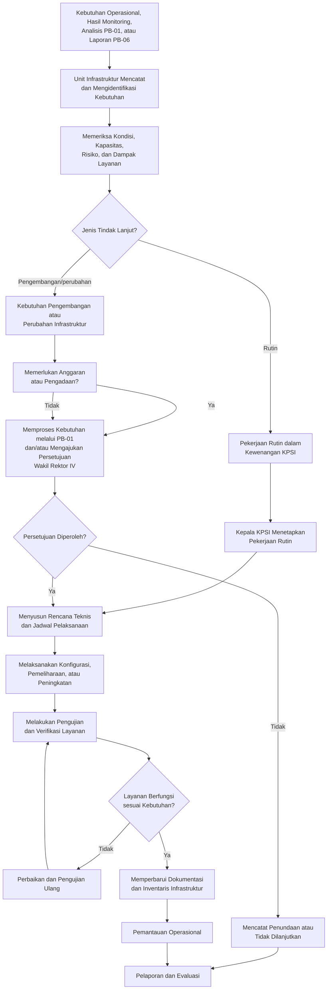

# PB-03 – PENGELOLAAN INFRASTRUKTUR JARINGAN DAN SERVER

## 1. Identitas Dokumen

| Elemen | Keterangan |
|---|---|
| Kode Proses | PB-03 |
| Nama Proses | Pengelolaan Infrastruktur Jaringan dan Server |
| Kategori | Proses Utama |
| Penanggung Jawab Proses | Kepala Kantor Pusat Sistem Informasi |
| Unit Utama | Unit Infrastruktur Jaringan dan Server |
| Unit Pendukung | Unit Pengembangan Aplikasi dan Integrasi Sistem, Unit Analisis Sistem (sesuai kebutuhan) |
| Versi | 1.2 |
| Status | Draft untuk pembahasan dan validasi |

## 2. Tujuan

Proses ini bertujuan memastikan infrastruktur jaringan dan server universitas tersedia, berfungsi, aman dari sisi teknis, terpelihara, dan mampu mendukung layanan teknologi informasi universitas secara berkelanjutan.

## 3. Ruang Lingkup

PB-03 mencakup pengelolaan infrastruktur TI terpusat yang menjadi tanggung jawab KPSI, antara lain:

1. Jaringan komputer dan konektivitas antarlokasi yang dikelola secara terpusat.
2. Perangkat jaringan inti, seperti router, switch inti, firewall, access point terpusat, dan perangkat pendukung lainnya.
3. Server fisik maupun virtual, sistem operasi server, virtualisasi, dan layanan komputasi.
4. Penyimpanan data dan sumber daya komputasi yang dikelola KPSI.
5. Konektivitas internet dan hubungan dengan penyedia layanan jaringan.
6. Hosting dan lingkungan infrastruktur untuk aplikasi serta website universitas.
7. Pemantauan kapasitas, ketersediaan, dan kinerja infrastruktur.
8. Pemeliharaan, perubahan konfigurasi, peningkatan kapasitas, dan pemulihan infrastruktur.
9. Dokumentasi konfigurasi, inventaris, topologi, dan informasi teknis infrastruktur.
10. Perencanaan, supervisi, dan verifikasi pekerjaan jaringan Layer 1–2 yang dilaksanakan pihak ketiga.
11. Pengelolaan teknis jaringan mulai Layer 3 (Network) dan lapisan di atasnya oleh KPSI.

### Batasan tanggung jawab

- PB-03 berfokus pada infrastruktur terpusat yang dikelola KPSI.
- Laboratorium komputer, komputer pengguna, printer, perangkat lokal, dan fasilitas TI yang dikelola fakultas, program studi, biro, lembaga, atau unit lain tetap menjadi tanggung jawab unit masing-masing.
- KPSI dapat memberikan konsultasi, rekomendasi, atau bantuan teknis terhadap fasilitas TI milik unit lain apabila diminta atau ditugaskan sesuai kewenangan.
- Gangguan layanan infrastruktur yang sedang terjadi ditangani melalui PB-06 – Penanganan Gangguan dan Insiden TI, dengan koordinasi teknis Unit Infrastruktur Jaringan dan Server.
- Kebutuhan baru atau peningkatan infrastruktur yang memerlukan kajian dan perencanaan formal terlebih dahulu diproses melalui PB-01.
- Pekerjaan yang memerlukan anggaran atau pengadaan wajib memperoleh persetujuan akhir Wakil Rektor IV.
- Untuk pembangunan atau penataan jaringan, pekerjaan fisik dan teknis Layer 1–2 dapat dilaksanakan pihak ketiga. KPSI tetap bertanggung jawab atas analisis kebutuhan, penetapan kebutuhan teknis, supervisi, verifikasi, dan penerimaan hasil pekerjaan. Pengelolaan jaringan mulai Layer 3 (Network) dan lapisan di atasnya menjadi tanggung jawab KPSI.

PB-03 juga mengatur koordinasi infrastruktur dan konektivitas yang digunakan untuk mengakses layanan TI pihak ketiga atau SaaS. Infrastruktur internal penyedia SaaS, termasuk server aplikasi, penyimpanan, jaringan data center, dan basis data yang dikelola penyedia, bukan objek pengelolaan operasional langsung KPSI. KPSI bertanggung jawab atas konektivitas dari lingkungan universitas, pemantauan aspek yang dapat diakses, serta koordinasi teknis dengan penyedia sesuai kontrak dan kewenangannya.

## 4. Pihak yang Terlibat dan Tanggung Jawab

| Pihak | Tanggung Jawab |
|---|---|
| Wakil Rektor IV | Memberikan arahan atau keputusan atas kebutuhan infrastruktur yang memerlukan keputusan pimpinan serta memberikan persetujuan akhir untuk pekerjaan yang membutuhkan anggaran atau pengadaan. |
| Kepala KPSI | Mengendalikan pengelolaan infrastruktur, menetapkan prioritas dan penugasan teknis, memutuskan pekerjaan rutin dalam batas kewenangannya, memantau layanan, serta melaporkan masalah atau kebutuhan strategis kepada Wakil Rektor IV. |
| Unit Infrastruktur Jaringan dan Server | Mengelola, memantau, mengonfigurasi, memelihara, mengamankan, dan mendokumentasikan jaringan, server, penyimpanan, konektivitas, serta infrastruktur terpusat lainnya. |
| Unit Pengembangan Aplikasi dan Integrasi Sistem | Berkoordinasi terkait kebutuhan server, basis data, lingkungan aplikasi, deployment, integrasi, dan kebutuhan teknis aplikasi. |
| Unit Analisis Sistem | Membantu analisis kebutuhan kapasitas atau infrastruktur apabila berkaitan dengan kebutuhan sistem dan proses bisnis. |
| Unit Pemilik Layanan | Menyampaikan kebutuhan layanan, jadwal kegiatan yang berdampak pada infrastruktur, serta informasi gangguan atau perubahan kebutuhan layanan. |
| Penyedia Layanan TI | Menyediakan layanan internet, data center, cloud, perangkat, atau dukungan teknis sesuai kontrak dan ruang lingkup kerja sama. Untuk layanan SaaS, penyedia bertanggung jawab atas infrastruktur platform yang dikelolanya, sesuai kontrak dan tingkat layanan yang disepakati. |
| Pihak Ketiga Pekerjaan Jaringan Layer 1–2 | Melaksanakan pekerjaan fisik dan teknis jaringan pada Layer 1 (Physical) dan Layer 2 (Data Link), seperti penarikan dan terminasi kabel, pemasangan perangkat, koneksi fisik, serta konfigurasi/perapihan switching sesuai desain dan spesifikasi yang ditetapkan atau disetujui KPSI. Pekerjaan berada di bawah supervisi dan verifikasi KPSI. |

## 5. Masukan Proses

Masukan PB-03 dapat berasal dari:

1. Rencana kerja dan kebutuhan infrastruktur universitas.
2. Hasil analisis kebutuhan infrastruktur dari PB-01.
3. Hasil pemantauan kinerja, kapasitas, dan ketersediaan jaringan/server.
4. Laporan gangguan atau insiden dari PB-06.
5. Kebutuhan teknis dari aplikasi, website, dan layanan e-learning.
6. Informasi pemeliharaan atau perubahan layanan dari penyedia eksternal, termasuk pemberitahuan gangguan atau pemeliharaan layanan SaaS.
7. Hasil evaluasi, audit teknis, atau pemeriksaan keamanan infrastruktur.
8. Perubahan kebutuhan pengguna dan layanan universitas.
9. Informasi konektivitas, persyaratan akses, atau kebutuhan teknis untuk menggunakan layanan SaaS.

## 6. Diagram Alur Proses

**Catatan diagram:** kebutuhan pengembangan atau perubahan infrastruktur yang memerlukan kajian formal diproses melalui PB-01. Jika pekerjaan memerlukan anggaran atau pengadaan, persetujuan akhir Wakil Rektor IV wajib diperoleh sebelum komitmen biaya atau pengadaan dilakukan. Pekerjaan rutin tanpa kebutuhan anggaran/pengadaan dapat diputuskan Kepala KPSI dalam batas kewenangannya.

## 7. Tahapan Pelaksanaan Proses

| No. | Tahapan | Pelaksana/Penanggung Jawab | Uraian Kegiatan | Keluaran |
|---|---|---|---|---|
| 1 | Identifikasi kebutuhan atau kondisi | Unit Infrastruktur Jaringan dan Server | Mengidentifikasi kebutuhan dari rencana kerja, hasil monitoring, permintaan yang telah diproses, perubahan layanan, atau laporan gangguan. | Catatan kebutuhan/kondisi infrastruktur |
| 2 | Pencatatan dan klasifikasi | Unit Infrastruktur Jaringan dan Server | Mencatat kebutuhan atau kondisi dan mengelompokkannya sebagai pekerjaan rutin, pemeliharaan, penanganan gangguan, atau kebutuhan pengembangan/perubahan. | Catatan dan klasifikasi pekerjaan |
| 3 | Pemeriksaan kondisi teknis | Unit Infrastruktur Jaringan dan Server | Memeriksa kondisi perangkat, konfigurasi, kapasitas, kinerja, ketersediaan, ketergantungan layanan, dan risiko terhadap layanan universitas. | Hasil pemeriksaan teknis |
| 4 | Penentuan tindak lanjut | Kepala KPSI bersama Unit Infrastruktur Jaringan dan Server | Menentukan apakah pekerjaan dapat ditangani sebagai pekerjaan rutin, harus dikoordinasikan dengan proses PB-01, atau perlu ditangani sebagai insiden melalui PB-06. | Keputusan jalur tindak lanjut |
| 5 | Persetujuan pekerjaan | Kepala KPSI atau Wakil Rektor IV sesuai kewenangan | Kepala KPSI dapat memutuskan pekerjaan rutin yang tidak memerlukan anggaran atau pengadaan. Pekerjaan yang memerlukan anggaran atau pengadaan wajib memperoleh persetujuan akhir Wakil Rektor IV. Kebutuhan pengembangan formal mengikuti PB-01. | Keputusan atau persetujuan pekerjaan |
| 6 | Perencanaan teknis | Unit Infrastruktur Jaringan dan Server | Menyusun langkah kerja, kebutuhan personel, jadwal, risiko, dampak layanan, rencana komunikasi, dan rencana pemulihan apabila perubahan gagal. | Rencana teknis pelaksanaan |
| 7 | Koordinasi pelaksanaan | Kepala KPSI dan Unit Infrastruktur Jaringan dan Server | Menginformasikan jadwal dan potensi dampak kepada unit terkait. Apabila pekerjaan Layer 1–2 dilaksanakan pihak ketiga, KPSI menetapkan ruang lingkup, spesifikasi, jadwal, akses kerja, mekanisme supervisi, dan kriteria pemeriksaan hasil. | Kesepakatan jadwal dan rencana supervisi |
| 8 | Pelaksanaan pekerjaan | Unit Infrastruktur Jaringan dan Server dan/atau pihak ketiga sesuai pembagian Layer 1–2 dan Layer 3 ke atas | Pihak ketiga dapat melaksanakan pekerjaan fisik dan teknis jaringan Layer 1–2 sesuai spesifikasi KPSI. KPSI melaksanakan pengelolaan dan konfigurasi jaringan mulai Layer 3 (Network) dan lapisan di atasnya. KPSI melakukan supervisi atas pekerjaan pihak ketiga dan memastikan hasilnya sesuai desain serta standar teknis universitas. | Infrastruktur yang telah dibangun atau ditangani |
| 9 | Pengujian dan verifikasi | Unit Infrastruktur Jaringan dan Server bersama unit terkait; pihak ketiga apabila diperlukan | Memeriksa hasil pekerjaan Layer 1–2, termasuk kualitas instalasi fisik, terminasi, konektivitas, switching, dan kesesuaian dengan spesifikasi. KPSI melakukan pengujian jaringan Layer 3 dan lapisan di atasnya, serta memverifikasi konektivitas layanan secara menyeluruh. | Hasil pengujian/verifikasi dan berita acara pemeriksaan apabila diperlukan |
| 10 | Penanganan temuan | Unit Infrastruktur Jaringan dan Server | Memperbaiki masalah yang ditemukan dan mengulang pengujian sampai layanan memenuhi kriteria teknis yang ditetapkan. Jika terjadi gangguan operasional, koordinasikan penanganannya melalui PB-06. | Catatan perbaikan dan hasil pengujian ulang |
| 11 | Pembaruan dokumentasi | Unit Infrastruktur Jaringan dan Server | Memperbarui topologi, inventaris, konfigurasi, alamat jaringan, informasi server, kapasitas, dan catatan perubahan yang relevan. | Dokumentasi dan inventaris terkini |
| 12 | Pemantauan operasional | Unit Infrastruktur Jaringan dan Server | Memantau kondisi infrastruktur setelah pekerjaan, termasuk ketersediaan, kinerja, kapasitas, dan indikasi gangguan. | Catatan pemantauan |
| 13 | Pelaporan dan evaluasi | Kepala KPSI bersama Unit Infrastruktur Jaringan dan Server | Mengevaluasi hasil pekerjaan, kendala, kebutuhan tindak lanjut, serta menyampaikan laporan sesuai mekanisme pengendalian KPSI. | Laporan dan rekomendasi tindak lanjut |

## 8. Ketentuan Pengelolaan Infrastruktur

### 8.1 Pengelolaan rutin

1. Unit Infrastruktur Jaringan dan Server melaksanakan pemantauan dan pemeliharaan rutin terhadap infrastruktur terpusat.
2. Kepala KPSI dapat menetapkan pekerjaan rutin tanpa meminta persetujuan Wakil Rektor IV sepanjang pekerjaan tersebut berada dalam kewenangan KPSI dan tidak memerlukan anggaran atau pengadaan.
3. Pekerjaan rutin harus dicatat, termasuk waktu pelaksanaan, komponen yang ditangani, hasil, dan dampak terhadap layanan.
4. Pemeliharaan yang berpotensi mengganggu layanan harus dijadwalkan dan diinformasikan kepada unit terkait.

### 8.2 Pengembangan dan perubahan infrastruktur

1. Kebutuhan pengembangan atau perubahan infrastruktur yang bersifat formal, berdampak luas, atau memerlukan analisis kebutuhan diproses melalui PB-01.
2. Perubahan teknis rutin yang masih berada dalam kewenangan KPSI dapat ditetapkan Kepala KPSI.
3. Perubahan yang memerlukan anggaran atau pengadaan wajib memperoleh persetujuan akhir Wakil Rektor IV.
4. Perubahan konfigurasi harus mempertimbangkan dampak terhadap layanan lain, keamanan, kapasitas, dan keberlangsungan operasional.
5. Perubahan yang telah dilakukan harus dicatat dalam dokumentasi infrastruktur.

### 8.3 Pengelolaan server dan layanan

1. Unit Infrastruktur Jaringan dan Server mengelola sumber daya server dan lingkungan infrastruktur terpusat sesuai kebutuhan layanan universitas.
2. Akses administratif ke server dibatasi kepada personel yang diberi kewenangan.
3. Penggunaan sumber daya server harus memperhatikan kapasitas, keamanan, dan kebutuhan layanan.
4. Perubahan yang berdampak pada aplikasi atau basis data dikoordinasikan dengan Unit Pengembangan Aplikasi dan Integrasi Sistem.
5. Pengelolaan aplikasi pada tingkat fungsi dan proses bisnis tetap menjadi tanggung jawab unit pemilik proses bersama unit KPSI yang relevan.

### 8.4 Pemantauan dan ketersediaan

Pemantauan infrastruktur sekurang-kurangnya memperhatikan:

- Ketersediaan koneksi jaringan dan internet.
- Ketersediaan server dan layanan utama.
- Penggunaan CPU, memori, penyimpanan, dan kapasitas jaringan.
- Kondisi perangkat jaringan dan server.
- Indikasi gangguan, kegagalan, atau akses yang tidak wajar.
- Kebutuhan peningkatan kapasitas.

### 8.5 Gangguan dan insiden

1. Gangguan yang sedang terjadi ditangani melalui PB-06.
2. Unit Infrastruktur Jaringan dan Server menjadi pelaksana teknis untuk insiden yang berkaitan dengan jaringan, server, dan infrastruktur.
3. Insiden besar yang berdampak pada layanan utama atau memerlukan keputusan pimpinan dilaporkan Kepala KPSI kepada Wakil Rektor IV.
4. Hasil penanganan insiden dapat menjadi masukan untuk pemeliharaan, peningkatan kapasitas, atau kebutuhan pengembangan melalui PB-01.

### 8.6 Pelaksanaan pekerjaan jaringan oleh pihak ketiga

Dalam pembangunan atau penataan jaringan, KPSI dapat menggunakan pihak ketiga untuk melaksanakan pekerjaan pada Layer 1 dan Layer 2 OSI, sedangkan pengelolaan jaringan mulai Layer 3 dan lapisan di atasnya dilaksanakan oleh KPSI.

Pembagian tanggung jawab secara umum:

| Lapisan | Contoh ruang lingkup pekerjaan | Pelaksana utama | Peran KPSI |
|---|---|---|---|
| Layer 1 – Physical | Penarikan kabel UTP/fiber optik, pemasangan jalur kabel, ducting/tray, patch panel, konektor, terminasi, labeling, pemasangan fisik perangkat, dan pengujian media fisik | Pihak ketiga | Menentukan kebutuhan, spesifikasi, jalur/rencana konektivitas, mengawasi pekerjaan, memeriksa kualitas instalasi, dan menerima hasil |
| Layer 2 – Data Link | Pemasangan dan koneksi perangkat switching, patching port, konfigurasi switching dasar sesuai desain, serta pengujian konektivitas Layer 2 | Pihak ketiga sesuai penugasan | Menetapkan atau menyetujui desain dan standar Layer 2, mengawasi konfigurasi, memeriksa VLAN/trunking/port sesuai rancangan, dan memverifikasi hasil |
| Layer 3 – Network | Pengalamatan IP, subnetting, routing, gateway, inter-VLAN routing, dan pengaturan konektivitas ant jaringan | KPSI | Melaksanakan dan mengendalikan konfigurasi serta operasional jaringan |
| Layer 4–7 | Pengelolaan layanan jaringan dan transport, firewall policy, DNS, DHCP, VPN, autentikasi jaringan, monitoring, serta layanan pendukung lainnya sesuai arsitektur universitas | KPSI | Melaksanakan, mengelola, memantau, dan mengamankan layanan sesuai kewenangan |

**Catatan penerapan batas lapisan:**

1. Tabel di atas merupakan pembagian tanggung jawab operasional, bukan pembatasan bahwa pihak ketiga tidak boleh memberikan rekomendasi teknis di luar Layer 1–2.
2. Pihak ketiga dapat memberikan rekomendasi atau membantu pengujian lintas lapisan apabila diminta, tetapi perubahan konfigurasi Layer 3 ke atas harus berada dalam kendali dan persetujuan teknis KPSI.
3. Untuk perangkat yang memiliki fungsi lintas lapisan, seperti switch Layer 3, firewall, atau access point/controller, pembagian pekerjaan ditetapkan secara spesifik dalam desain dan ruang lingkup kerja.
4. KPSI tetap menjadi pemilik desain teknis jaringan universitas dan penentu standar konfigurasi, termasuk untuk pekerjaan yang dilaksanakan pihak ketiga.
5. Pihak ketiga wajib menyerahkan dokumentasi hasil pekerjaan, hasil pengujian, konfigurasi yang menjadi ruang lingkupnya, label dan pemetaan port, serta informasi teknis lain yang diperlukan KPSI.
6. Pekerjaan yang menggunakan anggaran atau pengadaan wajib memperoleh persetujuan akhir Wakil Rektor IV dan mengikuti ketentuan universitas.

### 8.7 Infrastruktur Layanan SaaS dan Pihak Ketiga

1. Infrastruktur internal yang digunakan penyedia SaaS untuk menjalankan platform, termasuk server aplikasi, jaringan data center, penyimpanan, dan basis data yang dikelola penyedia, menjadi tanggung jawab penyedia sesuai kontrak dan tingkat layanan yang disepakati.
2. KPSI tidak melakukan pengelolaan langsung terhadap infrastruktur internal penyedia SaaS, kecuali terdapat pengaturan khusus dalam kontrak atau penugasan resmi.
3. KPSI bertanggung jawab memastikan konektivitas dari jaringan universitas menuju layanan SaaS berjalan dengan baik, sepanjang berada dalam kendali infrastruktur universitas.
4. Apabila layanan SaaS tidak dapat diakses, KPSI melakukan pemeriksaan awal dari sisi jaringan dan konektivitas universitas untuk membedakan kemungkinan gangguan lokal dengan gangguan pada layanan penyedia.
5. Gangguan yang diduga berasal dari platform atau infrastruktur penyedia dikoordinasikan KPSI dengan penyedia melalui kanal dukungan yang disepakati. KPSI mencatat laporan, dampak, waktu kejadian, respons penyedia, dan tindak lanjutnya.
6. KPSI memantau informasi ketersediaan layanan, pemberitahuan pemeliharaan, atau status layanan yang disediakan vendor, sejauh fasilitas tersebut tersedia.
7. Pengelolaan backup, pemulihan, keamanan, dan ketersediaan infrastruktur internal SaaS mengikuti tanggung jawab penyedia sebagaimana diatur dalam kontrak. KPSI memastikan aspek tersebut diperhatikan dalam koordinasi dan evaluasi layanan, tanpa mengklaim melakukan operasi langsung atas infrastruktur penyedia.
8. Jika universitas menggunakan layanan cloud atau hosting yang dikelola sendiri atau secara khusus dikontrak dan diadministrasikan oleh KPSI, pengelolaannya tetap mengikuti ruang lingkup dan kewenangan yang ditetapkan dalam kontrak atau penugasan tersebut.

## 9. Batas Tanggung Jawab Infrastruktur

| Objek/Layanan | Penanggung Jawab Utama | Peran KPSI |
|---|---|---|
| Jaringan inti dan konektivitas terpusat universitas | KPSI | Mengelola dan memelihara secara teknis |
| Server dan penyimpanan terpusat yang dikelola KPSI | KPSI | Mengelola, memantau, dan memelihara |
| Infrastruktur hosting website dan aplikasi yang dikelola KPSI | KPSI | Mengelola infrastruktur dan layanan teknis |
| Koneksi internet universitas yang dikelola secara terpusat | KPSI | Mengelola hubungan teknis dan koordinasi penyedia |
| Infrastruktur internal platform SaaS yang dikelola penyedia | Penyedia SaaS | Melakukan pemeriksaan konektivitas dari sisi universitas dan berkoordinasi dengan penyedia jika terjadi gangguan |
| Ketersediaan dan dukungan layanan SaaS sesuai kontrak | Penyedia SaaS | Memantau informasi layanan, menyampaikan laporan gangguan, mengoordinasikan eskalasi, dan mengevaluasi tindak lanjut penyedia |
| Laboratorium komputer milik fakultas/unit | Fakultas/unit pemilik | Memberikan bantuan atau konsultasi apabila diminta |
| Komputer, printer, dan perangkat pengguna di unit kerja | Unit kerja masing-masing | Memberikan konsultasi atau bantuan sesuai permintaan dan kapasitas |
| Perangkat jaringan lokal yang dikelola fakultas/unit | Fakultas/unit pemilik | Memberikan rekomendasi atau bantuan teknis apabila diminta |
| Aturan penggunaan layanan dan data pada aplikasi | Unit pemilik proses | Mengelola aspek teknis sistem yang mendukung aturan tersebut |

## 10. Keluaran Proses

Keluaran PB-03 meliputi:

1. Catatan kebutuhan dan kondisi infrastruktur.
2. Hasil pemeriksaan teknis dan kapasitas.
3. Keputusan atau persetujuan pekerjaan.
4. Rencana teknis dan jadwal pelaksanaan.
5. Infrastruktur yang telah dipelihara, dikonfigurasi, atau ditingkatkan.
6. Hasil pengujian dan verifikasi layanan.
7. Catatan perubahan konfigurasi.
8. Dokumentasi topologi dan inventaris infrastruktur yang diperbarui.
9. Catatan pemantauan operasional.
10. Laporan pekerjaan dan rekomendasi tindak lanjut.
11. Catatan pemeriksaan konektivitas dan koordinasi gangguan dengan penyedia layanan eksternal/SaaS apabila relevan.
12. Dokumen hasil pekerjaan pihak ketiga, termasuk hasil pengujian, pemetaan kabel/port, konfigurasi Layer 2 sesuai ruang lingkup, dan berita acara pemeriksaan apabila digunakan.

## 11. Hubungan dengan Proses Bisnis Lain

| Proses | Hubungan |
|---|---|
| PB-01 – Pengelolaan Permintaan dan Analisis Kebutuhan TI | Menjadi jalur analisis formal untuk kebutuhan atau pengembangan infrastruktur baru. |
| PB-02 – Pengembangan dan Integrasi Aplikasi | Berkoordinasi dalam penyediaan server, jaringan, penyimpanan, dan lingkungan aplikasi. |
| PB-04 – Pengelolaan Website Universitas dan Unit Kerja | Menyediakan dan mengelola infrastruktur hosting serta konektivitas website yang dikelola KPSI. |
| PB-05 – Pengelolaan Layanan E-Learning | Menyediakan dukungan infrastruktur dan konektivitas universitas untuk mengakses layanan pembelajaran digital, termasuk LMS pada platform SaaS. Infrastruktur internal penyedia tetap menjadi tanggung jawab penyedia. |
| PB-06 – Penanganan Gangguan dan Insiden TI | Menjadi jalur penanganan gangguan jaringan, server, dan infrastruktur. |
| PM-03 – Monitoring dan Pengendalian | Menjadi bagian dari pemantauan kinerja dan kondisi layanan TI. |
| PP-01 – Dokumentasi dan Inventaris TI | Menyimpan informasi inventaris, topologi, konfigurasi, dan perubahan infrastruktur. |
| PP-02 – Keamanan, Backup, dan Pemulihan | Berkoordinasi dalam pengamanan infrastruktur, pencadangan, dan pemulihan layanan. |

## 12. Dokumen dan Formulir Terkait

Dokumen/formulir yang dapat digunakan untuk mendukung PB-03:

1. Daftar inventaris perangkat jaringan dan server.
2. Dokumentasi topologi jaringan.
3. Daftar server, layanan, dan kapasitas.
4. Catatan pemantauan infrastruktur.
5. Jadwal pemeliharaan.
6. Formulir/catatan perubahan konfigurasi.
7. Rencana pelaksanaan dan pemulihan perubahan.
8. Hasil pengujian dan verifikasi.
9. Catatan gangguan yang terhubung dengan PB-06.
10. Laporan kondisi dan kebutuhan infrastruktur.
11. Dokumen spesifikasi pekerjaan, supervisi, pemeriksaan, dan serah terima pihak ketiga untuk pekerjaan Layer 1–2.
12. Catatan gangguan, eskalasi, pemberitahuan pemeliharaan, dan komunikasi teknis dengan penyedia SaaS atau layanan eksternal.

Format dokumen dan formulir ditetapkan lebih lanjut melalui penyusunan SOP dan kebutuhan operasional KPSI.

## 13. Indikator Pemantauan

| No. | Indikator | Tujuan Pemantauan |
|---|---|---|
| 1 | Ketersediaan layanan jaringan dan server utama | Memantau kontinuitas layanan |
| 2 | Jumlah gangguan infrastruktur | Mengetahui tingkat gangguan dan kebutuhan perbaikan |
| 3 | Waktu penanganan gangguan infrastruktur | Memantau respons dan penyelesaian gangguan |
| 4 | Persentase pemeliharaan rutin yang terlaksana | Memastikan pemeliharaan berjalan |
| 5 | Persentase perubahan yang memiliki catatan dan dokumentasi | Menjaga keterlacakan perubahan |
| 6 | Kondisi penggunaan kapasitas server dan jaringan | Mengantisipasi kebutuhan peningkatan kapasitas |
| 7 | Jumlah insiden berulang pada komponen yang sama | Mengidentifikasi kebutuhan perbaikan permanen |

Target angka dan metode pengukuran ditetapkan kemudian sesuai kemampuan pemantauan dan prioritas universitas.

## 14. Catatan Pembahasan dan Validasi

Hal-hal berikut perlu divalidasi sebelum PB-03 ditetapkan:

1. Infrastruktur apa saja yang secara resmi termasuk infrastruktur terpusat yang dikelola KPSI?
2. Apakah KPSI mengelola seluruh access point kampus secara terpusat atau terdapat perangkat yang dikelola unit masing-masing?
3. Apakah terdapat jadwal pemeliharaan rutin yang perlu ditetapkan, misalnya bulanan atau triwulanan?
4. Apakah sudah tersedia sistem pemantauan jaringan/server dan pencatatan inventaris yang digunakan KPSI?
5. Bagaimana mekanisme koordinasi dan eskalasi dengan penyedia layanan internet, data center, atau cloud?
6. Apakah seluruh pekerjaan Layer 1–2, termasuk konfigurasi switching dasar, akan selalu dilaksanakan pihak ketiga, atau terdapat pekerjaan tertentu yang tetap dapat ditangani internal KPSI?
7. Untuk perangkat lintas lapisan seperti switch Layer 3, firewall, dan access point/controller, bagaimana pembagian pekerjaan teknis yang disepakati?
8. Apakah KPSI memiliki kanal dukungan dan kontak eskalasi resmi dengan penyedia SaaS untuk gangguan akses atau ketersediaan layanan?
9. Apakah terdapat SLA atau ketentuan kontrak yang mengatur ketersediaan, pemeliharaan, backup, pemulihan, dan pemberitahuan gangguan dari penyedia SaaS?

Validasi ini diperlukan agar batas pengelolaan KPSI dan unit lain sesuai kondisi infrastruktur universitas yang sebenarnya.

## 15. Penutup

PB-03 menjadi pedoman pengelolaan infrastruktur jaringan dan server yang menjadi tanggung jawab KPSI, termasuk batas koordinasi teknis ketika universitas menggunakan layanan SaaS atau infrastruktur pihak ketiga. Pelaksanaan proses harus menjaga ketersediaan layanan, memperhatikan keamanan dan kapasitas, mencatat setiap perubahan, serta memastikan kebutuhan pengembangan dan pengadaan mengikuti kewenangan yang berlaku di universitas.
