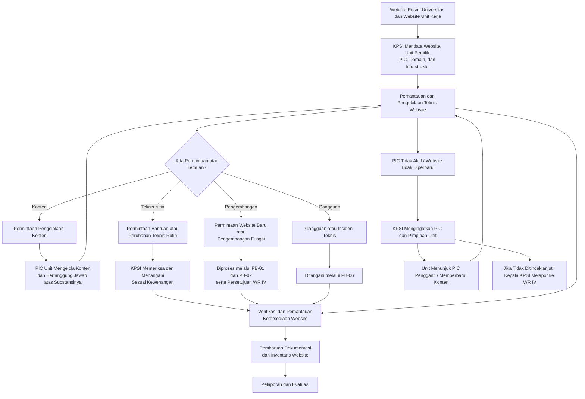

# PB-04 – PENGELOLAAN WEBSITE UNIVERSITAS DAN UNIT KERJA

## 1. Identitas Dokumen

| Elemen | Keterangan |
|---|---|
| Kode Proses | PB-04 |
| Nama Proses | Pengelolaan Website Universitas dan Unit Kerja |
| Kategori | Proses Utama |
| Penanggung Jawab Proses | Kepala Kantor Pusat Sistem Informasi |
| Unit Utama | Unit Pengembangan Aplikasi dan Integrasi Sistem |
| Unit Pendukung | Unit Infrastruktur Jaringan dan Server, Unit Analisis Sistem (sesuai kebutuhan) |
| Versi | 1.1 |
| Status | Draft untuk pembahasan dan validasi |

## 2. Tujuan

Proses ini bertujuan memastikan website resmi universitas dan unit kerja dikelola secara teknis dengan baik, tersedia, aman, terpelihara, serta mendukung penyampaian informasi dan layanan universitas.

Proses ini juga memperjelas pembagian tanggung jawab antara KPSI sebagai pengelola teknis website dan unit pemilik website sebagai penanggung jawab konten serta kebenaran informasi yang dipublikasikan.

## 3. Ruang Lingkup

PB-04 mencakup pengelolaan teknis website resmi universitas dan website unit kerja yang termasuk dalam lingkup layanan KPSI, antara lain:

1. Pengelolaan domain dan subdomain website universitas serta unit kerja.
2. Pengelolaan DNS, hosting, server, sertifikat SSL/TLS, dan komponen infrastruktur website.
3. Penyediaan, konfigurasi, pembaruan, dan pemeliharaan platform website.
4. Pengelolaan akun administrator teknis dan pengaturan hak akses sesuai kewenangan.
5. Pemantauan ketersediaan, kinerja, dan keamanan teknis website.
6. Pemeliharaan, pencadangan, pemulihan, dan penanganan masalah teknis website.
7. Penerapan standar teknis website universitas.
8. Pendampingan teknis kepada unit pemilik website.
9. Koordinasi pengelolaan konten dengan unit pemilik website.
10. Pengembangan atau perubahan website melalui mekanisme PB-01 dan PB-02 apabila perubahan tersebut termasuk pengembangan aplikasi atau sistem.

### Batas tanggung jawab

- KPSI bertanggung jawab atas pengelolaan teknis website, termasuk domain, DNS, hosting, server, platform, keamanan teknis, pemeliharaan, dan standar teknis.
- Unit pemilik website bertanggung jawab atas isi dan substansi konten, termasuk berita, pengumuman, informasi layanan, dokumen, data, serta kebenaran dan kelayakan informasi yang dipublikasikan.
- Setiap unit pemilik website wajib menunjuk satu PIC utama untuk pengelolaan konten dan koordinasi dengan KPSI. Unit dapat menunjuk pengelola tambahan sesuai kebutuhan.
- Unit pemilik website memiliki kewenangan mengelola dan mempublikasikan konten melalui CMS sesuai ketentuan internal unit.
- KPSI dapat memberikan panduan, pelatihan, konsultasi, dan bantuan teknis kepada PIC website.
- Jika PIC tidak aktif atau website tidak dikelola, tanggung jawab konten tetap berada pada unit pemilik website. KPSI melakukan pengingat dan eskalasi kepada pimpinan unit, bukan mengambil alih pengelolaan konten.
- KPSI tidak bertanggung jawab melakukan penulisan, pemeriksaan substansi, atau pembaruan rutin konten setiap unit, kecuali terdapat penugasan khusus yang disepakati.
- Pengembangan website baru, penambahan fungsi, atau perubahan sistem yang bersifat pengembangan mengikuti PB-01 dan PB-02.
- Gangguan teknis website ditangani melalui PB-06 dengan dukungan unit KPSI yang relevan.
- Pekerjaan yang memerlukan anggaran atau pengadaan wajib memperoleh persetujuan akhir Wakil Rektor IV.

## 4. Pihak yang Terlibat dan Tanggung Jawab

| Pihak | Tanggung Jawab |
|---|---|
| Wakil Rektor IV | Memberikan arahan atau keputusan atas kebutuhan website yang memerlukan keputusan pimpinan serta memberikan persetujuan pengembangan aplikasi/website dan persetujuan akhir apabila pekerjaan memerlukan anggaran atau pengadaan. |
| Kepala KPSI | Mengendalikan pengelolaan teknis website universitas dan unit kerja, menetapkan prioritas dan penugasan, memastikan standar teknis diterapkan, serta melaporkan masalah atau kebutuhan strategis kepada Wakil Rektor IV. |
| Unit Pengembangan Aplikasi dan Integrasi Sistem | Mengelola platform website, konfigurasi aplikasi/CMS, tema atau komponen teknis, akun administrator teknis, pemeliharaan aplikasi, serta dukungan teknis website. |
| Unit Infrastruktur Jaringan dan Server | Mengelola domain dan DNS dari sisi teknis, hosting, server, sertifikat SSL/TLS, pencadangan infrastruktur, ketersediaan, dan pemantauan layanan hosting. |
| Unit Analisis Sistem | Membantu analisis kebutuhan apabila terdapat permintaan pengembangan fungsi atau perubahan website yang memerlukan kajian sistem. |
| Unit Pemilik Website | Bertanggung jawab atas tujuan, informasi, konten, dan substansi website unit; menunjuk PIC; memastikan konten yang dipublikasikan benar, mutakhir, dan sesuai ketentuan universitas. |
| PIC Website Unit | Menjadi narahubung resmi unit dengan KPSI, mengelola konten sesuai kewenangan yang diberikan unit, menjaga akun yang digunakan, serta menyampaikan kebutuhan dan gangguan teknis kepada KPSI. |
| Pihak Ketiga | Melaksanakan pekerjaan teknis website apabila ditugaskan, seperti desain, pengembangan, migrasi, atau dukungan khusus, di bawah pengendalian dan supervisi KPSI. |

## 5. Masukan Proses

Masukan PB-04 dapat berasal dari:

1. Daftar website resmi universitas dan unit kerja.
2. Penetapan unit pemilik website dan PIC website.
3. Permintaan pembuatan website atau subdomain baru.
4. Permintaan perubahan atau pengembangan website.
5. Permintaan perubahan domain, DNS, hosting, atau konfigurasi teknis.
6. Hasil pemantauan ketersediaan, kinerja, dan keamanan website.
7. Laporan gangguan atau insiden dari PB-06.
8. Permintaan bantuan atau konsultasi teknis dari unit pemilik website.
9. Hasil evaluasi teknis dan kebutuhan pembaruan platform.

## 6. Diagram Alur Proses

## 7. Tahapan Pelaksanaan Proses

| No. | Tahapan | Pelaksana/Penanggung Jawab | Uraian Kegiatan | Keluaran |
|---|---|---|---|---|
| 1 | Pendataan website | Unit Pengembangan Aplikasi dan Integrasi Sistem bersama Unit Infrastruktur Jaringan dan Server | Mendata website resmi universitas dan unit kerja yang masuk dalam lingkup pengelolaan KPSI, termasuk nama website, domain/subdomain, platform, hosting, unit pemilik, dan PIC. | Daftar inventaris website |
| 2 | Penetapan unit pemilik dan PIC | Unit pemilik website, dikoordinasikan Kepala KPSI | Setiap unit pemilik website menunjuk PIC sebagai narahubung pengelolaan website dan konten unit. Informasi PIC disampaikan kepada KPSI. | Daftar unit pemilik dan PIC website |
| 3 | Pengelolaan infrastruktur website | Unit Infrastruktur Jaringan dan Server | Mengelola domain, DNS, hosting, server, sertifikat SSL/TLS, kapasitas, dan ketersediaan infrastruktur website. | Infrastruktur website tersedia |
| 4 | Pengelolaan platform website | Unit Pengembangan Aplikasi dan Integrasi Sistem | Mengelola platform/CMS, konfigurasi teknis, pembaruan komponen, tema atau plugin yang digunakan, dan akun administrator teknis. | Platform website terkelola |
| 5 | Pengelolaan konten | PIC website dan unit pemilik website | Menyiapkan, memeriksa, memperbarui, dan mempublikasikan konten sesuai kewenangan unit. Unit pemilik bertanggung jawab atas kebenaran, kelengkapan, kemutakhiran, dan kelayakan substansi konten. | Konten website terbarui |
| 6 | Pemantauan website | Unit Pengembangan Aplikasi dan Integrasi Sistem bersama Unit Infrastruktur Jaringan dan Server | Memantau ketersediaan website, kinerja, kapasitas, sertifikat, pembaruan platform, dan indikasi masalah keamanan teknis. | Catatan pemantauan website |
| 7 | Penerimaan permintaan teknis | KPSI | Menerima permintaan teknis dari PIC website, mencatat, mengklasifikasikan, dan menentukan unit KPSI yang menangani. | Catatan permintaan teknis |
| 8 | Penanganan teknis rutin | Unit KPSI terkait | Menangani pekerjaan teknis rutin, seperti perubahan konfigurasi, bantuan akses, pembaruan komponen rutin, dan pemulihan teknis sederhana sesuai kewenangan. | Permintaan teknis ditangani |
| 9 | Penanganan pengembangan website | Kepala KPSI dan unit terkait | Permintaan website baru, penambahan fungsi, atau perubahan yang bersifat pengembangan diarahkan melalui PB-01 dan PB-02. Pengembangan hanya dilaksanakan setelah memperoleh persetujuan Wakil Rektor IV. | Hasil analisis dan persetujuan pengembangan |
| 10 | Penanganan gangguan website | Unit KPSI terkait melalui PB-06 | Gangguan seperti website tidak dapat diakses, error aplikasi, masalah server, DNS, sertifikat, atau indikasi insiden keamanan dicatat dan ditangani melalui PB-06. | Catatan penanganan gangguan |
| 11 | Verifikasi hasil penanganan | Unit KPSI terkait bersama PIC website apabila diperlukan | Memastikan website atau fungsi teknis yang ditangani telah berjalan sesuai kebutuhan. Untuk perubahan konten, PIC/unit pemilik memeriksa substansi konten. | Hasil verifikasi |
| 12 | Pembaruan dokumentasi | Unit KPSI terkait | Memperbarui informasi domain, DNS, hosting, platform, konfigurasi, hak akses teknis, unit pemilik, PIC, dan catatan perubahan. | Dokumentasi dan inventaris terkini |
| 13 | Pelaporan dan evaluasi | Kepala KPSI bersama unit terkait | Mengevaluasi ketersediaan website, gangguan, kebutuhan pemeliharaan, kepatuhan standar teknis, dan kebutuhan pengembangan. | Laporan dan rekomendasi tindak lanjut |

## 8. Ketentuan Pengelolaan Website

### 8.1 Pengelolaan teknis oleh KPSI

1. KPSI mengelola aspek teknis website resmi universitas dan unit kerja yang termasuk dalam lingkup pengelolaannya.
2. Pengelolaan teknis mencakup domain, subdomain, DNS, hosting, server, sertifikat SSL/TLS, platform/CMS, pembaruan teknis, keamanan, pencadangan, dan pemantauan.
3. KPSI secara bertahap menyusun dan menetapkan standar teknis minimum untuk website resmi universitas dan unit kerja, termasuk standar platform/CMS, tampilan, keamanan, aksesibilitas, struktur teknis, dan pengelolaan akun. Sebelum standar ditetapkan, KPSI memberikan arahan teknis berdasarkan praktik yang berlaku dan kondisi layanan.
4. KPSI dapat memberikan panduan dan bantuan teknis kepada PIC website unit.
5. Perubahan teknis yang berpotensi mengganggu layanan harus direncanakan dan diinformasikan kepada unit pemilik website.

### 8.2 Pengelolaan konten oleh unit pemilik website

1. Unit pemilik website bertanggung jawab atas seluruh substansi informasi yang dipublikasikan melalui websitenya.
2. Unit pemilik website menunjuk PIC yang mengelola konten dan berkoordinasi dengan KPSI.
3. PIC memastikan konten yang dipublikasikan benar, relevan, mutakhir, dan sesuai ketentuan universitas.
4. KPSI tidak melakukan verifikasi substantif terhadap berita, pengumuman, kebijakan, data, atau informasi layanan yang dipublikasikan unit.
5. Jika ditemukan masalah teknis dalam proses publikasi, PIC dapat meminta bantuan KPSI.
6. Kewenangan persetujuan konten internal unit ditetapkan oleh pimpinan unit masing-masing.
7. Unit pemilik website wajib memastikan PIC tetap aktif dan melakukan pembaruan konten sesuai kebutuhan layanan unit.

### 8.3 Pembuatan website baru dan pengembangan fungsi

1. Permintaan pembuatan website baru, subdomain untuk layanan baru, penambahan fitur, atau perubahan fungsi yang bersifat pengembangan diproses melalui PB-01.
2. Pelaksanaan pengembangan mengikuti PB-02 dan wajib memperoleh persetujuan Wakil Rektor IV sebelum pekerjaan pengembangan dimulai.
3. KPSI menetapkan atau menyetujui standar teknis, arsitektur, platform, keamanan, dan integrasi website.
4. Pengembangan dapat dilaksanakan oleh personel internal KPSI atau pihak ketiga di bawah supervisi dan pengendalian KPSI.
5. Pekerjaan yang memerlukan anggaran atau pengadaan wajib memperoleh persetujuan akhir Wakil Rektor IV.

### 8.4 Akun dan hak akses

1. Akun administrator teknis dikelola oleh KPSI dan diberikan hanya kepada personel yang membutuhkan sesuai tugas.
2. Akun pengelola konten diberikan kepada PIC atau personel yang ditunjuk unit pemilik website sesuai kewenangannya.
3. Setiap unit bertanggung jawab atas penggunaan akun pengelola konten yang diberikan kepada personelnya.
4. Penggunaan akun bersama harus dihindari apabila platform mendukung akun individual.
5. Perubahan PIC atau personel pengelola konten harus diinformasikan kepada KPSI agar hak akses dapat diperbarui.
6. Akses pihak ketiga diberikan secara terbatas, sesuai kebutuhan pekerjaan, dan ditinjau atau dicabut setelah pekerjaan selesai.

### 8.5 Pemantauan, keamanan, dan pemulihan

1. KPSI memantau ketersediaan dan kondisi teknis website sesuai kapasitas sarana pemantauan.
2. KPSI melaksanakan pembaruan teknis dan pengamanan platform website sesuai kebutuhan dan risiko.
3. Pencadangan website dan basis data dilakukan sesuai kebijakan pencadangan KPSI.
4. Pemulihan website akibat gangguan teknis dilakukan oleh KPSI atau pihak yang ditugaskan di bawah kendali KPSI.
5. Apabila ditemukan indikasi peretasan, penyalahgunaan akses, atau kebocoran data, kejadian ditangani melalui mekanisme PB-06 dan dikoordinasikan dengan pihak berwenang di universitas.
6. Unit pemilik website membantu memberikan informasi dan melakukan tindak lanjut yang berkaitan dengan konten atau akun personel unit.

### 8.6 Pelaksanaan pekerjaan oleh pihak ketiga

1. KPSI dapat menggunakan pihak ketiga untuk pekerjaan desain, pengembangan, migrasi, audit teknis, atau dukungan khusus website apabila sumber daya internal tidak mencukupi.
2. Analisis kebutuhan, penetapan standar teknis, supervisi, verifikasi, dan pengendalian hasil pekerjaan tetap menjadi tanggung jawab KPSI.
3. Pelibatan pihak ketiga untuk pengembangan website mengikuti persetujuan Wakil Rektor IV sebagaimana diatur dalam PB-01 dan PB-02.
4. Pekerjaan yang memerlukan anggaran atau pengadaan wajib memperoleh persetujuan akhir Wakil Rektor IV.
5. Pihak ketiga wajib menyerahkan hasil pekerjaan, source code apabila relevan, dokumentasi teknis, konfigurasi, informasi lisensi/hak penggunaan, dan akses administratif sesuai ruang lingkup kerja sama.
6. KPSI memeriksa hasil pekerjaan sebelum dinyatakan selesai dan memastikan website dapat dikelola secara berkelanjutan oleh universitas.

### 8.7 Penanganan PIC tidak aktif dan website yang tidak diperbarui

1. KPSI melakukan pemantauan administratif terhadap keberadaan PIC dan kondisi pengelolaan website, termasuk mengidentifikasi website yang tidak menunjukkan pembaruan dalam periode evaluasi.
2. Apabila PIC tidak aktif, tidak dapat dihubungi, atau tidak lagi menjalankan tugasnya, KPSI menyampaikan pengingat kepada PIC dan/atau unit pemilik website.
3. Jika pengingat tidak ditindaklanjuti, KPSI menyampaikan pemberitahuan kepada pimpinan unit dan meminta unit menunjuk PIC pengganti atau mengonfirmasi PIC yang masih bertugas.
4. Unit pemilik website bertanggung jawab menunjuk PIC pengganti dan memastikan keberlanjutan pengelolaan konten. KPSI membantu pengaturan, perubahan, atau pencabutan hak akses CMS sesuai pemberitahuan resmi unit.
5. Jika website tidak diperbarui atau terdapat informasi yang diduga sudah tidak berlaku, KPSI menyampaikan temuan dan rekomendasi pembaruan kepada PIC serta pimpinan unit. KPSI tidak mengubah atau menghapus substansi konten secara sepihak.
6. Jika unit tidak menindaklanjuti pemberitahuan dalam jangka waktu yang ditetapkan dalam SOP, Kepala KPSI dapat menyampaikan laporan kepada Wakil Rektor IV untuk memperoleh arahan atau keputusan lebih lanjut.
7. Website tidak dinonaktifkan semata-mata karena tidak diperbarui atau PIC tidak aktif. Penonaktifan, penggabungan, atau penghentian website dilakukan berdasarkan keputusan pihak yang berwenang. Pengecualian berlaku apabila tindakan segera diperlukan untuk mengatasi ancaman keamanan atau gangguan teknis serius.
8. Jangka waktu pengingat, batas waktu penunjukan PIC pengganti, dan periode evaluasi website ditetapkan lebih lanjut dalam SOP agar dapat diterapkan secara konsisten.
## 9. Pembagian Tanggung Jawab KPSI dan Unit Pemilik Website

| Aspek | KPSI | Unit Pemilik Website |
|---|---|---|
| Domain dan subdomain | Mengelola secara teknis | Menyampaikan kebutuhan dan informasi unit |
| DNS | Mengelola konfigurasi dan perubahan teknis | Menyampaikan kebutuhan layanan apabila ada |
| Hosting dan server | Menyediakan dan mengelola infrastruktur | Menggunakan layanan sesuai kebutuhan |
| Platform/CMS | Mengelola aspek teknis, pembaruan, dan pemeliharaan | Menggunakan platform untuk pengelolaan konten |
| Keamanan teknis | Mengelola keamanan platform, server, akses teknis, dan pemulihan | Menjaga akun konten dan melaporkan indikasi penyalahgunaan |
| Konten | Menyediakan dukungan teknis publikasi | Bertanggung jawab atas isi, kebenaran, dan kemutakhiran konten |
| Berita dan pengumuman | Tidak bertanggung jawab atas substansi | Menyusun, memeriksa, dan mempublikasikan |
| Pengelola konten | Menyediakan akun, panduan, dan dukungan teknis | Menunjuk PIC utama, mengatur kewenangan internal, serta memastikan konten dikelola |
| PIC tidak aktif | Mengingatkan, mengeskalasi kepada pimpinan unit, dan mengatur akses berdasarkan pemberitahuan resmi | Menunjuk PIC pengganti dan menjaga keberlanjutan pengelolaan konten |
| Konten tidak diperbarui | Memantau secara administratif dan menyampaikan temuan/rekomendasi | Menilai dan memperbarui konten serta bertanggung jawab atas substansinya |
| Pengembangan fungsi | Menganalisis, mengendalikan, mengembangkan atau mensupervisi pihak ketiga | Menjelaskan kebutuhan dan memvalidasi fungsi |
| Gangguan teknis | Mencatat dan menangani melalui mekanisme layanan | Melaporkan gangguan dan membantu verifikasi |
| Penerimaan informasi | Menangani aspek teknis tampilan/publikasi | Memastikan informasi yang ditampilkan benar dan layak |

## 10. Keluaran Proses

Keluaran PB-04 meliputi:

1. Daftar inventaris website resmi universitas dan unit kerja.
2. Daftar unit pemilik website dan PIC.
3. Website yang tersedia dan dikelola secara teknis.
4. Dokumentasi domain, DNS, hosting, platform, dan konfigurasi teknis.
5. Catatan pemantauan ketersediaan dan kondisi website.
6. Catatan pemeliharaan, pembaruan, dan perubahan teknis.
7. Catatan permintaan dan bantuan teknis.
8. Catatan gangguan dan penanganannya melalui PB-06.
9. Catatan pengingat, eskalasi, dan pembaruan penetapan PIC.
10. Dokumentasi pengembangan atau perubahan website.
11. Laporan dan rekomendasi peningkatan layanan website.

## 11. Hubungan dengan Proses Bisnis Lain

| Proses | Hubungan |
|---|---|
| PB-01 – Pengelolaan Permintaan dan Analisis Kebutuhan TI | Menangani analisis kebutuhan website baru atau pengembangan fungsi website. |
| PB-02 – Pengembangan dan Integrasi Aplikasi | Menjadi proses pengembangan website baru, fitur, atau integrasi yang telah memperoleh persetujuan. |
| PB-03 – Pengelolaan Infrastruktur Jaringan dan Server | Menyediakan dan mengelola infrastruktur hosting, server, jaringan, dan konektivitas website. |
| PB-06 – Penanganan Gangguan dan Insiden TI | Menangani gangguan teknis, ketidaktersediaan website, dan insiden keamanan. |
| PP-01 – Dokumentasi dan Inventaris TI | Menyimpan inventaris website, domain, konfigurasi, dan dokumentasi teknis. |
| PP-02 – Keamanan, Backup, dan Pemulihan | Menjadi acuan pengamanan, pencadangan, dan pemulihan website. |
| PM-03 – Monitoring dan Pengendalian | Memantau ketersediaan, kinerja, dan penyelesaian pekerjaan pengelolaan website. |

## 12. Dokumen dan Formulir Terkait

Dokumen/formulir yang dapat digunakan untuk mendukung PB-04:

1. Daftar inventaris website universitas dan unit kerja.
2. Formulir penetapan PIC website unit.
3. Daftar domain, subdomain, dan informasi DNS.
4. Daftar hosting, server, platform, dan konfigurasi teknis.
5. Daftar akun administrator teknis dan pengelola konten.
6. Panduan pengelolaan konten website untuk PIC unit.
7. Catatan pemantauan ketersediaan website.
8. Catatan pemeliharaan dan perubahan teknis.
9. Catatan permintaan bantuan teknis.
10. Catatan gangguan yang terhubung dengan PB-06.
11. Dokumen analisis dan persetujuan pengembangan dari PB-01/PB-02.
12. Dokumentasi dan berita acara serah terima pekerjaan pihak ketiga apabila digunakan.

Format dokumen dan formulir ditetapkan lebih lanjut melalui penyusunan SOP dan kebutuhan operasional KPSI.

## 13. Indikator Pemantauan

| No. | Indikator | Tujuan Pemantauan |
|---|---|---|
| 1 | Jumlah website resmi yang terinventarisasi | Memastikan seluruh website dalam lingkup KPSI terdata |
| 2 | Persentase website yang memiliki unit pemilik dan PIC | Memastikan tanggung jawab konten dan koordinasi jelas |
| 3 | Ketersediaan website utama dan website unit | Memantau kontinuitas layanan |
| 4 | Jumlah gangguan teknis website | Mengetahui frekuensi gangguan |
| 5 | Waktu penanganan gangguan teknis | Memantau respons dan penyelesaian |
| 6 | Persentase website dengan pembaruan teknis yang diperlukan | Memantau pemeliharaan platform |
| 7 | Persentase website yang memiliki pencadangan sesuai kebijakan | Memantau kesiapan pemulihan |
| 8 | Jumlah temuan keamanan teknis yang belum ditindaklanjuti | Memantau risiko keamanan website |
| 9 | Persentase website yang memiliki PIC aktif | Memantau keberlangsungan penanggung jawab konten |
| 10 | Jumlah website yang tidak diperbarui dan telah ditindaklanjuti unit pemilik | Memantau tindak lanjut unit terhadap kemutakhiran informasi |

Target angka dan metode pengukuran ditetapkan kemudian sesuai kemampuan pemantauan dan prioritas universitas.

## 14. Hasil Validasi dan Ketentuan yang Perlu Ditindaklanjuti

Berdasarkan pembahasan, ketentuan PB-04 yang telah disepakati adalah:

1. Seluruh website universitas dan unit kerja menggunakan domain resmi universitas.
2. Setiap unit pemilik website menunjuk satu PIC utama untuk pengelolaan konten. Unit dapat menunjuk pengelola tambahan sesuai kebutuhan.
3. Unit pemilik website memiliki kewenangan mengelola dan mempublikasikan konten melalui CMS. Persetujuan internal atas konten mengikuti ketentuan pimpinan unit masing-masing.
4. KPSI akan menetapkan platform/CMS standar untuk website universitas dan unit kerja. Standar tersebut belum ditetapkan dan perlu disusun secara bertahap.
5. KPSI akan menyusun standar minimum website, termasuk aspek tampilan, keamanan, aksesibilitas, dan kualitas teknis. Standar tersebut belum ditetapkan dan perlu dituangkan dalam pedoman atau SOP tersendiri.
6. Apabila PIC tidak aktif atau website tidak diperbarui, unit pemilik website tetap bertanggung jawab atas pengelolaan konten dan wajib menunjuk PIC pengganti apabila diperlukan. KPSI melakukan pengingat, eskalasi kepada pimpinan unit, dan pelaporan kepada Wakil Rektor IV apabila tidak ada tindak lanjut.

### Rekomendasi tindak lanjut

1. Menyusun daftar induk website yang mencatat domain, unit pemilik, PIC utama, platform/CMS, dan status pengelolaan.
2. Menetapkan mekanisme evaluasi berkala terhadap keaktifan PIC dan kemutakhiran website. Frekuensi evaluasi ditentukan dalam SOP.
3. Menetapkan batas waktu pengingat dan penunjukan PIC pengganti dalam SOP. Batas waktu tersebut sebaiknya realistis dan berlaku seragam bagi seluruh unit.
4. Menyusun standar teknis website dan standar minimum pengelolaan konten bersama unit terkait, dengan tetap menempatkan tanggung jawab substansi konten pada unit pemilik.
5. Menyusun mekanisme eskalasi kepada Wakil Rektor IV untuk website yang tidak dikelola dalam jangka panjang atau membutuhkan keputusan tentang penggabungan maupun penghentian layanan.

## 15. Penutup

PB-04 menjadi acuan pengelolaan teknis website resmi universitas dan unit kerja serta koordinasi antara KPSI dan unit pemilik website. Pelaksanaan proses ini menempatkan KPSI sebagai pengelola teknis terpusat, sementara tanggung jawab atas isi dan kemutakhiran informasi tetap berada pada unit pemilik website.

Rincian operasional, formulir, standar teknis, periode evaluasi, dan batas waktu tindak lanjut ditetapkan lebih lanjut melalui SOP dan pedoman teknis KPSI.
