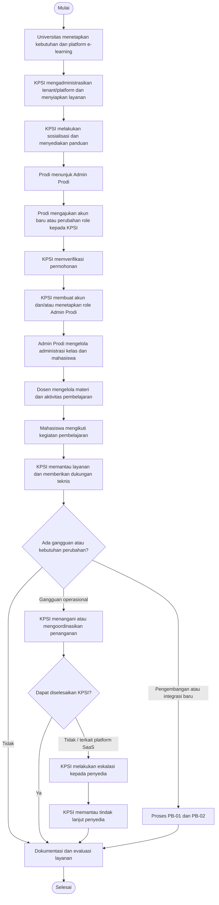

# PB-05 – PENGELOLAAN LAYANAN E-LEARNING

| Informasi | Keterangan |
|---|---|
| Kode Proses | PB-05 |
| Nama Proses | Pengelolaan Layanan E-Learning |
| Pemilik Proses | Kantor Pusat Sistem Informasi (KPSI) |
| Penanggung Jawab | Kepala KPSI |
| Unit Pelaksana | Unit E-Learning |
| Pihak Terkait | Wakil Rektor IV, fakultas/program studi, dosen, mahasiswa, unit akademik terkait, dan penyedia layanan/platform |
| Versi | 1.0 |
| Status | Draf untuk ditinjau |
| Dokumen Induk | Peta Proses Bisnis KPSI Level 0 |

---

## 1. Tujuan

PB-05 menjadi acuan bagi KPSI dalam mengelola layanan e-learning agar dapat digunakan secara andal, aman, dan berkelanjutan untuk mendukung kegiatan pembelajaran di lingkungan universitas.

Proses ini mengatur pengelolaan platform e-learning, administrasi tenant atau lingkungan universitas, pengelolaan akun dan hak akses, dukungan teknis, koordinasi dengan penyedia layanan, serta pemantauan dan evaluasi layanan.

PB-05 juga memperjelas pembagian tanggung jawab antara KPSI, program studi, dosen, dan pihak penyedia layanan agar pengelolaan teknis platform tidak tercampur dengan kewenangan akademik.

## 2. Ruang Lingkup

PB-05 mencakup:

1. Pengelolaan platform atau layanan e-learning yang digunakan universitas, baik berupa SaaS, platform yang dikelola sendiri, maupun kombinasi keduanya.
2. Administrasi tingkat universitas terhadap tenant atau lingkungan LMS.
3. Pembuatan akun, aktivasi akun, pengaturan role, perubahan hak akses, dan penonaktifan akun sesuai permohonan atau ketentuan yang berlaku.
4. Penetapan dan pengelolaan akses Admin Prodi.
5. Koordinasi teknis dengan program studi, dosen, mahasiswa, unit terkait, dan penyedia layanan.
6. Pemberian panduan, sosialisasi, dan dukungan teknis penggunaan platform.
7. Pemantauan ketersediaan dan fungsi teknis layanan e-learning.
8. Penanganan gangguan teknis dan koordinasi eskalasi kepada penyedia layanan.
9. Pengelolaan integrasi e-learning dengan sistem universitas lainnya sesuai kewenangan dan mekanisme yang berlaku.
10. Dokumentasi, pelaporan, dan evaluasi layanan e-learning.

PB-05 tidak mengatur:

- Penetapan kebijakan akademik, kurikulum, metode pembelajaran, dan standar evaluasi pembelajaran.
- Penentuan materi, aktivitas, tugas, ujian, nilai, dan substansi pembelajaran yang menjadi tanggung jawab dosen atau unit akademik.
- Penetapan mahasiswa ke dalam kelas atau mata kuliah sebagai keputusan akademik. Pengelolaan administratifnya dapat dilakukan Admin Prodi sesuai data dan arahan unit akademik.
- Pengembangan aplikasi atau integrasi baru yang memerlukan pekerjaan pengembangan. Kegiatan tersebut mengikuti PB-01 dan PB-02.
- Pengelolaan infrastruktur internal platform SaaS yang menjadi tanggung jawab penyedia layanan sesuai kontrak. Aspek tersebut dikoordinasikan melalui PB-03 dan mekanisme hubungan dengan penyedia.

## 3. Prinsip Pengelolaan

1. **KPSI sebagai pengelola teknis:** KPSI mengelola aspek teknis layanan e-learning dan menjadi koordinator utama universitas dengan penyedia layanan.
2. **Unit akademik sebagai pemilik proses akademik:** kewenangan atas kebijakan, ketentuan, dan keakuratan data akademik tetap berada pada unit akademik yang berwenang.
3. **Program studi mengelola administrasi pembelajaran tingkat prodi:** prodi menunjuk Admin Prodi dan bertanggung jawab atas ketepatan penunjukan serta informasi yang disampaikan kepada KPSI.
4. **Dosen bertanggung jawab atas kegiatan pembelajaran:** dosen mengelola konten, aktivitas, tugas, dan evaluasi pembelajaran sesuai kebijakan akademik.
5. **Hak akses berdasarkan kewenangan:** setiap akun diberikan role sesuai tugas dan kewenangan pengguna, serta ditinjau apabila terjadi perubahan penugasan.
6. **Penyedia bertanggung jawab atas layanan yang dikelolanya:** untuk platform SaaS, tanggung jawab penyedia atas infrastruktur, pemeliharaan inti, ketersediaan, backup, dan pemulihan mengikuti kontrak atau SLA.
7. **Pengelolaan berbasis dokumentasi:** permintaan administrasi penting, perubahan hak akses, gangguan, dan tindak lanjut dicatat agar dapat ditelusuri.

## 4. Pihak yang Terlibat dan Tanggung Jawab

| Pihak | Tanggung Jawab |
|---|---|
| Wakil Rektor IV | Memberikan arahan atau keputusan untuk kebutuhan strategis, pengembangan, kerja sama, anggaran, atau permasalahan layanan yang memerlukan keputusan pimpinan. |
| Kepala KPSI | Bertanggung jawab atas penyelenggaraan layanan e-learning, menetapkan penugasan internal KPSI, mengoordinasikan penyelesaian masalah, dan melakukan eskalasi kepada WR IV bila diperlukan. |
| Unit E-Learning | Melaksanakan administrasi teknis layanan, pengelolaan akun dan role, dukungan pengguna, sosialisasi, dokumentasi, serta pemantauan layanan. |
| Program Studi | Menunjuk Admin Prodi, menyampaikan permohonan pembuatan akun atau perubahan role, serta bertanggung jawab atas pengelolaan administrasi kelas dan mahasiswa sesuai kewenangan akademik. |
| Admin Prodi | Mengelola administrasi kelas, mata kuliah, dan data mahasiswa pada LMS sesuai role, panduan platform, dan ketentuan prodi. |
| Dosen | Mengelola ruang pembelajaran, materi, aktivitas, tugas, dan evaluasi pembelajaran sesuai ketentuan akademik. |
| Mahasiswa | Menggunakan layanan e-learning sesuai akun dan hak akses yang diberikan serta melaporkan kendala penggunaan melalui kanal yang ditetapkan. |
| Unit akademik terkait | Menetapkan kebijakan dan memberikan data atau arahan akademik yang diperlukan untuk mendukung pengelolaan LMS. |
| Penyedia layanan/platform | Menyediakan dan memelihara platform sesuai kontrak, termasuk dukungan teknis, penanganan gangguan, dan kewajiban layanan lainnya. |

## 5. Masukan Proses

1. Kebijakan atau arahan universitas terkait pemanfaatan e-learning.
2. Penetapan platform atau layanan e-learning yang digunakan universitas.
3. Data pengguna yang diperlukan untuk pembuatan atau pengelolaan akun.
4. Permohonan penunjukan Admin Prodi, pembuatan akun, perubahan role, atau penonaktifan akses.
5. Informasi program studi, kelas, mata kuliah, dosen, dan mahasiswa dari unit yang berwenang.
6. Permintaan bantuan, laporan kendala, atau laporan gangguan layanan.
7. Dokumentasi penggunaan, panduan, dan informasi teknis dari penyedia platform.
8. Informasi kontrak, batas layanan, SLA, jadwal pemeliharaan, dan mekanisme dukungan penyedia.

## 6. Alur Proses

## 7. Tahapan Pelaksanaan

### 7.1 Penyiapan dan Administrasi Layanan

1. KPSI memastikan platform e-learning yang digunakan universitas telah ditetapkan melalui keputusan atau arahan pihak yang berwenang.
2. KPSI mengelola administrasi tingkat universitas pada tenant atau lingkungan LMS sesuai kewenangan yang diberikan oleh penyedia atau pengelola platform.
3. KPSI menyiapkan konfigurasi umum, struktur organisasi pengguna, role standar, dan pengaturan teknis lain yang menjadi kewenangannya.
4. Untuk platform SaaS, KPSI mengelola konfigurasi tenant dan akses administrator universitas, bukan infrastruktur internal platform yang menjadi tanggung jawab penyedia.
5. KPSI mendokumentasikan informasi layanan, kontak dukungan penyedia, panduan administrasi, serta ketentuan layanan yang relevan.

### 7.2 Sosialisasi dan Panduan Penggunaan

1. KPSI berkoordinasi dengan unit akademik dan program studi untuk menyelenggarakan sosialisasi penggunaan LMS.
2. KPSI menyediakan panduan teknis penggunaan sesuai role pengguna, seperti Admin Prodi, dosen, dan mahasiswa.
3. KPSI memberikan penjelasan mengenai kanal pelaporan gangguan dan mekanisme permintaan bantuan.
4. Penjelasan mengenai kebijakan akademik, desain pembelajaran, dan tata cara penilaian disampaikan oleh unit akademik atau pihak yang berwenang, bukan ditetapkan oleh KPSI.
5. KPSI mendokumentasikan kegiatan sosialisasi dan materi panduan yang telah disampaikan.

### 7.3 Penunjukan dan Pengelolaan Admin Prodi

1. Program studi menentukan dan menunjuk pengguna yang akan bertugas sebagai Admin Prodi.
2. Program studi menyampaikan permohonan resmi kepada KPSI untuk memberikan role Admin Prodi. Permohonan sekurang-kurangnya memuat identitas pengguna, program studi, akun yang digunakan jika sudah tersedia, dan persetujuan atau pengesahan pejabat prodi yang berwenang.
3. Pemberian role Admin Prodi dapat dilakukan melalui dua mekanisme:
   - **Pembuatan akun baru oleh KPSI:** KPSI membuat akun pengguna sesuai data yang disampaikan, kemudian memberikan role Admin Prodi.
   - **Penggunaan akun yang sudah tersedia:** program studi menunjuk akun pengguna yang sudah ada, kemudian meminta KPSI mengubah atau menambahkan role Admin Prodi pada akun tersebut.
4. KPSI memeriksa kelengkapan permohonan dan memastikan akun yang dimaksud dapat diidentifikasi pada platform.
5. Setelah permohonan dinyatakan sesuai, KPSI membuat akun dan/atau memberikan role Admin Prodi sesuai kewenangannya.
6. KPSI menyampaikan informasi bahwa akses telah diberikan kepada program studi melalui mekanisme yang aman. Kata sandi awal atau informasi autentikasi tidak disampaikan melalui kanal terbuka.
7. Program studi bertanggung jawab memastikan Admin Prodi yang ditunjuk memahami tugasnya dan menggunakan akses sesuai kewenangan.
8. Apabila terjadi pergantian Admin Prodi, program studi menyampaikan permohonan perubahan. KPSI memperbarui role dan akses sesuai permohonan tersebut.
9. KPSI mencatat pemberian, perubahan, dan pencabutan role administratif untuk keperluan penelusuran.

### 7.4 Pengelolaan Kelas dan Data Pembelajaran

1. Admin Prodi mengelola administrasi kelas, mata kuliah, dan data mahasiswa pada LMS sesuai fitur dan kewenangan yang diberikan platform.
2. Pengelolaan tersebut dilakukan berdasarkan data dan ketentuan akademik yang ditetapkan oleh program studi atau unit akademik yang berwenang.
3. Admin Prodi melakukan koordinasi dengan unit akademik apabila terdapat ketidaksesuaian data kelas, mata kuliah, dosen, atau mahasiswa.
4. KPSI membantu apabila kendala pengelolaan disebabkan oleh konfigurasi teknis, hak akses, atau fungsi platform.
5. KPSI tidak menetapkan sendiri perubahan data akademik atau keputusan penempatan mahasiswa ke kelas tanpa dasar atau arahan dari unit yang berwenang.

### 7.5 Pengelolaan Pembelajaran oleh Dosen

1. Dosen menggunakan akun dan role yang diberikan untuk mengelola ruang pembelajaran sesuai penugasan mengajar.
2. Dosen bertanggung jawab atas materi, sumber belajar, aktivitas, tugas, forum, ujian, dan evaluasi yang diselenggarakan melalui LMS.
3. Dosen memastikan konten dan aktivitas pembelajaran sesuai kebijakan akademik dan ketentuan program studi.
4. KPSI memberikan panduan dan dukungan teknis terkait penggunaan fitur LMS.
5. KPSI tidak bertanggung jawab atas ketepatan substansi materi, metode pembelajaran, atau penilaian akademik yang ditetapkan dosen.

### 7.6 Dukungan Pengguna dan Penanganan Gangguan

1. Pengguna menyampaikan kendala penggunaan LMS melalui kanal layanan yang ditetapkan KPSI.
2. KPSI mencatat laporan dan melakukan identifikasi awal untuk membedakan kendala akun, hak akses, penggunaan fitur, konektivitas, konfigurasi, atau gangguan platform.
3. KPSI menangani kendala yang berada dalam kewenangan administrasi dan teknisnya.
4. Apabila kendala berkaitan dengan kebijakan akademik, data akademik, atau pengelolaan kelas, KPSI mengarahkan atau mengoordinasikan penyelesaian dengan program studi atau unit akademik terkait.
5. Apabila kendala berasal dari platform SaaS atau komponen yang dikelola penyedia, KPSI menyampaikan laporan kepada penyedia melalui kanal dukungan resmi.
6. KPSI memantau tindak lanjut penyedia, menyampaikan perkembangan yang relevan kepada pihak terdampak, dan mencatat hasil penanganan.
7. Gangguan yang berdampak luas, berlangsung lama, atau memerlukan keputusan pimpinan dieskalasikan oleh Kepala KPSI kepada WR IV sesuai tingkat dampaknya.
8. Penanganan gangguan operasional mengikuti PB-06 – Penanganan Gangguan dan Insiden TI. PB-05 mengatur konteks layanan e-learning dan koordinasi pihak-pihak yang terlibat.

### 7.7 Pemantauan dan Evaluasi Layanan

1. KPSI memantau ketersediaan layanan, fungsi teknis utama, status gangguan, dan tindak lanjut penyedia sesuai informasi dan akses yang tersedia.
2. Untuk platform SaaS, pemantauan dilakukan melalui dashboard administrator, informasi status layanan, laporan pengguna, dan komunikasi resmi penyedia. KPSI tidak mengklaim melakukan pemantauan langsung terhadap infrastruktur internal penyedia apabila akses tersebut tidak tersedia.
3. KPSI mengumpulkan masukan dari program studi, dosen, dan mahasiswa mengenai kendala penggunaan serta kebutuhan peningkatan layanan.
4. KPSI menyusun laporan berkala mengenai penggunaan layanan, gangguan, permintaan dukungan, dan rekomendasi perbaikan.
5. Kebutuhan perubahan konfigurasi rutin ditangani sesuai kewenangan administrasi KPSI dan ketentuan platform.
6. Kebutuhan fitur baru, pengembangan modul, atau integrasi dengan sistem lain dianalisis melalui PB-01 dan dilaksanakan melalui PB-02 setelah memperoleh persetujuan yang dipersyaratkan.

## 8. Ketentuan Pengelolaan

### 8.1 Pengelolaan Tenant dan Platform

1. KPSI menjadi administrator tingkat universitas sesuai hak yang diberikan kepada universitas.
2. KPSI mengelola konfigurasi tenant, role standar, parameter teknis, dan administrasi platform yang berada dalam kewenangannya.
3. KPSI tidak melakukan perubahan terhadap komponen inti platform SaaS yang berada di luar hak administrasi universitas.
4. Perubahan konfigurasi yang berdampak luas terhadap pengguna dikoordinasikan terlebih dahulu dengan unit terkait dan, apabila diperlukan, penyedia layanan.
5. Apabila universitas menggunakan platform yang dikelola sendiri, tanggung jawab operasional infrastruktur mengikuti pembagian tugas pada PB-03.

### 8.2 Pengelolaan Akun dan Hak Akses

1. Akun pengguna diberikan berdasarkan kebutuhan dan identitas pengguna yang dapat diverifikasi.
2. Role diberikan berdasarkan tugas dan kewenangan pengguna.
3. Penunjukan Admin Prodi merupakan kewenangan program studi, sedangkan pemberian role teknis pada LMS dilaksanakan oleh KPSI.
4. KPSI dapat membuat akun baru atau memberikan role kepada akun yang telah tersedia berdasarkan permohonan resmi program studi.
5. Perubahan atau pencabutan role Admin Prodi dilakukan berdasarkan pemberitahuan atau permohonan resmi program studi, atau berdasarkan ketentuan universitas yang sah.
6. KPSI dapat mengambil tindakan pengamanan sementara terhadap akun apabila ditemukan indikasi penyalahgunaan atau ancaman keamanan. Tindakan tersebut didokumentasikan dan dikoordinasikan dengan pihak terkait.
7. Akun administratif tidak boleh digunakan bersama apabila platform menyediakan akun individual. Informasi autentikasi harus dijaga dan disampaikan melalui mekanisme yang aman.

### 8.3 Batas Tanggung Jawab Akademik dan Teknis

1. KPSI bertanggung jawab atas aspek teknis platform dan administrasi akses sesuai kewenangannya.
2. Program studi bertanggung jawab atas penunjukan Admin Prodi dan pengelolaan administrasi kelas serta mahasiswa sesuai ketentuan akademik.
3. Dosen bertanggung jawab atas materi, aktivitas, dan evaluasi pembelajaran.
4. Unit akademik yang berwenang menetapkan kebijakan, ketentuan, dan sumber data akademik.
5. Apabila terjadi ketidaksesuaian data atau perbedaan kewenangan, KPSI mengoordinasikan penyelesaian dengan pemilik proses atau data terkait dan tidak mengambil keputusan akademik secara sepihak.

### 8.4 Platform SaaS dan Penyedia Layanan

1. KPSI menjadi penghubung teknis universitas dengan penyedia platform.
2. Penyedia bertanggung jawab atas infrastruktur internal, pemeliharaan inti platform, dan ketersediaan layanan sesuai kontrak atau SLA.
3. KPSI mengelola administrasi tenant, akses administrator universitas, konfigurasi yang tersedia, serta koordinasi dukungan.
4. KPSI memastikan informasi mengenai kanal dukungan, jadwal pemeliharaan, batas layanan, dan prosedur eskalasi tersedia bagi pihak terkait.
5. Pengelolaan backup, pemulihan data, ekspor data, dan pengakhiran layanan mengikuti ketentuan kontrak. KPSI berkoordinasi dengan penyedia dan unit pemilik data untuk memastikan kepentingan universitas diperhatikan.
6. Apabila universitas membutuhkan fitur tambahan atau integrasi melalui API, KPSI terlebih dahulu memeriksa dokumentasi, hak akses API, keamanan, batas penggunaan, biaya, dan ketentuan kontrak. Pelaksanaan pengembangan mengikuti PB-01 dan PB-02.
7. KPSI tidak mengakses basis data internal SaaS secara langsung tanpa mekanisme resmi dan dasar kewenangan yang jelas.

### 8.5 Integrasi dengan Sistem Lain

1. Integrasi LMS dengan sistem akademik, identitas, atau aplikasi universitas lainnya harus memiliki kebutuhan dan tujuan yang jelas.
2. KPSI mengoordinasikan analisis integrasi dengan unit pemilik proses dan data.
3. Sumber data utama untuk setiap jenis data harus disepakati bersama unit yang berwenang.
4. Integrasi menggunakan API atau mekanisme resmi yang disediakan platform dan memperhatikan keamanan autentikasi, hak akses, pencatatan aktivitas, penanganan kesalahan, serta perubahan versi API.
5. Pembuatan integrasi baru atau perubahan yang memerlukan pengembangan mengikuti PB-01 dan PB-02.

### 8.6 Penggunaan dan Pemanfaatan Data

1. Data pengguna dan data pembelajaran dikelola sesuai kewenangan masing-masing unit dan ketentuan universitas.
2. KPSI menggunakan data yang dapat diaksesnya hanya untuk administrasi, dukungan, pemantauan teknis, keamanan, dan pelaporan layanan sesuai kewenangannya.
3. Permintaan akses, ekspor, atau pemanfaatan data untuk kebutuhan di luar operasional rutin harus memperoleh persetujuan unit pemilik data atau pejabat yang berwenang.
4. KPSI berkoordinasi dengan penyedia terkait perlindungan data, retensi, backup, ekspor, dan penghapusan data sesuai kontrak dan ketentuan yang berlaku.
5. Informasi pribadi, kredensial, dan data pembelajaran tidak boleh dibagikan kepada pihak yang tidak berwenang.

### 8.7 Pelibatan Pihak Ketiga

1. KPSI dapat berkoordinasi dengan penyedia platform atau pihak ketiga untuk konfigurasi, pelatihan, dukungan, migrasi, integrasi, atau pekerjaan teknis lainnya.
2. KPSI tetap bertanggung jawab atas analisis kebutuhan, koordinasi, pengawasan teknis, verifikasi hasil, dan dokumentasi pekerjaan yang menjadi tanggung jawab universitas.
3. Ruang lingkup, akses, tanggung jawab, keamanan data, hasil pekerjaan, dan mekanisme serah terima harus ditetapkan secara jelas.
4. Pekerjaan pengembangan aplikasi atau integrasi oleh pihak ketiga mengikuti PB-01 dan PB-02, termasuk ketentuan persetujuan dan pengendalian hasil pekerjaan.
5. Pengadaan atau pekerjaan yang memerlukan anggaran mengikuti mekanisme persetujuan dan pengadaan universitas.

## 9. Pembagian Tanggung Jawab

| Aktivitas | KPSI | Program Studi | Admin Prodi | Dosen | Unit Akademik | Penyedia |
|---|---|---|---|---|---|---|
| Administrasi tenant tingkat universitas | Bertanggung jawab | - | - | - | Konsultasi bila diperlukan | Dukungan sesuai kontrak |
| Menunjuk Admin Prodi | Menerima dan memproses permohonan | Bertanggung jawab | - | - | Sesuai kebijakan | - |
| Membuat akun dan memberikan role Admin Prodi | Bertanggung jawab | Mengajukan dan mengesahkan penunjukan | Menggunakan akses | - | - | Menyediakan fungsi platform |
| Mengelola kelas dan administrasi mahasiswa | Dukungan teknis | Bertanggung jawab atas ketentuan prodi | Melaksanakan sesuai kewenangan | Koordinasi | Menetapkan kebijakan/data akademik sesuai kewenangan | Dukungan sesuai kontrak |
| Mengelola materi dan aktivitas pembelajaran | Dukungan teknis | Koordinasi/pengawasan akademik | Dukungan administratif bila diperlukan | Bertanggung jawab | Menetapkan kebijakan akademik | Menyediakan fungsi platform |
| Mengelola evaluasi dan nilai akademik | Dukungan teknis | Pengawasan sesuai ketentuan | Dukungan administratif bila diperlukan | Bertanggung jawab sesuai kewenangan | Menetapkan ketentuan akademik | Menyediakan fungsi platform |
| Menangani kendala teknis | Bertanggung jawab/koordinator | Melaporkan dan membantu klarifikasi | Melaporkan dan membantu klarifikasi | Melaporkan | - | Menangani kendala platform sesuai kontrak |
| Menangani kebijakan atau data akademik | Koordinasi | Bertanggung jawab sesuai kewenangan | Melaksanakan arahan | Koordinasi | Bertanggung jawab sesuai kewenangan | Dukungan teknis bila diperlukan |
| Menangani gangguan SaaS | Koordinator dan eskalasi | Melaporkan dampak | Melaporkan dampak | Melaporkan dampak | Mendukung koordinasi | Bertanggung jawab sesuai kontrak/SLA |
| Mengembangkan integrasi atau fitur baru | Analisis dan pengendalian teknis | Memberikan kebutuhan | Memberikan masukan | Memberikan masukan | Menilai aspek akademik/data | Dukungan sesuai kontrak |

## 10. Keluaran Proses

1. Platform atau layanan e-learning yang siap digunakan sesuai kewenangan universitas.
2. Konfigurasi tenant dan administrasi tingkat universitas.
3. Daftar akun dan role administratif yang dikelola KPSI.
4. Catatan permohonan, pemberian, perubahan, dan pencabutan role Admin Prodi.
5. Admin Prodi yang telah ditetapkan oleh program studi dan diberikan akses oleh KPSI.
6. Panduan penggunaan dan dokumentasi sosialisasi.
7. Catatan dukungan pengguna dan penanganan gangguan.
8. Catatan koordinasi dan eskalasi kepada penyedia layanan.
9. Informasi pemantauan ketersediaan dan kondisi layanan.
10. Laporan evaluasi dan rekomendasi peningkatan layanan e-learning.

## 11. Proses Terkait

| Kode | Nama Proses | Hubungan dengan PB-05 |
|---|---|---|
| PM-01 | Perencanaan Teknologi Informasi | Menjadi dasar perencanaan layanan dan kebutuhan e-learning. |
| PB-01 | Pengelolaan Permintaan dan Analisis Kebutuhan TI | Digunakan untuk analisis kebutuhan fitur, perubahan besar, dan integrasi e-learning. |
| PB-02 | Pengembangan dan Integrasi Aplikasi | Digunakan untuk pengembangan modul, aplikasi tambahan, dan integrasi LMS. |
| PB-03 | Pengelolaan Infrastruktur Jaringan dan Server | Mengatur infrastruktur internal dan konektivitas yang mendukung akses e-learning. |
| PB-06 | Penanganan Gangguan dan Insiden TI | Menjadi proses penanganan gangguan operasional dan insiden teknis. |
| PP-01 | Dokumentasi dan Inventaris TI | Mengelola dokumentasi platform, akun administratif, dan informasi layanan. |
| PP-02 | Keamanan, Backup, dan Pemulihan | Mengatur aspek keamanan, backup, dan pemulihan sesuai batas tanggung jawab KPSI dan penyedia. |
| PP-04 | Pengelolaan Kerja Sama dan Penyedia TI | Mengatur koordinasi dan hubungan kerja dengan penyedia layanan. |

## 12. Dokumen dan Formulir Pendukung

Dokumen atau formulir yang dapat digunakan untuk mendukung proses ini:

1. Formulir permohonan pembuatan akun LMS.
2. Formulir permohonan penetapan atau perubahan role Admin Prodi.
3. Formulir permohonan penonaktifan atau pencabutan akses.
4. Daftar akun dan role administratif LMS.
5. Daftar Admin Prodi per program studi.
6. Panduan penggunaan LMS berdasarkan role.
7. Dokumentasi sosialisasi dan pelatihan.
8. Formulir atau tiket pelaporan kendala e-learning.
9. Catatan eskalasi gangguan kepada penyedia.
10. Dokumentasi konfigurasi dan integrasi LMS.
11. Kontrak, SLA, dokumentasi API, dan panduan dukungan penyedia sesuai kebutuhan.

Formulir dapat disederhanakan atau diintegrasikan ke dalam sistem layanan KPSI. Tidak semua kebutuhan harus menggunakan dokumen cetak.

## 13. Indikator Kinerja Proses

| No. | Indikator | Tujuan |
|---|---|---|
| 1 | Persentase permohonan akun atau perubahan role yang diproses sesuai target layanan | Mengukur ketepatan layanan administrasi akun |
| 2 | Persentase program studi yang memiliki Admin Prodi aktif | Memantau kesiapan administrasi LMS di tingkat prodi |
| 3 | Jumlah permohonan perubahan role yang belum ditindaklanjuti | Memantau antrean administrasi hak akses |
| 4 | Jumlah gangguan teknis e-learning dan status penyelesaiannya | Memantau kualitas dukungan teknis |
| 5 | Ketersediaan layanan berdasarkan data yang dapat diakses | Memantau keandalan platform |
| 6 | Persentase eskalasi kepada penyedia yang memperoleh tindak lanjut | Memantau koordinasi penanganan gangguan SaaS |
| 7 | Jumlah kegiatan sosialisasi atau pelatihan penggunaan LMS | Memantau dukungan peningkatan kemampuan pengguna |
| 8 | Jumlah kebutuhan pengembangan atau integrasi yang telah dianalisis | Memantau kebutuhan peningkatan layanan |

Target dan periode pengukuran indikator ditetapkan lebih lanjut dalam SOP atau rencana kerja KPSI, dengan mempertimbangkan kemampuan pemantauan platform dan ketentuan layanan penyedia.

## 14. Catatan Validasi

Hal-hal berikut perlu dikonfirmasi sebelum PB-05 ditetapkan sebagai dokumen final:

1. **Penanggung jawab data kelas dan mahasiswa:** apakah Admin Prodi sepenuhnya mengelola data kelas dan mahasiswa di LMS berdasarkan data akademik yang diberikan prodi, atau ada proses sinkronisasi otomatis dari sistem akademik?
2. **Pembuatan akun dosen dan mahasiswa:** apakah akun dosen dan mahasiswa dibuat atau disinkronkan oleh KPSI, dibuat oleh Admin Prodi, atau mengikuti mekanisme otomatis dari platform SaaS?
3. **Penugasan dosen ke kelas:** apakah Admin Prodi yang memasukkan dosen ke kelas/mata kuliah, atau data penugasan berasal dari sistem akademik?
4. **Dukungan pengguna:** apakah laporan kendala LMS dari dosen dan mahasiswa disampaikan langsung ke KPSI, atau melalui Admin Prodi terlebih dahulu?
5. **Backup dan ekspor data:** apakah kontrak SaaS memberikan fasilitas backup atau ekspor data yang dapat diakses dan dikelola oleh administrator universitas?
6. **Sosialisasi dan pelatihan:** apakah KPSI menjadi penyelenggara utama sosialisasi teknis, sementara prodi/unit akademik bertanggung jawab atas sosialisasi kebijakan dan pemanfaatan akademiknya?

Jawaban atas pertanyaan tersebut dapat digunakan untuk menyempurnakan pembagian tanggung jawab dan tahapan operasional. Apabila mekanismenya belum ditetapkan, PB-05 tetap dapat menggunakan prinsip umum dalam dokumen ini dan rincian teknisnya dituangkan kemudian dalam SOP.

## 15. Penutup

PB-05 menjadi acuan pengelolaan layanan e-learning di lingkungan universitas dengan menempatkan KPSI sebagai pengelola teknis dan koordinator layanan, program studi sebagai pihak yang menunjuk Admin Prodi serta mengelola administrasi pembelajaran tingkat prodi, dosen sebagai penanggung jawab kegiatan pembelajaran, dan unit akademik sebagai pemilik kebijakan serta proses akademik.

Penggunaan platform SaaS tidak mengubah pembagian tanggung jawab tersebut. Batas pengelolaan KPSI dan penyedia layanan mengikuti hak administrasi, kontrak, serta SLA yang berlaku. Rincian teknis, formulir, target layanan, dan mekanisme operasional ditetapkan lebih lanjut melalui SOP dan pedoman teknis KPSI.
