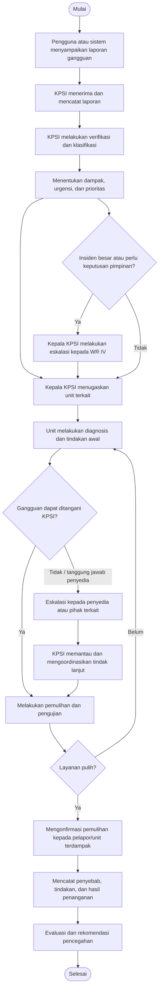

# PB-06 – PENANGANAN GANGGUAN DAN INSIDEN TEKNOLOGI INFORMASI

| Informasi | Keterangan |
|---|---|
| Kode Proses | PB-06 |
| Nama Proses | Penanganan Gangguan dan Insiden Teknologi Informasi |
| Pemilik Proses | Kantor Pusat Sistem Informasi (KPSI) |
| Penanggung Jawab | Kepala KPSI |
| Unit Pelaksana | Unit terkait di lingkungan KPSI |
| Pihak Terkait | Seluruh pengguna layanan TI universitas, unit kerja, dan penyedia layanan TI |
| Versi | 1.1 |
| Status | Draf untuk ditinjau |
| Dokumen Induk | Peta Proses Bisnis KPSI Level 0 |

---

## 1. Tujuan

PB-06 menjadi acuan penanganan gangguan dan insiden teknologi informasi di lingkungan universitas agar laporan dapat diterima, dicatat, dianalisis, ditangani, dan diselesaikan secara terkoordinasi.

Proses ini bertujuan untuk:

1. Memastikan pengguna memiliki jalur pelaporan gangguan yang jelas.
2. Memastikan setiap laporan gangguan dicatat dan ditindaklanjuti.
3. Menetapkan prioritas penanganan berdasarkan dampak dan urgensi.
4. Memperjelas pembagian tugas penanganan di antara unit-unit KPSI.
5. Mengatur koordinasi dengan unit pemilik layanan dan penyedia pihak ketiga.
6. Memastikan gangguan besar atau insiden yang berdampak luas dieskalasikan kepada pimpinan.
7. Menghasilkan dokumentasi penanganan sebagai bahan evaluasi dan pencegahan gangguan berulang.

## 2. Ruang Lingkup

PB-06 mencakup penanganan gangguan dan insiden yang berkaitan dengan layanan teknologi informasi universitas, antara lain:

1. Gangguan jaringan dan konektivitas internet.
2. Gangguan server, hosting, layanan cloud, dan infrastruktur yang dikelola KPSI.
3. Gangguan aplikasi dan sistem informasi universitas.
4. Gangguan website resmi universitas dan unit kerja.
5. Gangguan layanan e-learning atau LMS.
6. Gangguan akun, autentikasi, dan hak akses teknis.
7. Gangguan integrasi antar sistem.
8. Insiden keamanan informasi yang terdeteksi atau dilaporkan kepada KPSI.
9. Gangguan layanan TI yang dikelola penyedia pihak ketiga, termasuk SaaS, sepanjang berdampak pada layanan universitas.
10. Gangguan teknis lain yang berada dalam kewenangan KPSI.

PB-06 tidak mengatur:

- Permintaan pengembangan aplikasi baru atau perubahan besar yang belum merupakan penanganan gangguan. Permintaan tersebut mengikuti PB-01 dan PB-02.
- Permintaan layanan rutin yang bukan disebabkan gangguan, seperti permintaan akun baru atau perubahan role yang telah direncanakan. Permintaan tersebut ditangani melalui proses layanan terkait.
- Perbaikan rutin komputer, printer, laboratorium, dan perangkat lokal yang menjadi tanggung jawab unit pemilik. KPSI dapat memberikan konsultasi atau bantuan apabila diminta dan disepakati.
- Penanganan insiden fisik, keselamatan, atau keadaan darurat non-TI, kecuali terdapat keterkaitan langsung dengan layanan TI yang dikelola KPSI.

## 3. Prinsip Penanganan

1. **Pelaporan langsung:** pengguna dapat melaporkan gangguan langsung kepada KPSI tanpa harus melalui WR IV.
2. **Setiap laporan dicatat:** laporan gangguan yang diterima KPSI dicatat agar dapat ditelusuri dan dipantau.
3. **Prioritas berdasarkan dampak:** penanganan mempertimbangkan jumlah pengguna terdampak, tingkat kepentingan layanan, urgensi, dan risiko.
4. **Penanggung jawab jelas:** Kepala KPSI mengoordinasikan penugasan kepada unit KPSI yang relevan.
5. **Pemulihan layanan diutamakan:** tindakan awal diarahkan untuk memulihkan layanan secara aman, kemudian dilanjutkan dengan analisis penyebab dan pencegahan.
6. **Eskalasi sesuai kewenangan:** gangguan yang tidak dapat diselesaikan oleh KPSI, berdampak luas, atau membutuhkan keputusan pimpinan dieskalasikan kepada pihak yang berwenang.
7. **Koordinasi dengan pemilik proses:** apabila gangguan berkaitan dengan data atau proses akademik, keuangan, kepegawaian, atau proses unit lainnya, KPSI berkoordinasi dengan unit pemilik proses/data.
8. **Batas tanggung jawab penyedia:** untuk layanan SaaS atau layanan pihak ketiga, KPSI melakukan identifikasi awal, koordinasi, dan eskalasi kepada penyedia sesuai kontrak. KPSI tidak mengambil alih tanggung jawab teknis internal penyedia.
9. **Dokumentasi dan komunikasi:** perkembangan penanganan disampaikan kepada pelapor atau pihak terdampak sesuai kebutuhan.

## 4. Pihak yang Terlibat dan Tanggung Jawab

| Pihak | Tanggung Jawab |
|---|---|
| Pelapor/pengguna | Menyampaikan laporan gangguan dengan informasi yang cukup, membantu proses klarifikasi, dan mengonfirmasi kondisi layanan setelah penanganan bila memungkinkan. |
| Kepala KPSI | Mengendalikan proses penanganan, menetapkan prioritas dan penugasan, mengoordinasikan unit KPSI, melakukan eskalasi kepada WR IV, serta memastikan laporan penanganan tersedia. |
| Unit terkait di KPSI | Melakukan pemeriksaan, diagnosis, tindakan pemulihan, pengujian, dokumentasi, dan koordinasi teknis sesuai bidang tugasnya. |
| Unit pemilik layanan/proses | Memberikan informasi yang diperlukan, membantu verifikasi dampak, mengambil keputusan terkait proses atau data yang menjadi kewenangannya, dan mengonfirmasi pemulihan dari sisi operasional. |
| Wakil Rektor IV | Menerima eskalasi gangguan besar atau insiden yang memerlukan arahan, keputusan, koordinasi lintas unit, atau dukungan sumber daya. |
| Penyedia layanan TI | Menangani gangguan pada komponen layanan yang menjadi tanggung jawabnya sesuai kontrak, SLA, dan mekanisme dukungan. |
| Pihak ketiga teknis | Memberikan bantuan teknis sesuai ruang lingkup pekerjaan dan arahan pengendalian dari KPSI. |

## 5. Masukan Proses

1. Laporan gangguan dari mahasiswa, dosen, tenaga kependidikan, atau unit kerja melalui WhatsApp atau kanal layanan yang ditetapkan KPSI.
2. Peringatan atau notifikasi dari sistem pemantauan infrastruktur dan aplikasi.
3. Informasi gangguan dari penyedia layanan.
4. Hasil pemeriksaan rutin KPSI.
5. Laporan insiden keamanan informasi.
6. Informasi dampak gangguan dari unit pemilik layanan atau proses.
7. Catatan gangguan berulang dan hasil evaluasi penanganan sebelumnya.

## 6. Alur Proses

## 7. Tahapan Pelaksanaan

### 7.1 Penerimaan Laporan

1. Pada kondisi saat ini, laporan gangguan disampaikan melalui WhatsApp kepada personel atau kanal komunikasi KPSI yang ditetapkan.
2. Dalam pengembangan layanan ke depan, KPSI merencanakan penggunaan sistem keluhan atau tiket sebagai sarana pencatatan, pemantauan, dan tindak lanjut laporan secara terpusat. Selama sistem tersebut belum tersedia, pencatatan dilakukan melalui media dokumentasi yang digunakan KPSI.
3. Untuk gangguan biasa, layanan penanganan KPSI dilaksanakan pada jam kerja. Untuk kondisi darurat, laporan dapat disampaikan melalui kanal komunikasi cepat, termasuk komunikasi langsung dari Rektor kepada Kepala KPSI melalui WhatsApp.
4. KPSI tetap dapat menerima laporan darurat dari pengguna atau unit kerja lainnya dan melakukan tindakan sesuai tingkat urgensi serta kewenangannya. Penanganan darurat tidak harus menunggu laporan atau instruksi dari Rektor.
5. KPSI menerima laporan dari pengguna secara langsung. Pelapor tidak diwajibkan memperoleh persetujuan WR IV untuk melaporkan gangguan operasional.
6. Laporan yang diterima sekurang-kurangnya memuat:
   - identitas atau unit pelapor;
   - layanan atau sistem yang mengalami gangguan;
   - waktu mulai diketahui atau terjadi gangguan;
   - uraian gejala atau pesan kesalahan;
   - jumlah atau kelompok pengguna yang terdampak, jika diketahui;
   - informasi pendukung seperti tangkapan layar atau langkah untuk mereproduksi masalah, jika tersedia.
7. KPSI mencatat laporan dan memberikan nomor atau identitas tiket apabila menggunakan sistem tiket. Untuk laporan melalui WhatsApp, KPSI memindahkan informasi penting ke catatan penanganan agar tindak lanjut dapat ditelusuri.

### 7.2 Verifikasi dan Klasifikasi

1. KPSI memeriksa kelengkapan informasi dan melakukan klarifikasi kepada pelapor apabila diperlukan.
2. KPSI mengidentifikasi layanan, komponen, dan unit yang kemungkinan terkait dengan gangguan.
3. KPSI membedakan gangguan operasional dari:
   - permintaan layanan rutin;
   - permintaan perubahan atau pengembangan;
   - masalah kebijakan atau proses akademik/administratif;
   - gangguan pada perangkat lokal yang menjadi tanggung jawab unit.
4. Apabila laporan bukan merupakan kewenangan KPSI, KPSI memberikan arahan atau meneruskan koordinasi kepada unit yang tepat. Apabila KPSI menerima laporan sebagai titik kontak awal, status dan tindak lanjutnya tetap dicatat.
5. KPSI menetapkan klasifikasi dan prioritas awal berdasarkan dampak, urgensi, dan risiko. Prioritas dapat disesuaikan apabila informasi baru diperoleh.

### 7.3 Penetapan Prioritas

Sebagai acuan awal, gangguan dikelompokkan menjadi empat tingkat berikut:

| Prioritas | Kriteria Umum | Contoh |
|---|---|---|
| P1 – Kritis | Layanan utama universitas tidak dapat digunakan secara luas; banyak pengguna atau unit terdampak; terdapat risiko keamanan serius, kehilangan data, atau dampak operasional yang sangat besar. | Koneksi jaringan utama universitas terputus; sistem utama tidak dapat diakses seluruh pengguna; indikasi kompromi server atau kebocoran data yang serius. |
| P2 – Tinggi | Layanan penting terganggu untuk satu atau beberapa unit/kelompok pengguna; pekerjaan utama terhambat dan belum tersedia solusi sementara yang memadai. | LMS tidak dapat digunakan oleh beberapa program studi; aplikasi layanan administrasi penting mengalami gangguan; koneksi suatu gedung terputus. |
| P3 – Sedang | Gangguan terbatas pada sebagian fungsi atau pengguna dan masih tersedia cara kerja alternatif. | Satu fitur aplikasi tidak berfungsi; sebagian pengguna mengalami kendala akses; performa layanan menurun tetapi masih dapat digunakan. |
| P4 – Rendah | Gangguan berdampak kecil, tidak menghambat layanan utama, atau berupa kendala individual yang memiliki solusi sementara. | Kesulitan konfigurasi pada satu akun; tampilan halaman tidak sempurna tanpa menghambat fungsi utama. |

Ketentuan:

1. Klasifikasi di atas merupakan panduan awal dan dapat disesuaikan berdasarkan kondisi nyata.
2. Gangguan keamanan informasi dapat ditetapkan sebagai prioritas tinggi atau kritis meskipun jumlah pengguna terdampak belum diketahui.
3. Kepala KPSI dapat menaikkan prioritas berdasarkan pertimbangan risiko, urgensi, dan dampak terhadap kegiatan universitas.
4. Target waktu respons dan pemulihan untuk setiap prioritas ditetapkan lebih lanjut dalam SOP atau standar layanan KPSI.

### 7.4 Penugasan dan Diagnosis

1. Kepala KPSI atau petugas yang diberi kewenangan menugaskan laporan kepada unit KPSI sesuai bidang tanggung jawab.
2. Unit yang menerima penugasan melakukan pemeriksaan awal dan mengidentifikasi penyebab gangguan sejauh dapat diketahui.
3. Jika diperlukan, unit KPSI berkoordinasi dengan unit pemilik layanan untuk memperoleh informasi dampak dan melakukan pengujian.
4. Jika gangguan melibatkan beberapa komponen atau unit, Kepala KPSI mengoordinasikan penanganan lintas unit.
5. Unit pelaksana mencatat hasil diagnosis, tindakan yang dilakukan, perubahan konfigurasi, dan kebutuhan eskalasi.
6. Tindakan yang berisiko menimbulkan dampak tambahan harus mempertimbangkan keamanan, ketersediaan layanan, dan kemungkinan pemulihan kembali.

### 7.5 Pemulihan Layanan

1. Unit pelaksana melakukan tindakan pemulihan sesuai kewenangan dan prosedur teknis.
2. Apabila solusi permanen memerlukan waktu, KPSI dapat menerapkan solusi sementara yang aman untuk mengembalikan layanan utama, sepanjang tidak melanggar kebijakan atau kontrak.
3. Setelah tindakan dilakukan, unit pelaksana menguji fungsi layanan yang terdampak.
4. Jika layanan telah pulih, KPSI meminta konfirmasi dari pelapor atau unit pemilik layanan apabila diperlukan.
5. Jika gangguan belum pulih, penanganan dilanjutkan dengan diagnosis tambahan atau eskalasi.
6. Untuk gangguan yang berdampak luas, KPSI menyampaikan informasi perkembangan dan status pemulihan kepada pihak terdampak melalui kanal yang sesuai.

### 7.6 Eskalasi kepada Penyedia atau Pihak Ketiga

1. Apabila gangguan berasal dari layanan SaaS, cloud, hosting, jaringan, atau komponen lain yang dikelola penyedia, KPSI melakukan identifikasi awal dan mengumpulkan informasi pendukung.
2. KPSI menyampaikan laporan melalui kanal dukungan resmi penyedia sesuai kontrak atau SLA.
3. KPSI mencatat nomor laporan, waktu eskalasi, tanggapan penyedia, dan perkembangan penanganan.
4. KPSI memantau tindak lanjut penyedia dan berkoordinasi dengan unit terdampak.
5. Apabila penyedia meminta tindakan dari sisi universitas, KPSI mengoordinasikan pelaksanaan tindakan tersebut sesuai kewenangan.
6. KPSI tidak melakukan perubahan langsung terhadap infrastruktur internal atau basis data penyedia tanpa mekanisme resmi dan kewenangan yang jelas.
7. Apabila penyedia tidak memberikan tindak lanjut sesuai ketentuan layanan atau gangguan berdampak besar, Kepala KPSI dapat mengeskalasi permasalahan kepada WR IV dan pihak pengelola kerja sama/kontrak.

### 7.7 Eskalasi kepada Pimpinan

1. Kepala KPSI dapat segera memerintahkan atau melakukan tindakan teknis darurat dalam batas kewenangan dan kompetensi KPSI untuk memulihkan layanan, membatasi dampak gangguan, atau mengamankan sistem. Tindakan tersebut tidak harus menunggu persetujuan WR IV, tetapi wajib didokumentasikan dan dilaporkan kepada pimpinan sesuai tingkat dampaknya.
2. Kepala KPSI melakukan eskalasi kepada WR IV apabila gangguan:
   - berdampak luas terhadap layanan universitas;
   - menghambat kegiatan akademik atau administrasi penting;
   - berpotensi menimbulkan kehilangan atau kebocoran data;
   - memerlukan keputusan lintas unit atau kebijakan pimpinan;
   - membutuhkan sumber daya, anggaran, atau tindakan di luar kewenangan KPSI;
   - tidak dapat diselesaikan dalam waktu yang wajar atau berulang dengan dampak signifikan.
3. Untuk kondisi kritis, Kepala KPSI dapat menyampaikan pemberitahuan awal kepada WR IV tanpa menunggu seluruh hasil diagnosis. Dalam kondisi darurat, Rektor dapat menghubungi Kepala KPSI secara langsung melalui WhatsApp untuk menyampaikan informasi atau arahan.
4. Eskalasi memuat ringkasan kejadian, layanan terdampak, dampak yang diketahui, tindakan yang telah dilakukan, kebutuhan keputusan atau dukungan, dan perkembangan terakhir.
5. WR IV atau Rektor memberikan arahan atau keputusan sesuai kewenangannya.
6. Kepala KPSI mengoordinasikan tindak lanjut arahan tersebut dan mendokumentasikan hasilnya.

### 7.8 Penutupan dan Evaluasi

1. Laporan dapat ditutup setelah layanan dinyatakan pulih atau tindakan penanganan yang disepakati telah selesai, dengan status dan alasan yang jelas.
2. KPSI mencatat sekurang-kurangnya:
   - waktu laporan diterima;
   - layanan dan pengguna/unit terdampak;
   - klasifikasi dan prioritas;
   - hasil diagnosis atau penyebab yang diketahui;
   - tindakan pemulihan;
   - pihak yang terlibat dan eskalasi yang dilakukan;
   - waktu pemulihan atau penyelesaian;
   - konfirmasi pelapor/unit terdampak jika tersedia.
3. Untuk gangguan besar, insiden keamanan, atau gangguan berulang, KPSI melakukan evaluasi lebih lanjut dan menyusun rekomendasi pencegahan.
4. Rekomendasi yang memerlukan perubahan sistem, pengembangan, atau pengadaan diproses melalui mekanisme PB-01 dan PB-02 serta ketentuan persetujuan yang berlaku.
5. KPSI menggunakan data gangguan sebagai bahan pelaporan dan evaluasi layanan kepada pimpinan.

## 8. Ketentuan Penanganan Khusus

### 8.1 Gangguan Jaringan dan Infrastruktur

1. Gangguan jaringan, server, dan infrastruktur yang dikelola KPSI ditangani oleh unit infrastruktur sesuai kewenangannya.
2. Jika gangguan melibatkan pekerjaan fisik atau Layer 1–2 yang dilaksanakan pihak ketiga, KPSI mengoordinasikan pemeriksaan dan perbaikan dengan pihak tersebut.
3. KPSI bertanggung jawab atas koordinasi teknis, pengelolaan Layer 3 dan lapisan di atasnya sesuai pembagian tugas PB-03.
4. Gangguan pada perangkat lokal seperti komputer, printer, dan jaringan internal laboratorium/unit pada dasarnya menjadi tanggung jawab unit pemilik dan ditangani terlebih dahulu oleh personel unit.
5. Apabila personel unit tidak dapat menyelesaikan gangguan, unit dapat meminta bantuan KPSI. KPSI memberikan konsultasi atau bantuan teknis sesuai kapasitas, prioritas, dan kewenangan yang tersedia.

### 8.2 Gangguan Aplikasi dan Website

1. Gangguan aplikasi internal dan website yang dikelola KPSI ditangani oleh unit terkait sesuai bidang tugasnya.
2. KPSI melakukan pemeriksaan awal untuk membedakan masalah aplikasi, konfigurasi, server, jaringan, akun, dan integrasi.
3. Jika gangguan disebabkan oleh perubahan atau pengembangan yang baru dilakukan, unit pelaksana memeriksa perubahan tersebut dan melakukan pemulihan sesuai prosedur.
4. Perubahan permanen yang merupakan pengembangan atau perubahan ruang lingkup sistem tidak diselesaikan sebagai tindakan insidental semata, tetapi mengikuti PB-01 dan PB-02.

### 8.3 Gangguan E-Learning dan SaaS

1. Laporan gangguan LMS dapat disampaikan langsung oleh dosen, mahasiswa, Admin Prodi, atau unit terkait kepada KPSI melalui kanal layanan yang ditetapkan.
2. KPSI melakukan identifikasi awal terhadap akun, hak akses, konektivitas, konfigurasi tenant, dan status layanan.
3. Kendala administrasi kelas atau data akademik dikoordinasikan dengan Admin Prodi atau unit akademik yang berwenang.
4. Kendala pada platform SaaS dieskalasikan kepada penyedia sesuai mekanisme dukungan dan SLA.
5. KPSI menyampaikan perkembangan penanganan kepada pihak terdampak sesuai kebutuhan.
6. Tanggung jawab KPSI terbatas pada administrasi tenant, akses dan konfigurasi yang tersedia, konektivitas universitas, serta koordinasi teknis; infrastruktur internal platform SaaS tetap menjadi tanggung jawab penyedia sesuai kontrak.

### 8.4 Insiden Keamanan Informasi

1. Setiap dugaan akses tidak sah, penyalahgunaan akun, malware, kebocoran data, perubahan data tanpa izin, atau aktivitas mencurigakan yang dilaporkan kepada KPSI harus segera dicatat dan ditelaah.
2. KPSI melakukan tindakan pengamanan awal sesuai kewenangan, seperti membatasi akses, menonaktifkan sementara akun yang terindikasi disalahgunakan, mengisolasi komponen terdampak, atau meminta bantuan penyedia.
3. Tindakan pengamanan harus mempertimbangkan kebutuhan menjaga bukti dan catatan kejadian sejauh memungkinkan.
4. Kepala KPSI menjadi koordinator penanganan insiden keamanan informasi di tingkat universitas dan mengoordinasikan tindakan teknis awal serta komunikasi dengan pihak terkait.
5. Kepala KPSI segera melakukan eskalasi kepada WR IV atau Rektor apabila insiden berpotensi berdampak serius, memerlukan keputusan pimpinan, atau membutuhkan koordinasi lintas unit.
6. Jika insiden melibatkan data atau proses milik unit tertentu, KPSI berkoordinasi dengan unit pemilik data/proses dan pihak universitas yang berwenang.
7. Komunikasi kepada pihak internal maupun eksternal mengenai insiden dilakukan melalui pihak yang berwenang. KPSI tidak menyampaikan informasi sensitif secara terbuka tanpa persetujuan.
8. Penanganan lebih lanjut mengikuti kebijakan keamanan informasi dan ketentuan universitas yang berlaku.

### 8.5 Gangguan Berulang

1. KPSI mengidentifikasi gangguan yang terjadi berulang pada layanan atau komponen yang sama.
2. KPSI menganalisis pola, kemungkinan penyebab, dampak, dan efektivitas tindakan pemulihan sebelumnya.
3. Jika diperlukan, KPSI menyusun rekomendasi perbaikan permanen kepada Kepala KPSI.
4. Rekomendasi dapat berupa perubahan konfigurasi, peningkatan kapasitas, perbaikan prosedur, pelatihan pengguna, pengembangan sistem, atau pengadaan.
5. Rekomendasi yang memerlukan pengembangan, anggaran, atau pengadaan mengikuti proses dan persetujuan yang berlaku.

## 9. Pembagian Tanggung Jawab

| Aktivitas | Pelapor/Pengguna | Kepala KPSI | Unit KPSI | Unit Pemilik Layanan | Penyedia/Pihak Ketiga | WR IV |
|---|---|---|---|---|---|---|
| Melaporkan gangguan | Bertanggung jawab | - | - | Dapat melaporkan | Dapat memberi notifikasi | - |
| Mencatat dan mengklasifikasikan laporan | Memberi informasi | Mengendalikan | Melaksanakan | Memberi informasi dampak | Memberi informasi teknis | - |
| Menetapkan prioritas dan penugasan | - | Bertanggung jawab | Melaksanakan penugasan | Konsultasi | - | - |
| Diagnosis dan pemulihan dalam kewenangan KPSI | Membantu klarifikasi | Mengawasi/koordinasi | Bertanggung jawab | Membantu verifikasi | Bantuan sesuai ruang lingkup | - |
| Penanganan komponen milik penyedia | Melaporkan dampak | Mengendalikan eskalasi | Koordinasi teknis | Memberi informasi dampak | Bertanggung jawab sesuai kontrak | Arahan bila diperlukan |
| Keputusan terkait data/proses unit | Memberi informasi | Koordinasi | Dukungan teknis | Bertanggung jawab | Dukungan sesuai kontrak | Arahan bila lintas unit |
| Eskalasi gangguan besar | - | Bertanggung jawab | Menyediakan informasi | Memberi informasi dampak | Memberi informasi teknis | Menerima dan memberi arahan |
| Konfirmasi dan penutupan | Konfirmasi bila diperlukan | Memastikan | Mencatat dan menutup | Konfirmasi operasional | Memberi status bila terkait | - |
| Evaluasi dan pencegahan | Memberi masukan | Mengendalikan | Menyusun analisis | Memberi masukan | Rekomendasi sesuai kontrak | Arahan bila diperlukan |

## 10. Keluaran Proses

1. Catatan atau tiket laporan gangguan.
2. Hasil verifikasi, klasifikasi, dan prioritas gangguan.
3. Penugasan penanganan kepada unit KPSI.
4. Catatan diagnosis dan tindakan pemulihan.
5. Catatan eskalasi kepada penyedia atau pihak ketiga.
6. Catatan eskalasi kepada WR IV untuk gangguan besar atau insiden yang memerlukan keputusan pimpinan.
7. Konfirmasi pemulihan layanan atau status akhir penanganan.
8. Dokumentasi penyebab dan hasil penanganan.
9. Rekomendasi pencegahan gangguan berulang.
10. Laporan periodik gangguan dan kinerja layanan TI.

## 11. Proses Terkait

| Kode | Nama Proses | Hubungan dengan PB-06 |
|---|---|---|
| PM-03 | Monitoring dan Pengendalian | Menjadi dasar pemantauan gangguan dan pengendalian tindak lanjut. |
| PM-04 | Pelaporan dan Evaluasi | Menggunakan data gangguan untuk pelaporan dan evaluasi layanan KPSI. |
| PB-01 | Pengelolaan Permintaan dan Analisis Kebutuhan TI | Menangani kebutuhan baru atau perubahan yang teridentifikasi dari hasil penanganan gangguan. |
| PB-02 | Pengembangan dan Integrasi Aplikasi | Menangani pengembangan atau perubahan aplikasi yang diperlukan sebagai perbaikan permanen. |
| PB-03 | Pengelolaan Infrastruktur Jaringan dan Server | Menjadi acuan batas tanggung jawab dan penanganan gangguan infrastruktur. |
| PB-04 | Pengelolaan Website Universitas dan Unit Kerja | Menjadi acuan pengelolaan teknis website yang mengalami gangguan. |
| PB-05 | Pengelolaan Layanan E-Learning | Menjadi acuan pengelolaan layanan LMS yang mengalami gangguan. |
| PP-02 | Keamanan, Backup, dan Pemulihan | Menjadi acuan tindakan keamanan, backup, dan pemulihan sesuai kewenangan. |
| PP-04 | Pengelolaan Kerja Sama dan Penyedia TI | Menjadi acuan koordinasi dengan penyedia layanan dan pihak ketiga. |

## 12. Dokumen dan Formulir Pendukung

1. Catatan laporan gangguan TI melalui WhatsApp atau kanal komunikasi yang digunakan saat ini.
2. Formulir atau tiket laporan gangguan TI pada sistem keluhan/tiket yang direncanakan.
3. Daftar klasifikasi dan prioritas gangguan.
4. Catatan penugasan penanganan.
5. Catatan diagnosis dan tindakan pemulihan.
6. Catatan komunikasi dan eskalasi kepada penyedia.
7. Catatan eskalasi kepada WR IV atau Rektor.
8. Catatan konfirmasi pemulihan dan penutupan laporan.
9. Laporan evaluasi gangguan besar atau berulang.
10. Daftar kontak teknis internal dan penyedia layanan.
11. Dokumentasi konfigurasi dan prosedur pemulihan yang relevan.

Dokumen pendukung dapat dikelola melalui sistem tiket atau aplikasi layanan KPSI. Penggunaan formulir cetak tidak diwajibkan apabila pencatatan elektronik telah memadai.

## 13. Indikator Kinerja Proses

| No. | Indikator | Tujuan |
|---|---|---|
| 1 | Jumlah laporan gangguan yang diterima | Memantau volume gangguan layanan TI |
| 2 | Persentase laporan yang tercatat dan memiliki klasifikasi prioritas | Memastikan seluruh laporan dikelola secara tertib |
| 3 | Waktu respons awal berdasarkan prioritas | Mengukur kecepatan KPSI merespons laporan |
| 4 | Waktu pemulihan layanan berdasarkan prioritas | Mengukur efektivitas pemulihan layanan |
| 5 | Persentase gangguan yang diselesaikan oleh KPSI tanpa eskalasi eksternal | Memantau kemampuan penanganan internal |
| 6 | Persentase eskalasi kepada penyedia yang memperoleh tindak lanjut | Memantau efektivitas koordinasi dengan penyedia |
| 7 | Jumlah gangguan berulang pada layanan yang sama | Mengidentifikasi kebutuhan perbaikan permanen |
| 8 | Persentase gangguan besar yang memiliki dokumentasi evaluasi | Memastikan pembelajaran dari insiden berdampak besar |
| 9 | Jumlah rekomendasi pencegahan yang ditindaklanjuti | Memantau peningkatan keandalan layanan |

Target, definisi pengukuran, dan periode pelaporan ditetapkan lebih lanjut dalam SOP atau rencana kerja KPSI.

## 14. Hasil Validasi dan Ketentuan Operasional

Berdasarkan pembahasan, ketentuan PB-06 yang telah disepakati adalah:

1. **Kanal pelaporan saat ini:** laporan gangguan disampaikan melalui WhatsApp kepada KPSI. KPSI merencanakan pengembangan sistem keluhan/tiket sebagai sarana pencatatan dan pemantauan layanan ke depan.
2. **Jam layanan:** penanganan gangguan biasa dilaksanakan pada jam kerja. Untuk kondisi darurat, Rektor dapat menghubungi Kepala KPSI secara langsung melalui WhatsApp. KPSI juga dapat menerima laporan darurat dari pengguna atau unit lainnya.
3. **Kewenangan tindakan darurat:** Kepala KPSI berwenang memerintahkan atau melakukan tindakan teknis darurat untuk memulihkan layanan atau mengamankan sistem tanpa menunggu persetujuan WR IV. Tindakan harus didokumentasikan dan dilaporkan kepada pimpinan sesuai tingkat dampaknya.
4. **Klasifikasi prioritas:** klasifikasi P1–P4 pada PB-06 disepakati sebagai acuan awal. Target waktu respons dan pemulihan ditetapkan lebih lanjut dalam SOP dengan mempertimbangkan kapasitas KPSI dan SLA penyedia.
5. **Perangkat lokal unit:** unit pemilik menjadi penanggung jawab pertama atas komputer, printer, dan jaringan lokal. KPSI dapat diminta membantu apabila personel unit tidak dapat menyelesaikan gangguan.
6. **Koordinasi insiden keamanan informasi:** Kepala KPSI menjadi koordinator penanganan insiden keamanan informasi di tingkat universitas dan melakukan eskalasi kepada WR IV atau Rektor sesuai dampak serta kebutuhan keputusan.

### Rekomendasi tindak lanjut

1. Selama sistem keluhan/tiket belum tersedia, KPSI menggunakan format pencatatan sederhana untuk setiap laporan WhatsApp, termasuk waktu laporan, pelapor, layanan terdampak, prioritas, penanggung jawab, tindakan, dan status penyelesaian.
2. Pengembangan sistem keluhan/tiket dapat diajukan sebagai kebutuhan melalui PB-01 dan dikembangkan melalui PB-02 setelah memperoleh persetujuan yang dipersyaratkan.
3. SOP perlu menetapkan jam layanan, definisi kondisi darurat, target waktu respons dan pemulihan, mekanisme piket/on-call bila kelak diperlukan, serta format pelaporan tindakan darurat.
4. KPSI perlu menyusun daftar kontak eskalasi internal, Rektor/WR IV, unit pemilik layanan, dan penyedia layanan.
5. KPSI perlu menyusun prosedur koordinasi insiden keamanan informasi, termasuk pencatatan bukti, pembatasan dampak, komunikasi, dan pemulihan.

## 15. Penutup

PB-06 menjadi acuan penanganan gangguan dan insiden teknologi informasi di lingkungan universitas. Proses ini menempatkan KPSI sebagai titik koordinasi teknis yang menerima laporan secara langsung, mengatur prioritas dan penugasan, mengoordinasikan pemulihan, serta melakukan eskalasi kepada penyedia atau pimpinan sesuai tingkat dampak dan kewenangan.

Rincian kanal layanan, jam layanan, target waktu respons dan pemulihan, serta prosedur teknis ditetapkan lebih lanjut melalui SOP dan pedoman teknis KPSI.
