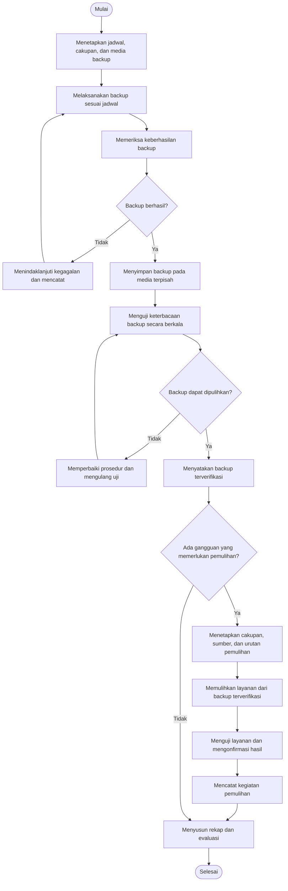

# SOP – BACKUP DAN PEMULIHAN

| Informasi | Keterangan |
|---|---|
| Kode SOP | SOP-PP-02-02 (usulan draf) |
| Nama SOP | Backup dan Pemulihan |
| Proses Induk | PP-02 Keamanan, Backup, dan Pemulihan |
| Pemilik SOP | Kantor Pusat Sistem Informasi (KPSI) |
| Penanggung Jawab | Kepala KPSI |
| Unit Pelaksana | Unit Infrastruktur Jaringan dan Server bersama unit terkait |
| Pihak Terkait | Unit-unit KPSI, unit pemilik layanan/data, dan penyedia layanan TI |
| Versi | 1.0 |
| Status | Draf untuk ditinjau |
| Dokumen Induk | Peta Proses Bisnis KPSI Level 0; PP-02 Keamanan, Backup, dan Pemulihan |

---

## 1. Tujuan

SOP ini menjadi acuan operasional bagi KPSI dalam melaksanakan pencadangan (backup) dan pemulihan layanan teknologi informasi agar:

1. Setiap layanan, sistem, dan infrastruktur yang menjadi objek PP-02 memiliki backup yang dilaksanakan sesuai jadwal dan tersimpan pada media yang terpisah dari sistem utama.
2. Keberhasilan setiap pelaksanaan backup diperiksa dan dicatat, serta kegagalan backup ditindaklanjuti dan tidak dibiarkan berulang tanpa penyelesaian.
3. Keterbacaan backup dan prosedur pemulihan diuji secara berkala, sehingga hanya backup yang telah teruji yang dinyatakan dapat diandalkan.
4. Layanan yang terganggu dapat dipulihkan dari backup yang telah terverifikasi secara tertib, tercatat, dan terkoordinasi dengan unit pemilik layanan.
5. Seluruh kegiatan backup, pengujian, dan pemulihan dapat ditelusuri dan dievaluasi sebagai bahan perbaikan.

## 2. Ruang Lingkup

SOP ini mencakup pelaksanaan backup dan pemulihan atas objek yang ditetapkan dalam PP-02, antara lain:

1. **Aplikasi dan database:** data operasional, struktur database, dan konfigurasi yang diperlukan untuk menjalankan kembali layanan.
2. **Server dan infrastruktur:** konfigurasi sistem, konfigurasi layanan, dan dokumen pemulihan.
3. **Website:** berkas website, database pendukung, dan konfigurasi terkait.
4. **Dokumen penting:** dokumentasi teknis dan dokumen pendukung pemulihan sesuai PP-01.

SOP ini **tidak mengatur** pengendalian keamanan teknis (pengamanan perimeter, server, aplikasi, dan akun), yang diatur melalui SOP Pengelolaan Keamanan Teknis, serta **tidak mengatur** penanganan insiden keamanan informasi di luar pemulihan layanan, yang mengikuti ketentuan PP-02 dan PB-06.

Untuk layanan SaaS dan pihak ketiga, SOP ini hanya mengatur bagian backup dan pemulihan yang menjadi tanggung jawab universitas. Backup, pemulihan, dan ketersediaan infrastruktur internal penyedia mengikuti tanggung jawab penyedia sebagaimana diatur dalam kontrak, dan KPSI memastikan aspek tersebut diperhatikan dalam koordinasi serta evaluasi layanan.

Tanggung jawab atas kebenaran data dan proses bisnis tetap berada pada unit pemilik data/proses. KPSI bertanggung jawab atas aspek teknis pencadangan dan pemulihan layanan sesuai kewenangannya.

## 3. Definisi

1. **Backup** adalah salinan data, konfigurasi, atau dokumen yang dibuat dan disimpan untuk keperluan pemulihan apabila sistem utama mengalami gangguan, kerusakan, atau kehilangan data.
2. **Media penyimpanan backup** adalah media atau lokasi penyimpanan yang digunakan untuk menyimpan backup dan terpisah dari sistem yang dicadangkan.
3. **Jadwal backup** adalah ketentuan waktu pelaksanaan backup yang ditetapkan berdasarkan klasifikasi layanan.
4. **Masa retensi** adalah jangka waktu backup disimpan sebelum dihapus melalui mekanisme yang aman dan tercatat.
5. **Target waktu pemulihan** adalah batas waktu yang ditetapkan untuk memulihkan layanan setelah gangguan, sesuai klasifikasi layanan.
6. **Target batas data yang dapat diterima kehilangannya** adalah batas data yang dapat diterima hilang antara backup terakhir dan saat terjadinya gangguan, sesuai klasifikasi layanan.
7. **Uji pemulihan** adalah kegiatan pengujian keterbacaan backup dan prosedur pemulihan pada skenario tertentu untuk memastikan backup dapat digunakan.
8. **Rencana pemulihan** adalah dokumen yang memuat objek yang dipulihkan, sumber backup, urutan pemulihan, penanggung jawab, dan cara pengujian layanan setelah pemulihan.
9. **Backup terverifikasi** adalah backup yang keterbacaannya telah diuji dan dinyatakan dapat digunakan untuk pemulihan.

## 4. Referensi

1. Peta Proses Bisnis KPSI Level 0.
2. PP-02 Keamanan, Backup, dan Pemulihan.
3. PP-01 Pengelolaan Dokumentasi dan Informasi Teknis TI.
4. PB-03 Pengelolaan Infrastruktur Jaringan dan Server.
5. PB-06 Penanganan Gangguan dan Insiden TI.
6. PM-03 Monitoring dan Pengendalian.
7. Kebijakan dan ketentuan universitas yang berlaku.

## 5. Pihak Terkait dan Tanggung Jawab

| Pihak | Tanggung Jawab |
|---|---|
| Kepala KPSI | Menetapkan klasifikasi layanan beserta target waktu pemulihan dan target batas data yang dapat diterima kehilangannya; mengendalikan pelaksanaan pemulihan layanan; menyetujui rekap pelaksanaan backup, pengujian, dan pemulihan. |
| Unit Infrastruktur Jaringan dan Server | Melaksanakan backup, pengujian keterbacaan backup dan pemulihan, serta pemulihan layanan pada infrastruktur, server, dan layanan yang menjadi bidang tugasnya; memantau keberhasilan backup dan ketersediaan layanan; menyiapkan data rekap pelaksanaan. |
| Unit-unit KPSI lainnya | Melaksanakan backup dan pengujian pada bidang tugasnya; memperbarui dokumentasi teknis terkait; melaporkan kegagalan backup, kegagalan pengujian, atau gangguan kepada Kepala KPSI. |
| Unit pemilik layanan/data | Menetapkan kebutuhan pemulihan layanan bersama KPSI; mengonfirmasi hasil pemulihan layanan; menyampaikan informasi mengenai dampak gangguan terhadap kegiatan unit. |
| Penyedia layanan TI | Melaksanakan backup dan pemulihan yang menjadi tanggung jawabnya sesuai kontrak atau perjanjian; menyediakan informasi layanan dan dukungan; memberitahukan gangguan atau perubahan layanan kepada KPSI. |

## 6. Prosedur

### 6.1 Penetapan Jadwal dan Cakupan Backup

1. Kepala KPSI bersama Unit Infrastruktur Jaringan dan Server menetapkan jadwal backup dan masa retensi untuk setiap klasifikasi layanan berdasarkan PP-02, serta mendokumentasikannya dalam jadwal backup.
2. Cakupan backup ditetapkan berdasarkan jenis objek, sekurang-kurangnya:
   - **Aplikasi dan database:** data operasional, struktur database, dan konfigurasi yang diperlukan untuk menjalankan kembali layanan;
   - **Server dan infrastruktur:** konfigurasi sistem, konfigurasi layanan, dan dokumen pemulihan;
   - **Website:** berkas website, database pendukung, dan konfigurasi terkait;
   - **Dokumen penting:** dokumentasi teknis dan dokumen pendukung pemulihan sesuai PP-01.
3. Media dan lokasi penyimpanan backup ditetapkan untuk setiap objek, dengan ketentuan backup disimpan pada media atau lokasi yang terpisah dari sistem utama, dan salinan untuk layanan kritis disimpan pada lokasi yang berbeda dari lokasi sistem utama.
4. Rencana pemulihan disusun untuk layanan kritis, sekurang-kurangnya memuat objek yang dipulihkan, sumber backup, urutan pemulihan, penanggung jawab, dan cara pengujian layanan setelah pemulihan.
5. Jadwal, cakupan, media penyimpanan, dan rencana pemulihan ditinjau kembali apabila terjadi penambahan, perubahan, atau penghentian layanan, perubahan klasifikasi, atau hasil evaluasi pelaksanaan sebelumnya.

### 6.2 Pelaksanaan Backup

1. Unit pelaksana melaksanakan backup sesuai jadwal yang telah ditetapkan. Pelaksanaan backup dilakukan secara terjadwal dan terpantau, serta tidak bergantung pada pelaksanaan manual yang tidak tercatat, kecuali untuk kebutuhan tertentu yang didokumentasikan.
2. Backup yang memuat data sensitif dilindungi dengan enkripsi atau mekanisme pengamanan yang setara, dan dilindungi dari perubahan serta penghapusan yang tidak berwenang.
3. Setelah pelaksanaan backup, unit pelaksana memeriksa keberhasilan backup dan mencatat hasilnya, sekurang-kurangnya memuat waktu pelaksanaan, pelaksana, objek yang dicadangkan, hasil, dan tindak lanjut apabila diperlukan.
4. Apabila backup gagal, unit pelaksana menindaklanjuti kegagalan tersebut pada kesempatan pertama dan mencatat penyebab serta tindakan perbaikannya. Kegagalan backup yang berulang dilaporkan kepada Kepala KPSI dan tidak dibiarkan tanpa penyelesaian.
5. Backup yang telah melewati masa retensi dihapus melalui mekanisme yang aman dan tercatat.
6. Perubahan cakupan backup akibat penambahan, perubahan, atau penghentian layanan dicatat dan disesuaikan tanpa menunggu jadwal evaluasi berkala.

### 6.3 Pengujian Keterbacaan Backup dan Pemulihan

1. Unit pelaksana menguji keterbacaan backup dan prosedur pemulihan secara berkala sesuai klasifikasi layanan.
2. Pengujian mencakup sekurang-kurangnya satu skenario pemulihan, misalnya pemulihan berkas yang hilang, pemulihan database, atau pemulihan layanan pada perangkat pengganti.
3. Hasil pengujian dicatat, meliputi tanggal pengujian, objek yang diuji, hasil, kendala, dan tindak lanjut yang diperlukan.
4. Apabila pengujian menunjukkan backup tidak dapat dipulihkan, Unit Infrastruktur Jaringan dan Server wajib menindaklanjuti temuan tersebut dan mengulang pengujian setelah perbaikan.
5. Backup yang belum pernah diuji tidak dinyatakan sebagai cadangan yang dapat diandalkan dalam perencanaan pemulihan.
6. Hasil pengujian dievaluasi sebagai bahan perbaikan prosedur backup dan pemulihan.

### 6.4 Pemulihan Layanan

1. Pemulihan layanan dilaksanakan apabila terjadi gangguan, kerusakan data, atau kehilangan layanan yang memerlukan pengembalian dari backup.
2. Kepala KPSI atau unit yang diberi kewenangan menetapkan cakupan pemulihan, sumber backup yang digunakan, dan urutan pemulihan berdasarkan klasifikasi layanan dan rencana pemulihan yang tersedia.
3. Pemulihan menggunakan backup terakhir yang telah terverifikasi keterbacaannya. Apabila backup terakhir tidak dapat digunakan, digunakan backup sebelumnya yang terverifikasi, dan selisih data yang hilang dicatat serta disampaikan kepada unit pemilik layanan.
4. Selama pemulihan, unit pelaksana berkoordinasi dengan unit pemilik layanan mengenai dampak pemulihan terhadap kegiatan unit.
5. Setelah pemulihan, unit terkait melakukan pengujian layanan untuk memastikan layanan berfungsi sebelum dinyatakan pulih, dan unit pemilik layanan mengonfirmasi hasil pemulihan tersebut.
6. Unit pemilik layanan dan pengguna yang terdampak diinformasikan mengenai status pemulihan sesuai kebutuhan.
7. Seluruh kegiatan pemulihan dicatat, meliputi penyebab gangguan, backup yang digunakan, waktu pemulihan, hasil pengujian, dan tindak lanjut.

### 6.5 Pencatatan dan Pelaporan

1. Setiap pelaksanaan backup, pengujian pemulihan, dan pemulihan layanan dicatat dengan sekurang-kurangnya memuat waktu, pelaksana, objek, hasil, dan tindak lanjut.
2. Kegagalan backup, kegagalan pengujian, dan gangguan layanan dilaporkan kepada Kepala KPSI pada kesempatan pertama.
3. Unit Infrastruktur Jaringan dan Server menyusun rekap pelaksanaan backup, pengujian pemulihan, dan pemulihan layanan secara berkala sebagai bahan evaluasi dan pelaporan sesuai mekanisme pelaporan KPSI.
4. Catatan pelaksanaan backup dan pemulihan disimpan sebagai bahan evaluasi dan tidak disebarluaskan di luar pihak yang berwenang.

## 7. Alur Prosedur

## 8. Formulir dan Catatan

Dokumen atau alat bantu yang dapat digunakan untuk mendukung SOP ini:

1. Jadwal backup dan masa retensi per layanan.
2. Daftar media dan lokasi penyimpanan backup.
3. Rencana pemulihan layanan kritis.
4. Template laporan pengujian keterbacaan backup dan pemulihan.
5. Template laporan pemulihan layanan.
6. Rekap pelaksanaan backup, pengujian pemulihan, dan pemulihan layanan.
7. Daftar layanan, sistem, dan infrastruktur beserta klasifikasi dan target pemulihannya.

## 9. Indikator Kinerja

| No. | Indikator | Tujuan |
|---|---|---|
| 1 | Persentase pelaksanaan backup terjadwal yang berhasil | Mengukur keandalan pelaksanaan backup |
| 2 | Jumlah kegagalan backup yang belum ditindaklanjuti | Memantau penyelesaian kegagalan backup |
| 3 | Persentase layanan kritis yang memiliki backup yang telah diuji keterbacaannya | Mengukur kesiapan pemulihan layanan kritis |
| 4 | Persentase layanan yang memiliki rencana pemulihan yang terdokumentasi | Mengukur kesiapan pemulihan |
| 5 | Persentase pengujian pemulihan berkala yang dilaksanakan sesuai jadwal | Memantau kedisiplinan pengujian |
| 6 | Persentase temuan pengujian atau pemulihan yang telah ditindaklanjuti dengan perbaikan | Mengukur tindak lanjut perbaikan |

Target dan periode pengukuran indikator ditetapkan lebih lanjut dalam rencana kerja KPSI, dengan mempertimbangkan kapasitas personel dan ketersediaan data.

## 10. Catatan Validasi

Ketentuan dalam versi ini disusun berdasarkan PP-02 dan Peta Proses Bisnis KPSI Level 0. Sebelum dokumen ditetapkan, hal-hal operasional berikut dapat dikonfirmasi:

1. Jadwal backup dan masa retensi untuk setiap klasifikasi layanan.
2. Media dan lokasi penyimpanan backup, termasuk lokasi penyimpanan salinan untuk layanan kritis.
3. Periode pengujian keterbacaan backup dan pemulihan untuk setiap klasifikasi layanan.
4. Penunjukan koordinator backup dan pembagian tanggung jawab pelaksanaan pada masing-masing unit KPSI.
5. Format dan template catatan pelaksanaan backup, pengujian, dan pemulihan.
6. Penegasan batas dengan SOP Backup dan Pemulihan Infrastruktur (PB-03) agar tidak terjadi duplikasi prosedur.
7. Penetapan kode SOP final sesuai penomoran SOP KPSI yang disepakati.
8. Mekanisme penyimpanan rahasia untuk kredensial dan informasi keamanan yang disetujui universitas.

Hal-hal teknis tersebut dapat ditetapkan melalui keputusan internal KPSI tanpa mengubah prinsip pengelolaan dalam dokumen ini.

## 11. Penutup

SOP ini menjadi acuan operasional pelaksanaan backup dan pemulihan layanan teknologi informasi di lingkungan universitas, sebagai turunan dari PP-02 Keamanan, Backup, dan Pemulihan.

Backup yang dilaksanakan sesuai jadwal, disimpan terpisah, dan teruji keterbacaannya, serta pemulihan yang dilaksanakan secara tertib dan tercatat, menjadi dasar bagi keberlangsungan layanan teknologi informasi universitas. Rincian jadwal, target pemulihan, media penyimpanan, dan penanggung jawab ditetapkan lebih lanjut sesuai ketentuan pada Bab 10.
