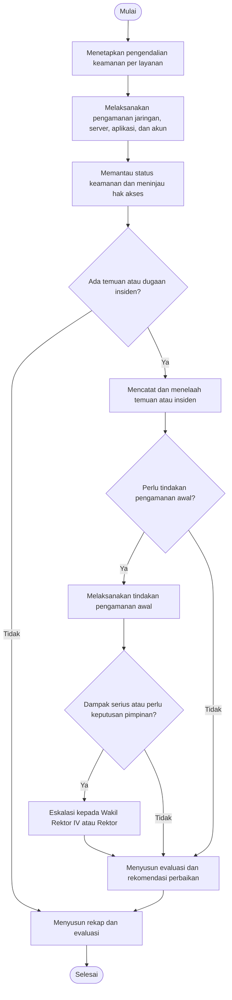

# SOP – PENGELOLAAN KEAMANAN TEKNIS

| Informasi | Keterangan |
|---|---|
| Kode SOP | SOP-PP-02-01 (usulan draf) |
| Nama SOP | Pengelolaan Keamanan Teknis |
| Proses Induk | PP-02 Keamanan, Backup, dan Pemulihan |
| Pemilik SOP | Kantor Pusat Sistem Informasi (KPSI) |
| Penanggung Jawab | Kepala KPSI |
| Unit Pelaksana | Unit Infrastruktur Jaringan dan Server bersama unit terkait |
| Pihak Terkait | Unit-unit KPSI, unit pemilik layanan/data, dan penyedia layanan TI |
| Versi | 1.0 |
| Status | Draf untuk ditinjau |
| Dokumen Induk | Peta Proses Bisnis KPSI Level 0; PP-02 Keamanan, Backup, dan Pemulihan |

---

## 1. Tujuan

SOP ini menjadi acuan operasional bagi KPSI dalam melaksanakan pengamanan teknis layanan teknologi informasi agar:

1. Layanan teknologi informasi yang dikelola KPSI terlindungi dari akses tidak sah, malware, penyalahgunaan, dan perubahan tanpa izin melalui pengamanan berlapis pada perimeter, jaringan, server, aplikasi, dan data.
2. Setiap akun dan personel hanya memperoleh hak akses yang diperlukan untuk melaksanakan tugasnya, dan hak akses tersebut ditinjau secara berkala.
3. Sistem, aplikasi, dan perangkat yang dikelola KPSI diperbarui mengikuti pembaruan keamanan yang tersedia dan hasil penilaian risiko.
4. Kerentanan dan aktivitas mencurigakan dicatat dan ditindaklanjuti sesuai tingkat risikonya.
5. Informasi mengenai konfigurasi keamanan, kerentanan, dan kredensial diperlakukan sebagai informasi terbatas dan hanya dapat diakses oleh personel yang berwenang.
6. Dugaan insiden keamanan informasi ditangani secara tercatat, terkoordinasi, dan dievaluasi sebagai bahan perbaikan.

## 2. Ruang Lingkup

SOP ini mencakup pengelolaan keamanan teknis atas layanan teknologi informasi universitas, antara lain:

1. **Jaringan dan perimeter:** pengendalian pada sisi perimeter, perangkat jaringan, dan perangkat keamanan yang dikelola KPSI.
2. **Server dan sistem:** sistem operasi, perangkat lunak, firmware, layanan, dan konfigurasi pada server yang dikelola KPSI.
3. **Aplikasi dan website:** aplikasi yang dikembangkan sendiri, aplikasi pihak ketiga, aplikasi SaaS, serta website resmi universitas dan unit kerja beserta platform pendukungnya.
4. **Akun dan hak akses:** akun administratif, akun layanan, dan hak akses atas sistem, aplikasi, infrastruktur, dan layanan TI yang dikelola KPSI.
5. **Informasi keamanan dan data sensitif:** konfigurasi keamanan, kerentanan, kredensial, dan hasil penanganan insiden keamanan informasi.

SOP ini **tidak mengatur** pencadangan (backup) dan pemulihan layanan, yang diatur melalui SOP Backup dan Pemulihan, serta **tidak mengatur** penanganan gangguan layanan secara umum, yang mengikuti PB-06 Penanganan Gangguan dan Insiden TI.

SOP ini **tidak menggantikan kebijakan keamanan informasi universitas**. Ketentuan mengenai tata kelola keamanan informasi, klasifikasi data, dan tanggung jawab hukum ditetapkan melalui kebijakan universitas yang berlaku, sedangkan SOP ini mengatur pelaksanaan teknis pengamanan oleh KPSI.

Untuk layanan SaaS dan pihak ketiga, SOP ini hanya mengatur bagian pengamanan yang menjadi tanggung jawab universitas. Pengamanan infrastruktur internal penyedia mengikuti tanggung jawab penyedia sebagaimana diatur dalam kontrak, dan KPSI memastikan aspek tersebut diperhatikan dalam koordinasi serta evaluasi layanan.

## 3. Definisi

1. **Pengendalian keamanan** adalah tindakan teknis yang diterapkan untuk melindungi layanan teknologi informasi dari akses tidak sah, penyalahgunaan, dan perubahan tanpa izin.
2. **Perimeter** adalah batas antara jaringan universitas dan jaringan di luar universitas, tempat diterapkan pengendalian terhadap lalu lintas yang masuk dan keluar.
3. **Hak akses minimum** adalah prinsip pemberian hak akses sekurang-kurangnya sesuai kebutuhan tugas pemegang akun.
4. **Akun administratif** adalah akun yang memiliki kewenangan pengelolaan atas sistem, aplikasi, infrastruktur, atau layanan TI.
5. **Akun layanan** adalah akun yang digunakan oleh sistem atau aplikasi untuk menjalankan layanan, bukan oleh personel secara langsung.
6. **Kerentanan** adalah kelemahan pada sistem, aplikasi, atau konfigurasi yang dapat dimanfaatkan untuk mengganggu atau mengakses layanan tanpa izin.
7. **Insiden keamanan informasi** adalah dugaan atau kejadian akses tidak sah, penyalahgunaan akun, malware, kebocoran data, perubahan data tanpa izin, atau aktivitas mencurigakan lainnya.
8. **Informasi terbatas** adalah informasi mengenai konfigurasi keamanan, kerentanan, prosedur pemulihan, dan hasil penanganan insiden yang hanya dapat diakses oleh personel yang diberi kewenangan.
9. **Kredensial** adalah kata sandi, token, private key, secret, dan recovery code yang digunakan untuk mengakses sistem, aplikasi, atau layanan.

## 4. Referensi

1. Peta Proses Bisnis KPSI Level 0.
2. PP-02 Keamanan, Backup, dan Pemulihan.
3. PP-01 Pengelolaan Dokumentasi dan Informasi Teknis TI.
4. PB-03 Pengelolaan Infrastruktur Jaringan dan Server.
5. PB-04 Pengelolaan Website Universitas dan Unit Kerja.
6. PB-06 Penanganan Gangguan dan Insiden TI.
7. PM-03 Monitoring dan Pengendalian.
8. Kebijakan dan ketentuan universitas yang berlaku.

## 5. Pihak Terkait dan Tanggung Jawab

| Pihak | Tanggung Jawab |
|---|---|
| Kepala KPSI | Menetapkan kewenangan dan pengendalian keamanan; menjadi koordinator penanganan insiden keamanan informasi di tingkat universitas; melakukan eskalasi kepada Wakil Rektor IV atau Rektor apabila diperlukan; menyetujui rekap pelaksanaan pengamanan dan penanganan insiden. |
| Unit Infrastruktur Jaringan dan Server | Melaksanakan pengamanan infrastruktur, server, dan jaringan; mengelola akun dan hak akses pada bidang tugasnya; memantau status keamanan dan ketersediaan layanan; melaksanakan tindakan teknis awal penanganan insiden; menyiapkan data rekap pelaksanaan. |
| Unit-unit KPSI lainnya | Melaksanakan pengamanan pada bidang tugasnya; memperbarui dokumentasi teknis terkait; melaporkan temuan kerentanan, anomali, atau dugaan insiden keamanan kepada Kepala KPSI. |
| Unit pemilik layanan/data | Bertanggung jawab atas konten dan kebenaran data yang dikelolanya; mengusulkan kebutuhan akses unit; berkoordinasi dalam penanganan insiden yang melibatkan data atau proses milik unit. |
| Penyedia layanan TI | Melaksanakan pengamanan yang menjadi tanggung jawabnya sesuai kontrak atau perjanjian; menyediakan informasi layanan dan dukungan; memberitahukan gangguan atau perubahan layanan kepada KPSI. |

## 6. Prosedur

### 6.1 Pengamanan Jaringan dan Perimeter

1. Unit pelaksana melindungi akses ke jaringan dan layanan universitas melalui pengendalian pada sisi perimeter, antara lain penyaringan trafik berbahaya, pembatasan laju permintaan, dan pembatasan akses administratif.
2. Perangkat jaringan dan perangkat keamanan dikonfigurasi sesuai kebutuhan layanan dan ditinjau secara berkala.
3. Lalu lintas yang mencurigakan dicatat dan ditindaklanjuti sesuai tingkat risikonya.
4. Perubahan konfigurasi perimeter yang berdampak pada layanan dikoordinasikan dengan unit terkait dan didokumentasikan.
5. Pembagian tanggung jawab pengelolaan jaringan mengikuti PB-03.

### 6.2 Pengamanan Server dan Sistem

1. Unit pelaksana memperbarui sistem operasi, perangkat lunak, dan firmware pada server yang dikelola KPSI mengikuti pembaruan keamanan yang tersedia dan hasil penilaian risiko.
2. Layanan dan port yang tidak diperlukan pada server dinonaktifkan.
3. Akun administratif server dibatasi hanya bagi personel yang berwenang dan ditinjau secara berkala.
4. Aktivitas administratif yang penting dicatat agar dapat ditelusuri apabila terjadi gangguan atau insiden.
5. Lingkungan produksi dan lingkungan pengujian dipisahkan apabila pemisahan tersebut dimungkinkan dan diperlukan untuk mengurangi risiko terhadap layanan yang sedang berjalan.
6. Perubahan pengendalian keamanan didokumentasikan dan diinformasikan kepada personel terkait agar tidak menimbulkan gangguan layanan yang tidak direncanakan.

### 6.3 Pengamanan Aplikasi dan Website

1. Unit pelaksana memperbarui aplikasi dan platform website yang dikelola KPSI mengikuti pembaruan keamanan yang tersedia dan hasil penilaian risiko.
2. Masukan pengguna pada aplikasi divalidasi agar tidak dapat digunakan untuk mengubah perilaku aplikasi atau mengakses data tanpa izin.
3. Mekanisme sesi dan autentikasi pada aplikasi dikelola sesuai ketentuan keamanan yang berlaku.
4. Sertifikat keamanan website dipantau masa berlakunya dan diperbarui sebelum kedaluwarsa.
5. Perubahan konten atau berkas website tanpa izin diperiksa melalui pemantauan berkala, dan temuan ditindaklanjuti sebagai gangguan atau insiden sesuai PB-06.
6. Pembagian tanggung jawab pengelolaan website mengikuti PB-04.

### 6.4 Pengelolaan Akun dan Hak Akses

1. Setiap akun diberikan hak akses sekurang-kurangnya sesuai kebutuhan tugas pemegang akun.
2. Akun administratif dan akun layanan didata beserta pemilik, tujuan penggunaan, dan tingkat hak aksesnya.
3. Akun bersama untuk pekerjaan administratif dihindari. Apabila tidak dapat dihindari, penggunaannya dicatat dan dibatasi.
4. Kredensial tidak dicatat dalam dokumen biasa. Kredensial dikelola melalui mekanisme penyimpanan rahasia yang aman sesuai 6.5.
5. Hak akses ditinjau secara berkala. Akun personel yang berpindah tugas, tidak lagi memiliki kewenangan, atau tidak aktif harus disesuaikan atau dinonaktifkan.
6. Akun yang terindikasi disalahgunakan dinonaktifkan sementara dan ditindaklanjuti sebagai insiden keamanan sesuai 6.6.

### 6.5 Penanganan Informasi Keamanan dan Data Sensitif

1. Informasi mengenai konfigurasi keamanan, kerentanan, prosedur pemulihan, dan hasil penanganan insiden diklasifikasikan sebagai informasi terbatas.
2. Informasi terbatas hanya dapat diakses oleh personel yang diberi kewenangan.
3. Kredensial, token, private key, secret, dan recovery code tidak boleh disimpan dalam dokumen biasa atau repositori yang tidak dilindungi.
4. Penyampaian informasi keamanan kepada pihak ketiga dibatasi pada informasi yang diperlukan untuk pekerjaan dan berdasarkan persetujuan yang berwenang.
5. Kehilangan, perubahan tanpa izin, atau kebocoran informasi keamanan ditangani sebagai insiden keamanan informasi sesuai 6.6.

### 6.6 Penanganan Awal Insiden Keamanan Informasi

1. Setiap dugaan akses tidak sah, penyalahgunaan akun, malware, kebocoran data, perubahan data tanpa izin, atau aktivitas mencurigakan yang dilaporkan kepada KPSI harus segera dicatat dan ditelaah.
2. KPSI melakukan tindakan pengamanan awal sesuai kewenangan, seperti membatasi akses, menonaktifkan sementara akun yang terindikasi disalahgunakan, mengisolasi komponen terdampak, atau meminta bantuan penyedia.
3. Tindakan pengamanan harus mempertimbangkan kebutuhan menjaga bukti dan catatan kejadian sejauh memungkinkan.
4. Kepala KPSI menjadi koordinator penanganan insiden keamanan informasi di tingkat universitas dan mengoordinasikan tindakan teknis awal serta komunikasi dengan pihak terkait.
5. Kepala KPSI segera melakukan eskalasi kepada Wakil Rektor IV atau Rektor apabila insiden berpotensi berdampak serius, memerlukan keputusan pimpinan, atau membutuhkan koordinasi lintas unit.
6. Jika insiden melibatkan data atau proses milik unit tertentu, KPSI berkoordinasi dengan unit pemilik data/proses dan pihak universitas yang berwenang.
7. Komunikasi kepada pihak internal maupun eksternal mengenai insiden dilakukan melalui pihak yang berwenang. KPSI tidak menyampaikan informasi sensitif secara terbuka tanpa persetujuan.
8. Penanganan lebih lanjut mengikuti kebijakan keamanan informasi dan ketentuan universitas yang berlaku.
9. Setelah insiden ditangani, KPSI menyusun evaluasi yang memuat penyebab, dampak, tindakan yang dilakukan, dan rekomendasi perbaikan untuk mencegah kejadian berulang.

### 6.7 Pencatatan dan Pelaporan

1. Setiap pelaksanaan pengamanan, temuan kerentanan, peninjauan hak akses, dan penanganan insiden dicatat dengan sekurang-kurangnya memuat waktu, pelaksana, objek, hasil, dan tindak lanjut.
2. Temuan kerentanan atau anomali dicatat dan ditindaklanjuti sesuai tingkat risikonya.
3. Kegagalan pengendalian keamanan dan insiden keamanan dilaporkan kepada Kepala KPSI pada kesempatan pertama.
4. Unit Infrastruktur Jaringan dan Server menyusun rekap pelaksanaan pengamanan dan penanganan insiden secara berkala sebagai bahan evaluasi dan pelaporan sesuai mekanisme pelaporan KPSI.
5. Catatan penanganan insiden disimpan sebagai bahan evaluasi dan tidak disebarluaskan di luar pihak yang berwenang.

## 7. Alur Prosedur

## 8. Formulir dan Catatan

Dokumen atau alat bantu yang dapat digunakan untuk mendukung SOP ini:

1. Daftar pengendalian keamanan per layanan atau sistem.
2. Daftar akun dan hak akses beserta hasil peninjauannya.
3. Catatan temuan kerentanan dan tindak lanjutnya.
4. Template laporan insiden keamanan informasi.
5. Daftar kontak eskalasi internal, pimpinan, unit pemilik layanan, dan penyedia layanan.
6. Rekap pelaksanaan pengamanan dan penanganan insiden keamanan.

## 9. Indikator Kinerja

| No. | Indikator | Tujuan |
|---|---|---|
| 1 | Persentase akun yang telah ditinjau hak aksesnya dalam periode berjalan | Memantau pengendalian hak akses |
| 2 | Jumlah insiden keamanan informasi yang ditangani dan didokumentasikan | Memantau penanganan insiden |
| 3 | Persentase temuan pengujian atau insiden yang telah ditindaklanjuti dengan perbaikan | Mengukur tindak lanjut perbaikan |
| 4 | Persentase layanan yang memiliki pengendalian keamanan yang terdokumentasi | Mengukur kelengkapan pengamanan |
| 5 | Jumlah akun tidak aktif yang belum disesuaikan atau dinonaktifkan | Memantau kebersihan hak akses |

Target dan periode pengukuran indikator ditetapkan lebih lanjut dalam rencana kerja KPSI, dengan mempertimbangkan kapasitas personel dan ketersediaan data.

## 10. Catatan Validasi

Ketentuan dalam versi ini disusun berdasarkan PP-02 dan Peta Proses Bisnis KPSI Level 0. Sebelum dokumen ditetapkan, hal-hal operasional berikut dapat dikonfirmasi:

1. Daftar pengendalian keamanan untuk setiap layanan atau sistem.
2. Jadwal peninjauan hak akses dan pembaruan keamanan.
3. Mekanisme penyimpanan rahasia untuk kredensial dan informasi keamanan yang disetujui universitas.
4. Penunjukan koordinator keamanan serta pembagian tanggung jawab pelaksanaan pada masing-masing unit KPSI.
5. Daftar kontak eskalasi internal, pimpinan, unit pemilik layanan, dan penyedia layanan.
6. Penegasan batas dengan SOP Backup dan Pemulihan, SOP Pengelolaan Jaringan dan Server (PB-03), dan SOP Pengelolaan Teknis Website (PB-04) agar tidak terjadi duplikasi prosedur.
7. Penetapan kode SOP final sesuai penomoran SOP KPSI yang disepakati.

Hal-hal teknis tersebut dapat ditetapkan melalui keputusan internal KPSI tanpa mengubah prinsip pengelolaan dalam dokumen ini.

## 11. Penutup

SOP ini menjadi acuan operasional pelaksanaan pengamanan teknis layanan teknologi informasi di lingkungan universitas, sebagai turunan dari PP-02 Keamanan, Backup, dan Pemulihan.

Pengamanan yang berlapis, hak akses yang diberikan secukupnya dan ditinjau secara berkala, serta penanganan insiden yang tercatat dan terkoordinasi menjadi dasar bagi keamanan layanan teknologi informasi universitas. Rincian pengendalian, jadwal peninjauan, dan penanggung jawab ditetapkan lebih lanjut sesuai ketentuan pada Bab 10.

---

## Lampiran — Unduh Versi PDF

Dokumen ini tersedia dalam versi PDF yang dapat diunduh melalui tautan berikut:

- [Unduh SOP Pengelolaan Keamanan Teknis v1.0 (PDF)](https://drive.google.com/file/d/1LyTg9qKDHIhc9RkM00MFmYBUR7UGWWu-/view?usp=drivesdk)

Versi PDF disimpan pada folder Drive SOP_PUSINFO_2026. Apabila isi SOP diperbarui, versi PDF perlu dibuat ulang agar tetap sesuai dengan dokumen ini.
